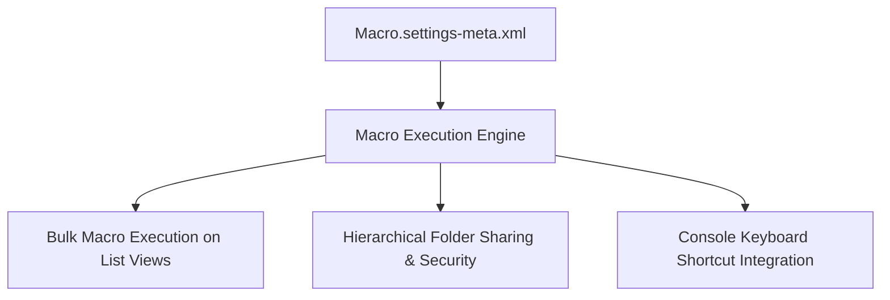

## Architectural Overview

`MacroSettings` configures organization-wide behaviors for Salesforce Macros. Macros automate repetitive agent workflows—such as inserting standard email templates, updating case statuses, logging call outcomes, and creating follow-up tasks—with a single click or keyboard shortcut in the Service and Sales Console.

From an architect's perspective, `MacroSettings` establishes enterprise productivity and governance policies. Activating bulk macros allows support reps to resolve dozens of related cases simultaneously, while enabling folder sharing prevents macro sprawl by allowing administrators to organize macros into role-restricted folders with fine-grained view and edit permissions.



## Directory and File Conventions

`MacroSettings` is a singleton Settings metadata asset stored in the `settings` directory:

| Property | Value |
| :--- | :--- |
| **Directory Name** | `settings` |
| **File Name** | `Macro.settings-meta.xml` |
| **Root XML Element** | `<MacroSettings>` |
| **API Version** | `68.0` |

## Key Metadata Fields

The `MacroSettings` schema provides governance controls:

| Field Name | Type | Description |
| :--- | :--- | :--- |
| `enableBulkMacros` | `boolean` | Allows agents to execute macros across multiple selected list view records at once. |
| `enableMacroFolderSharing` | `boolean` | Activates enhanced folder-based sharing and access control for macros. |
| `enableMacroSharing` | `boolean` | Permits individual users to share personal macros with other team members. |
| `enableMacroShortcuts` | `boolean` | Enables customizable hotkeys and keyboard shortcuts to launch macros in console apps. |

> [!TIP]
> Always enable `<enableMacroFolderSharing>true</enableMacroFolderSharing>` in enterprise environments. Folder sharing allows establishing departmental folders (such as Billing Support vs. Technical Support) so users only see macros relevant to their daily workflows.

## Declarative XML and Package Manifest Examples

Below is an enterprise configuration of `Macro.settings-meta.xml`:

```xml title="force-app/main/default/settings/Macro.settings-meta.xml"
<?xml version="1.0" encoding="UTF-8"?>
<MacroSettings xmlns="http://soap.sforce.com/2006/04/metadata">
    <enableBulkMacros>true</enableBulkMacros>
    <enableMacroFolderSharing>true</enableMacroFolderSharing>
    <enableMacroSharing>true</enableMacroSharing>
    <enableMacroShortcuts>true</enableMacroShortcuts>
</MacroSettings>
```

### Manifest Definition (`package.xml`)

Include the setting in `package.xml`:

```xml title="manifest/package.xml"
<?xml version="1.0" encoding="UTF-8"?>
<Package xmlns="http://soap.sforce.com/2006/04/metadata">
    <types>
        <members>Macro</members>
        <name>Settings</name>
    </types>
    <version>68.0</version>
</Package>
```

## CLI Retrieval and Deployment Commands

Use the Salesforce CLI to deploy macro settings:

```bash
# Retrieve Macro settings
sf project retrieve start --metadata Settings:Macro

# Deploy macro settings across environments
sf project deploy start --source-dir force-app/main/default/settings/Macro.settings-meta.xml
```

## Senior Architect Deployment Best Practices and Gotchas

- **Bulk Macro Irreversibility:** Because bulk macros execute database modifications across up to 50 records in parallel, ensure adequate validation rules and apex triggers are in place to prevent bulk data corruption.
- **Folder Migration:** When migrating from flat macro sharing to enhanced folder sharing (`enableMacroFolderSharing = true`), existing unfiled public macros must be reorganized into folders, which can alter URL references in custom documentation.
- **Console Utility Bar Placement:** Enabling macro settings is only half the implementation. For users to access macros efficiently, add the **Macros** standard component to the Lightning Console Utility Bar in your target `CustomApplication` metadata.

> [!WARNING]
> Disabling `<enableBulkMacros>` will hide the "Run Macro" button from all standard list views, preventing agents from batch processing mass customer notifications.
