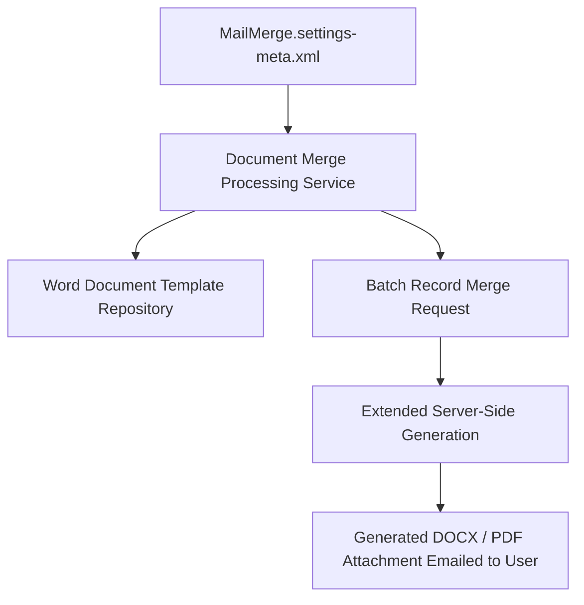

## Architectural Overview

`MailMergeSettings` governs configuration parameters for Salesforce Classic Mail Merge and Extended Mail Merge. In enterprise scenarios requiring generation of printed correspondence, customized physical letters, or formal billing statements, Mail Merge merges CRM record fields (such as Account names, Contact addresses, and Opportunity amounts) into Microsoft Word document templates.

From an architectural standpoint, standard mail merge requires local desktop execution with Microsoft Word plugins, whereas **Extended Mail Merge** executes document generation asynchronously on Salesforce servers and automatically attaches the resulting merged document to the requesting user's email or record.



## Directory and File Conventions

`MailMergeSettings` is stored in the `settings` directory:

| Property | Value |
| :--- | :--- |
| **Directory Name** | `settings` |
| **File Name** | `MailMerge.settings-meta.xml` |
| **Root XML Element** | `<MailMergeSettings>` |
| **API Version** | `68.0` |

## Key Metadata Fields

The `MailMergeSettings` schema configures merge execution limits:

| Field Name | Type | Description |
| :--- | :--- | :--- |
| `enableMailMerge` | `boolean` | Master toggle activating mail merge functionality. |
| `enableExtendedMailMerge` | `boolean` | Enables server-side asynchronous extended mail merge services. |
| `maxMailMergeRecipients` | `int` | Maximum allowed number of merged recipient records per batch operation. |

> [!NOTE]
> Extended Mail Merge requires enabling server-side document services. When enabled, merged files are delivered as compressed zip archives containing individual document files.

## Declarative XML and Package Manifest Examples

Below is a standard `MailMerge.settings-meta.xml` configuration:

```xml title="force-app/main/default/settings/MailMerge.settings-meta.xml"
<?xml version="1.0" encoding="UTF-8"?>
<MailMergeSettings xmlns="http://soap.sforce.com/2006/04/metadata">
    <enableMailMerge>true</enableMailMerge>
    <enableExtendedMailMerge>true</enableExtendedMailMerge>
    <maxMailMergeRecipients>1000</maxMailMergeRecipients>
</MailMergeSettings>
```

### Manifest Definition (`package.xml`)

Include the setting in `package.xml`:

```xml title="manifest/package.xml"
<?xml version="1.0" encoding="UTF-8"?>
<Package xmlns="http://soap.sforce.com/2006/04/metadata">
    <types>
        <members>MailMerge</members>
        <name>Settings</name>
    </types>
    <version>68.0</version>
</Package>
```

## CLI Retrieval and Deployment Commands

Use the Salesforce CLI to deploy mail merge configurations:

```bash
# Retrieve MailMerge settings
sf project retrieve start --metadata Settings:MailMerge

# Deploy settings to production
sf project deploy start --source-dir force-app/main/default/settings/MailMerge.settings-meta.xml
```

## Senior Architect Deployment Best Practices and Gotchas

- **Legacy Dependency Management:** While `MailMergeSettings` remains supported for backward compatibility, modern enterprise architectures should evaluate Salesforce Omnistudio Document Generation or AppExchange document engines for interactive, browser-native document authoring.
- **Batch Recipient Limits:** Keep `maxMailMergeRecipients` capped at or below 1,000 records. Submitting excessively large batch merge jobs can lead to transaction timeouts or email delivery rejections.
- **Attachment Storage Consumption:** Extended mail merge attaches generated documents to user records and sends email notifications. In high-volume operations, ensure sufficient Salesforce file storage is available.

> [!WARNING]
> Disabling `<enableMailMerge>` completely removes the Mail Merge button from page layouts and disables classic Word template generation across all objects.
