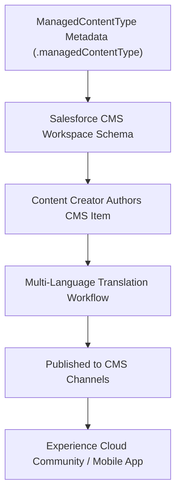

## Architectural Overview

`ManagedContentType` defines the data schema for Salesforce CMS (Content Management System) items. In digital experience architectures, organizations publish structured content—such as corporate news bulletins, product announcements, technical case studies, and event spotlights—across Experience Cloud portals, Commerce Cloud storefronts, and external websites.

Architecturally, `ManagedContentType` serves the same role for CMS content as `CustomObject` serves for relational records. It defines the constituent nodes (such as title, summary, rich-text body, hero image, and video links), field validations, and localization readiness. Experience Builder components then bind directly to these content nodes to render dynamic, responsive layouts.



## Directory and File Conventions

Managed Content Types are stored in the `managedContentTypes` directory:

| Property | Value |
| :--- | :--- |
| **Directory Name** | `managedContentTypes` |
| **File Extension** | `.managedContentType` |
| **Root XML Element** | `<ManagedContentType>` |
| **API Version** | `68.0` |

## Key Metadata Fields

The `ManagedContentType` metadata defines node structures and validations:

| Field Name | Type | Description |
| :--- | :--- | :--- |
| `developerName` | `string` | Unique API name for the CMS content type. |
| `masterLabel` | `string` | User-friendly label displayed in Salesforce CMS workspace authoring. |
| `description` | `string` | Administrative documentation describing the content structure. |
| `managedContentNodeTypes` | `ManagedContentNodeType[]` | Collection of structural nodes (fields) comprising the content item. |
| `nodeName` | `string` | Developer API name of the specific node. |
| `nodeLabel` | `string` | Label displayed on the authoring form for the node. |
| `nodeType` | `string` | Data type of the node: `TEXT`, `RTL` (Rich Text), `MEDIA`, or `URL`. |
| `isRequired` | `boolean` | Enforces mandatory completion before the item can be published. |
| `placeholderText` | `string` | Instructional guidance displayed in empty input fields. |

> [!TIP]
> Use the `RTL` (Rich Text) node type for long-form editorial bodies, and `MEDIA` nodes for responsive hero images and PDF downloads.

## Declarative XML and Package Manifest Examples

Below is a production `News_Article.managedContentType` definition:

```xml title="force-app/main/default/managedContentTypes/News_Article.managedContentType"
<?xml version="1.0" encoding="UTF-8"?>
<ManagedContentType xmlns="http://soap.sforce.com/2006/04/metadata">
    <developerName>News_Article</developerName>
    <masterLabel>Corporate News Article</masterLabel>
    <description>Standard article schema for corporate news and executive updates</description>
    <managedContentNodeTypes>
        <isMetadata>false</isMetadata>
        <isRequired>true</isRequired>
        <nodeLabel>Article Title</nodeLabel>
        <nodeName>title</nodeName>
        <nodeType>TEXT</nodeType>
        <placeholderText>Enter headline...</placeholderText>
    </managedContentNodeTypes>
    <managedContentNodeTypes>
        <isMetadata>false</isMetadata>
        <isRequired>true</isRequired>
        <nodeLabel>Summary</nodeLabel>
        <nodeName>summary</nodeName>
        <nodeType>TEXT</nodeType>
        <placeholderText>Brief article summary...</placeholderText>
    </managedContentNodeTypes>
    <managedContentNodeTypes>
        <isMetadata>false</isMetadata>
        <isRequired>true</isRequired>
        <nodeLabel>Article Body</nodeLabel>
        <nodeName>body</nodeName>
        <nodeType>RTL</nodeType>
    </managedContentNodeTypes>
    <managedContentNodeTypes>
        <isMetadata>false</isMetadata>
        <isRequired>false</isRequired>
        <nodeLabel>Banner Image</nodeLabel>
        <nodeName>bannerImage</nodeName>
        <nodeType>MEDIA</nodeType>
    </managedContentNodeTypes>
</ManagedContentType>
```

### Manifest Definition (`package.xml`)

Include `ManagedContentType` in `package.xml`:

```xml title="manifest/package.xml"
<?xml version="1.0" encoding="UTF-8"?>
<Package xmlns="http://soap.sforce.com/2006/04/metadata">
    <types>
        <members>News_Article</members>
        <name>ManagedContentType</name>
    </types>
    <version>68.0</version>
</Package>
```

## CLI Retrieval and Deployment Commands

Use the Salesforce CLI to deploy CMS content types:

```bash
# Retrieve all ManagedContentType definitions
sf project retrieve start --metadata ManagedContentType

# Deploy a specific content type to target orgs
sf project deploy start --source-dir force-app/main/default/managedContentTypes/News_Article.managedContentType
```

## Senior Architect Deployment Best Practices and Gotchas

- **Node Immutability:** Once a `ManagedContentType` is deployed and content authors have published records against it, modifying node types or deleting existing nodes is restricted to protect content integrity.
- **Experience Cloud Binding:** Experience Cloud FlexiPages that display CMS collections bind to specific node names (such as `title` and `bannerImage`). Maintain consistent node naming across sandboxes and production to prevent broken component bindings.
- **CMS Workspace Channel Assignment:** Deploying the content type defines the schema, but administrators must assign the new content type to target CMS Workspaces in Setup or via Tooling API before authors can create records.

> [!WARNING]
> Deleting an active node from a `ManagedContentType` XML file that is referenced by published CMS items will fail deployment with a reference integrity error.
