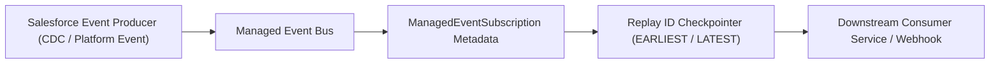

## Architectural Overview

`ManagedEventSubscription` is an essential component of Salesforce Event Mesh and event-driven enterprise architectures. As organizations decouple monoliths using Platform Events, Change Data Capture (CDC), and the Pub/Sub API, maintaining reliable event subscriptions without custom middleware code becomes critical.

Architecturally, `ManagedEventSubscription` manages the state and routing parameters for event consumers. It declaratively binds an event topic (such as `/event/Order_Fulfilled__e` or `/data/AccountChangeEvent`) to a downstream target service, tracks consumer checkpointing via replay IDs, and guarantees that event streams can recover seamlessly after downstream network disconnects or maintenance windows.



## Directory and File Conventions

Managed Event Subscriptions are stored in the `managedEventSubscriptions` folder:

| Property | Value |
| :--- | :--- |
| **Directory Name** | `managedEventSubscriptions` |
| **File Extension** | `.managedEventSubscription` |
| **Root XML Element** | `<ManagedEventSubscription>` |
| **API Version** | `68.0` |

## Key Metadata Fields

The `ManagedEventSubscription` metadata schema configures subscription mechanics:

| Field Name | Type | Description |
| :--- | :--- | :--- |
| `developerName` | `string` | Unique programmatic identifier for the subscription. |
| `masterLabel` | `string` | Administrative display name. |
| `eventTopic` | `string` | Target event channel path (for example, `/event/Invoice_Event__e`). |
| `replayType` | `string` | Checkpoint replay strategy: `LATEST`, `EARLIEST`, or `CUSTOM`. |
| `replayId` | `string` | Explicit event replay ID used when `replayType` is `CUSTOM`. |
| `targetService` | `string` | Registered destination endpoint or downstream consumer service identifier. |
| `status` | `string` | Operational state: `Active`, `Paused`, or `Error`. |

> [!TIP]
> In production environments with strict message delivery SLAs, configure `<replayType>EARLIEST</replayType>` or track dynamic replay IDs via external state stores to guarantee zero message loss during consumer outages.

## Declarative XML and Package Manifest Examples

Below is an enterprise subscription configuration `Order_Fulfillment_Sub.managedEventSubscription`:

```xml title="force-app/main/default/managedEventSubscriptions/Order_Fulfillment_Sub.managedEventSubscription"
<?xml version="1.0" encoding="UTF-8"?>
<ManagedEventSubscription xmlns="http://soap.sforce.com/2006/04/metadata">
    <developerName>Order_Fulfillment_Sub</developerName>
    <masterLabel>Enterprise Order Fulfillment Subscription</masterLabel>
    <eventTopic>/event/Order_Fulfillment__e</eventTopic>
    <replayType>LATEST</replayType>
    <status>Active</status>
    <targetService>ERP_Fulfillment_Gateway</targetService>
</ManagedEventSubscription>
```

### Manifest Definition (`package.xml`)

Include the subscription along with custom platform events in `package.xml`:

```xml title="manifest/package.xml"
<?xml version="1.0" encoding="UTF-8"?>
<Package xmlns="http://soap.sforce.com/2006/04/metadata">
    <types>
        <members>Order_Fulfillment_Sub</members>
        <name>ManagedEventSubscription</name>
    </types>
    <types>
        <members>Order_Fulfillment__e</members>
        <name>CustomObject</name>
    </types>
    <version>68.0</version>
</Package>
```

## CLI Retrieval and Deployment Commands

Use the Salesforce CLI to deploy event subscriptions:

```bash
# Retrieve all ManagedEventSubscription definitions
sf project retrieve start --metadata ManagedEventSubscription

# Deploy a specific subscription file to production
sf project deploy start --source-dir force-app/main/default/managedEventSubscriptions/Order_Fulfillment_Sub.managedEventSubscription
```

## Senior Architect Deployment Best Practices and Gotchas

- **Platform Event Schema Dependency:** The target `eventTopic` must exist in the target org prior to deploying `ManagedEventSubscription`. Deploy custom platform events (`__e`) before deploying subscriptions.
- **Replay Window Expiration:** Platform events are retained on the Salesforce Event Bus for a finite window (72 hours for standard high-volume events). If a consumer is offline longer than the retention window, setting `<replayType>EARLIEST</replayType>` will only replay events within the active 72-hour retention boundary.
- **Deployment Status Safety:** When deploying subscriptions into production, deploy with `<status>Paused</status>` initially if downstream target consumer systems are not yet verified, then activate post-deployment.

> [!WARNING]
> Changing `eventTopic` on an active subscription resets the replay checkpoint, causing consumers to miss in-flight events published during the metadata migration.
