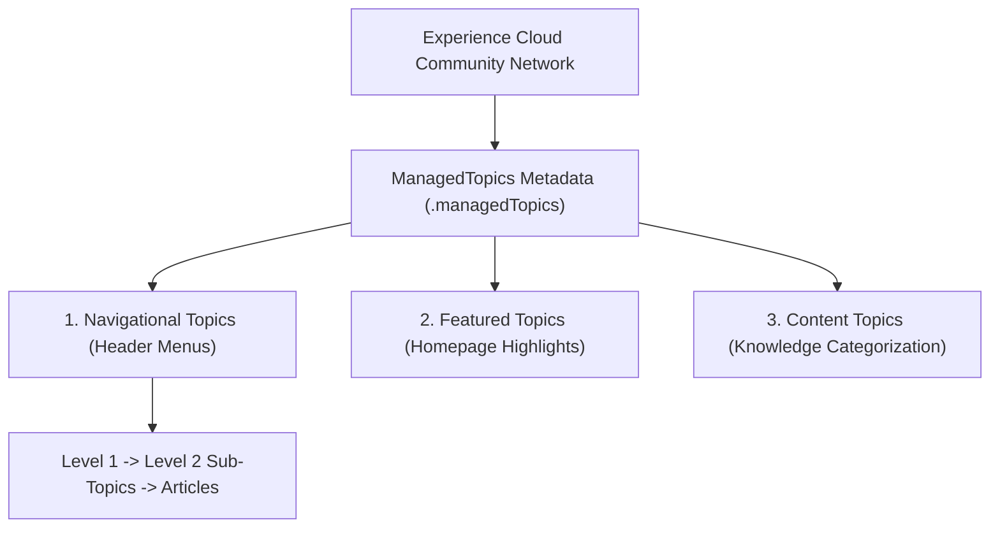

## Architectural Overview

`ManagedTopics` defines the content categorization and navigation taxonomy for Salesforce Experience Cloud (formerly Community Cloud) sites. As self-service customer portals and partner communities scale to thousands of Knowledge articles, discussions, and technical manuals, users require intuitive hierarchical navigation to discover relevant content.

Architecturally, `ManagedTopics` structures community taxonomy into three distinct functional tiers:
1. **Navigational Topics:** Render primary navigation header menus and mega-dropdowns (up to 3 levels of depth).
2. **Featured Topics:** Highlight prominent product lines or seasonal support initiatives on the community homepage with hero imagery.
3. **Content Topics:** Group articles and discussion threads behind the scenes for search engine optimization and automated content curation.



## Directory and File Conventions

Managed Topics files are stored in the `managedTopics` directory:

| Property | Value |
| :--- | :--- |
| **Directory Name** | `managedTopics` |
| **File Extension** | `.managedTopics` |
| **Root XML Element** | `<ManagedTopics>` |
| **API Version** | `68.0` |

## Key Metadata Fields

The `ManagedTopics` metadata type defines hierarchical topic arrangements:

| Field Name | Type | Description |
| :--- | :--- | :--- |
| `networkName` | `string` | API name of the target Experience Cloud Community Network. |
| `managedTopic` | `ManagedTopic[]` | Array of configured topic elements belonging to the community. |
| `topicName` | `string` | Text label of the topic shown to community users. |
| `topicType` | `string` | Classification: `Navigational`, `Featured`, or `Content`. |
| `parentTopicName` | `string` | Name of the parent topic when constructing multi-level navigation trees. |
| `position` | `int` | Display order sequence on the navigation bar or card carousel. |

> [!TIP]
> Structure your navigational hierarchy with a maximum depth of two to three levels. Deeper topic hierarchies increase cognitive load and hinder mobile community navigation.

## Declarative XML and Package Manifest Examples

Below is a production `Customer_Portal.managedTopics` configuration:

```xml title="force-app/main/default/managedTopics/Customer_Portal.managedTopics"
<?xml version="1.0" encoding="UTF-8"?>
<ManagedTopics xmlns="http://soap.sforce.com/2006/04/metadata">
    <managedTopic>
        <position>0</position>
        <topicName>Hardware Products</topicName>
        <topicType>Navigational</topicType>
    </managedTopic>
    <managedTopic>
        <parentTopicName>Hardware Products</parentTopicName>
        <position>0</position>
        <topicName>Servers & Storage</topicName>
        <topicType>Navigational</topicType>
    </managedTopic>
    <managedTopic>
        <position>0</position>
        <topicName>Security Announcements</topicName>
        <topicType>Featured</topicType>
    </managedTopic>
    <managedTopic>
        <topicName>Firmware Updates</topicName>
        <topicType>Content</topicType>
    </managedTopic>
</ManagedTopics>
```

### Manifest Definition (`package.xml`)

Include `ManagedTopics` along with the associated `Network` in `package.xml`:

```xml title="manifest/package.xml"
<?xml version="1.0" encoding="UTF-8"?>
<Package xmlns="http://soap.sforce.com/2006/04/metadata">
    <types>
        <members>Customer_Portal</members>
        <name>ManagedTopics</name>
    </types>
    <types>
        <members>Customer_Portal</members>
        <name>Network</name>
    </types>
    <version>68.0</version>
</Package>
```

## CLI Retrieval and Deployment Commands

Retrieve and deploy topics using the Salesforce CLI:

```bash
# Retrieve ManagedTopics metadata
sf project retrieve start --metadata ManagedTopics

# Deploy the topic structure alongside the community network
sf project deploy start --source-dir force-app/main/default/networks force-app/main/default/managedTopics
```

## Senior Architect Deployment Best Practices and Gotchas

- **Network Name Alignment:** The file name and `<networkName>` must match the developer name of an active `Network` in the target org. Deploying `ManagedTopics` into an org where the community has not yet been provisioned will fail.
- **Topic Deletion Behaviors:** Deploying a modified `ManagedTopics` file that omits an existing topic does not automatically delete that topic from the target org—it simply unassigns its navigational role. To purge topics completely, use Experience Workspaces or the Connect REST API.
- **Article Topic Assignments:** `ManagedTopics` defines the taxonomy structure, but the actual assignment of individual Knowledge articles to topics is stored as data records (`TopicAssignment`). Seed topic assignments using data loader scripts in automated CI/CD pipelines.

> [!WARNING]
> Renaming a top-level parent navigational topic in XML without updating the `<parentTopicName>` tags on child topics will sever the navigation tree and result in deployment errors.
