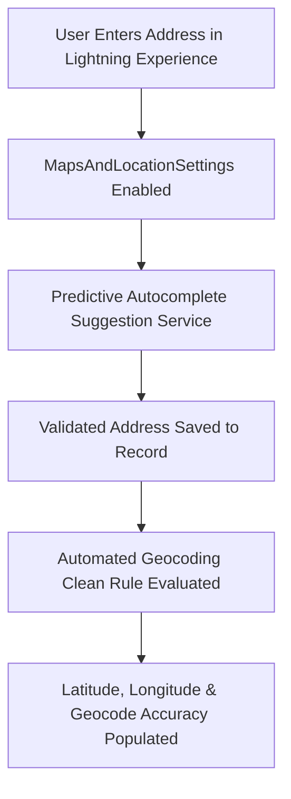

## Architectural Overview

`MapsAndLocationSettings` controls native geolocation, mapping services, and address autocomplete features across Salesforce. In sales and field service operations, accurate geospatial coordinates are essential for calculating territory boundaries, optimizing field rep travel routes, and rendering map visuals on record layouts.

Architecturally, `MapsAndLocationSettings` powers two primary capabilities:
1. **Address Autocomplete:** Provides real-time predictive address entry in standard address compound fields across Account, Contact, and Lead records in Lightning Experience.
2. **Automated Geocoding Data Integration:** Interacts with Salesforce geocoding clean rules to convert street addresses into precise geographic coordinates (`Latitude` and `Longitude`) upon record creation and updates.



## Directory and File Conventions

`MapsAndLocationSettings` is a singleton Settings metadata asset stored in the `settings` directory:

| Property | Value |
| :--- | :--- |
| **Directory Name** | `settings` |
| **File Name** | `MapsAndLocation.settings-meta.xml` |
| **Root XML Element** | `<MapsAndLocationSettings>` |
| **API Version** | `68.0` |

## Key Metadata Fields

The `MapsAndLocationSettings` schema configures geocoding and location behaviors:

| Field Name | Type | Description |
| :--- | :--- | :--- |
| `enableAddressAutocomplete` | `boolean` | Activates predictive address lookup prompts in standard address fields. |
| `enableMapsAndLocation` | `boolean` | Master toggle activating native mapping visual components and location services. |

> [!NOTE]
> Standard geocoding populates `MailingLatitude` and `MailingLongitude` on Contact, and `BillingLatitude` / `BillingLongitude` on Account.

## Declarative XML and Package Manifest Examples

Below is an enterprise `MapsAndLocation.settings-meta.xml` configuration:

```xml title="force-app/main/default/settings/MapsAndLocation.settings-meta.xml"
<?xml version="1.0" encoding="UTF-8"?>
<MapsAndLocationSettings xmlns="http://soap.sforce.com/2006/04/metadata">
    <enableAddressAutocomplete>true</enableAddressAutocomplete>
    <enableMapsAndLocation>true</enableMapsAndLocation>
</MapsAndLocationSettings>
```

### Manifest Definition (`package.xml`)

Include the setting in `package.xml`:

```xml title="manifest/package.xml"
<?xml version="1.0" encoding="UTF-8"?>
<Package xmlns="http://soap.sforce.com/2006/04/metadata">
    <types>
        <members>MapsAndLocation</members>
        <name>Settings</name>
    </types>
    <version>68.0</version>
</Package>
```

## CLI Retrieval and Deployment Commands

Use the Salesforce CLI to deploy maps and location settings:

```bash
# Retrieve MapsAndLocation settings
sf project retrieve start --metadata Settings:MapsAndLocation

# Deploy settings to scratch org or sandbox
sf project deploy start --source-dir force-app/main/default/settings/MapsAndLocation.settings-meta.xml
```

## Senior Architect Deployment Best Practices and Gotchas

- **Address Autocomplete User Experience:** Enabling `enableAddressAutocomplete` drastically improves data hygiene by standardizing city names, postal codes, and country codes at the point of user entry, reducing downstream CRM deduplication overhead.
- **Geocoding Data Integration Rules:** Deploying `MapsAndLocationSettings` enables the platform capability, but administrators must also verify that the corresponding **Clean Rules** (such as *Geocodes for Account Billing Address*) are set to Active in the target org.
- **Data Privacy and Third-Party Providers:** The predictive autocomplete engine queries trusted mapping providers. Ensure your enterprise data governance and security compliance teams approve external address resolution requests.

> [!WARNING]
> If address autocomplete is enabled but users work in remote international regions with unmapped postal grids, ensure users can still manually bypass autocomplete to enter custom local addresses.
