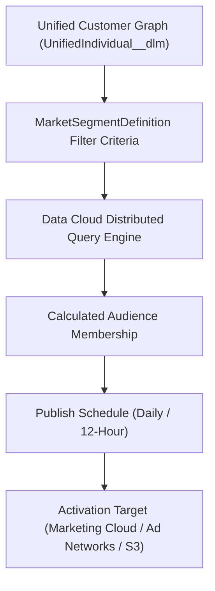

## Architectural Overview

`MarketSegmentDefinition` represents the audience segmentation blueprint inside Salesforce Data Cloud (Customer Data Platform / CDP). As enterprises unify hundreds of millions of customer touchpoints across point-of-sale systems, mobile apps, web telemetry, and transactional ERPs, marketing and analytics teams must build precise customer cohorts for targeted activation.

Architecturally, `MarketSegmentDefinition` encapsulates the audience definition:
- **Segment On Entity:** Identifies the foundational Data Model Object (DMO)—typically `UnifiedIndividual__dlm` or `Account__dlm`.
- **Filtering Logic:** Encodes complex boolean rule criteria spanning demographic attributes, engagement recency, and calculated insights (such as high-lifetime-value churn risks).
- **Publish Schedule:** Governs automated recalculation cadence (for example, daily batch or hourly incremental updates) before publishing audience segments to downstream activation targets like Google Ads, Meta, Amazon S3, or Marketing Cloud.



## Directory and File Conventions

Market Segment Definitions are stored in the `marketSegmentDefinitions` directory:

| Property | Value |
| :--- | :--- |
| **Directory Name** | `marketSegmentDefinitions` |
| **File Extension** | `.marketSegmentDefinition` |
| **Root XML Element** | `<MarketSegmentDefinition>` |
| **API Version** | `68.0` |

## Key Metadata Fields

The `MarketSegmentDefinition` metadata specifies segment criteria and operational targets:

| Field Name | Type | Description |
| :--- | :--- | :--- |
| `developerName` | `string` | Programmatic API identifier of the market segment. |
| `masterLabel` | `string` | Display name of the segment in the Data Cloud UI. |
| `dataSpace` | `string` | Developer name of the Data Space isolating the segment scope. |
| `segmentOn` | `string` | Core entity being segmented (such as `UnifiedIndividual__dlm`). |
| `segmentCriteriaFilter` | `string` | Serialized JSON filter query representing audience membership logic. |
| `publishSchedule` | `string` | Recurrence schedule for segment publishing (for example, `Daily` or `Hourly`). |
| `description` | `string` | Business rationale and compliance scope of the audience segment. |

> [!TIP]
> Always partition enterprise segments into dedicated Data Spaces (`dataSpace`) to satisfy regional compliance regulations (such as separating GDPR European data from CCPA North American cohorts).

## Declarative XML and Package Manifest Examples

Below is a production `High_Value_Churn_Risk.marketSegmentDefinition` configuration:

```xml title="force-app/main/default/marketSegmentDefinitions/High_Value_Churn_Risk.marketSegmentDefinition"
<?xml version="1.0" encoding="UTF-8"?>
<MarketSegmentDefinition xmlns="http://soap.sforce.com/2006/04/metadata">
    <developerName>High_Value_Churn_Risk</developerName>
    <masterLabel>High Value Customers at Risk of Churn</masterLabel>
    <dataSpace>default</dataSpace>
    <segmentOn>UnifiedIndividual__dlm</segmentOn>
    <publishSchedule>Daily</publishSchedule>
    <description>Identifies unified individual profiles with lifetime spend above 5000 and no purchases in 90 days</description>
</MarketSegmentDefinition>
```

### Manifest Definition (`package.xml`)

Include `MarketSegmentDefinition` in `package.xml`:

```xml title="manifest/package.xml"
<?xml version="1.0" encoding="UTF-8"?>
<Package xmlns="http://soap.sforce.com/2006/04/metadata">
    <types>
        <members>High_Value_Churn_Risk</members>
        <name>MarketSegmentDefinition</name>
    </types>
    <version>68.0</version>
</Package>
```

## CLI Retrieval and Deployment Commands

Use the Salesforce CLI to deploy Data Cloud segment definitions:

```bash
# Retrieve all MarketSegmentDefinition items
sf project retrieve start --metadata MarketSegmentDefinition

# Deploy segment definitions to the production Data Cloud instance
sf project deploy start --source-dir force-app/main/default/marketSegmentDefinitions/High_Value_Churn_Risk.marketSegmentDefinition
```

## Senior Architect Deployment Best Practices and Gotchas

- **Data Space Preexistence:** The target `<dataSpace>` must exist in the destination environment. Deploying a segment referencing an unprovisioned Data Space will fail deployment validation.
- **Data Model Object Dependencies:** Ensure all referenced Data Model Objects (`__dlm`) and Calculated Insights (`__cio`) utilized in `segmentOn` or filter expressions are fully mapped and populated in the target org before publishing the segment.
- **Publish Schedule Resource Consumption:** Frequent recalculation schedules (such as hourly) consume significant Data Cloud credits and processing units. Standardize on daily or 12-hour publish schedules unless real-time activation is an explicit business requirement.

> [!WARNING]
> Deploying changes to `segmentOn` drops existing audience membership tables and cancels active outbound activation runs until the segment is recalculated.
