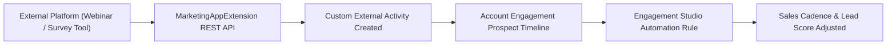

## Architectural Overview

`MarketingAppExtension` establishes enterprise integration bridges between external marketing platforms (such as webinar systems, survey tools, event registration engines, or video streaming platforms) and Salesforce Marketing Cloud Account Engagement (formerly Pardot). In modern demand generation architectures, prospect interactions take place across dozens of external digital touchpoints outside native Pardot landing pages.

Architecturally, `MarketingAppExtension` registers external activity definitions and external action endpoints. When an external system records an interaction (such as a prospect attending a virtual webinar or completing a product certification), the extension allows the external system to push that activity into Account Engagement, where it appears on prospect timelines and dynamically triggers Engagement Studio nurture branching.



## Directory and File Conventions

Marketing App Extensions are stored in the `marketingAppExtensions` directory:

| Property | Value |
| :--- | :--- |
| **Directory Name** | `marketingAppExtensions` |
| **File Extension** | `.marketingAppExtension` |
| **Root XML Element** | `<MarketingAppExtension>` |
| **API Version** | `68.0` |

## Key Metadata Fields

The `MarketingAppExtension` metadata schema defines external interaction types:

| Field Name | Type | Description |
| :--- | :--- | :--- |
| `developerName` | `string` | Unique API name for the marketing application extension. |
| `masterLabel` | `string` | User-friendly label displayed in Account Engagement settings. |
| `isActive` | `boolean` | Master toggle enabling external systems to submit activity records. |
| `actionDefinitions` | `MarketingAppExtAction[]` | Packaged custom marketing actions executable from Engagement Studio. |
| `activityDefinitions` | `MarketingAppExtActivity[]` | Registered types of external prospect activities that can be captured. |
| `activityName` | `string` | API identifier of a specific external activity type (for example, `Attended_Webinar`). |
| `iconName` | `string` | SLDS (Salesforce Lightning Design System) icon rendering on the prospect timeline. |

> [!TIP]
> Use clear and standard SLDS icon identifiers in `iconName` (such as `standard:event` or `custom:custom83`) so sales development reps quickly recognize external actions when reviewing prospect engagement histories.

## Declarative XML and Package Manifest Examples

Below is an enterprise configuration `Webinar_Platform_Connector.marketingAppExtension`:

```xml title="force-app/main/default/marketingAppExtensions/Webinar_Platform_Connector.marketingAppExtension"
<?xml version="1.0" encoding="UTF-8"?>
<MarketingAppExtension xmlns="http://soap.sforce.com/2006/04/metadata">
    <developerName>Webinar_Platform_Connector</developerName>
    <masterLabel>Virtual Webinar Platform Connector</masterLabel>
    <isActive>true</isActive>
    <activityDefinitions>
        <activityName>Registered_For_Webinar</activityName>
        <iconName>standard:event</iconName>
        <isActive>true</isActive>
        <masterLabel>Registered for Webinar</masterLabel>
    </activityDefinitions>
    <activityDefinitions>
        <activityName>Attended_Live_Webinar</activityName>
        <iconName>standard:screen</iconName>
        <isActive>true</isActive>
        <masterLabel>Attended Live Webinar</masterLabel>
    </activityDefinitions>
</MarketingAppExtension>
```

### Manifest Definition (`package.xml`)

Include `MarketingAppExtension` in `package.xml`:

```xml title="manifest/package.xml"
<?xml version="1.0" encoding="UTF-8"?>
<Package xmlns="http://soap.sforce.com/2006/04/metadata">
    <types>
        <members>Webinar_Platform_Connector</members>
        <name>MarketingAppExtension</name>
    </types>
    <version>68.0</version>
</Package>
```

## CLI Retrieval and Deployment Commands

Use the Salesforce CLI to deploy marketing app extensions:

```bash
# Retrieve all MarketingAppExtension definitions
sf project retrieve start --metadata MarketingAppExtension

# Deploy the extension to production
sf project deploy start --source-dir force-app/main/default/marketingAppExtensions/Webinar_Platform_Connector.marketingAppExtension
```

## Senior Architect Deployment Best Practices and Gotchas

- **Business Unit Scoping:** In multi-business-unit Account Engagement setups, deploying `MarketingAppExtension` creates the global definition, but administrators must explicitly assign the extension to target Business Units in Setup.
- **Connected App and Auth:** External systems pushing activity records to the extension require a dedicated `ConnectedApp` with OAuth 2.0 Client Credentials or JWT Bearer flow authorized for the `pardot_api` scope.
- **Activity Immutability:** Once an external activity definition has captured production prospect records, deleting or modifying its `activityName` is restricted to safeguard historical audit logs and Engagement Studio branching rules.

> [!WARNING]
> Setting `<isActive>false</isActive>` immediately rejects incoming API payloads from external marketing integrations, causing unhandled 400 Bad Request exceptions on external integration queues.
