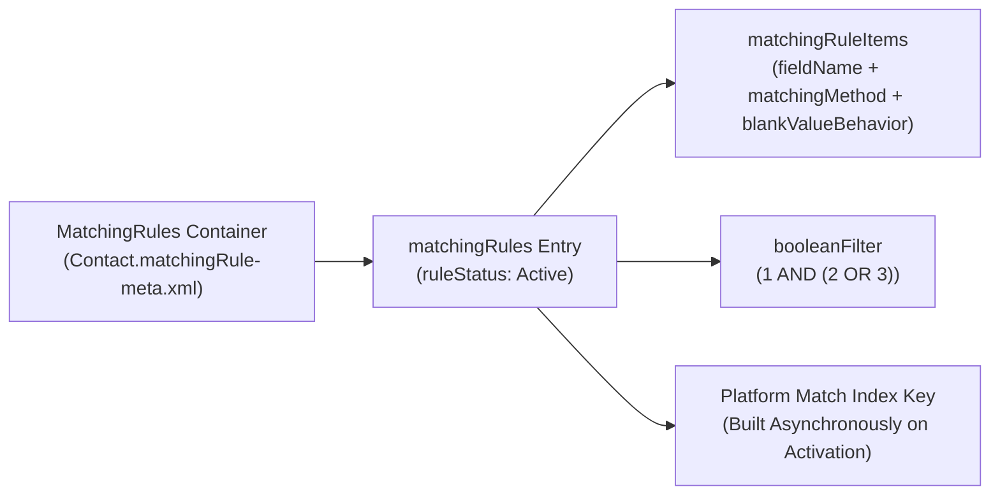

The `MatchingRule` metadata type defines the field comparison formula and phonetic/fuzzy algorithms that determine whether two records on an object represent the same real-world entity. Introduced in API version 33.0, `MatchingRule` works hand-in-hand with [DuplicateRule](/docs/metadata/duplicate-rule-metadata-type/): the `MatchingRule` computes the match index keys and evaluates candidate pairs, while the `DuplicateRule` decides whether to block or alert the user.

In Salesforce DX projects, all matching rules for an object are stored in a single per-object file at `force-app/main/default/matchingRules/<ObjectName>.matchingRule-meta.xml`.



## Supported `matchingMethod` Algorithms

| `matchingMethod` | Supported Fields | Matching Algorithm & Threshold |
|---|---|---|
| `Exact` | Any supported standard or custom field | Deterministic exact string/value equality |
| `FirstName` | `FirstName` (`Contact`, `Lead`) | Jaro-Winkler + nickname equivalence dictionary (`Robert` = `Bob`) |
| `LastName` | `LastName` (`Contact`, `Lead`) | Keyboard distance + phonetic Soundex/NYSIIS |
| `CompanyName` | `Account.Name`, `Lead.Company` | Acronym expansion + corporate suffix stripping (`Inc`, `LLC`, `Corp`) |
| `Phone` | Phone fields | Normalizes country/area codes, punctuation, and digit segments |
| `Street` | Billing/Mailing Street | Normalizes street suffixes (`St` = `Street`, `Ave` = `Avenue`) |
| `City` / `Zip` / `Title` | City, PostalCode, Title | Edit-distance and token similarity |

## Key Metadata Fields

| Field | Location | Required | Description |
|---|---|---|---|
| `fullName` | `matchingRules` | Yes | Developer API name of the individual matching rule |
| `label` | `matchingRules` | Yes | Display name in Setup -> Matching Rules |
| `ruleStatus` | `matchingRules` | Yes | `Inactive`, `Active`, `Activating`, `Deactivating`, or `ActivationFailed` |
| `booleanFilter` | `matchingRules` | No | Boolean logic combining `matchingRuleItems` (for example, `(1 AND 2) OR 3`) |
| `fieldName` | `matchingRuleItems` | Yes | API name of the field being compared |
| `matchingMethod` | `matchingRuleItems` | Yes | `Exact` or one of the fuzzy methods (`FirstName`, `LastName`, `CompanyName`, etc.) |
| `blankValueBehavior` | `matchingRuleItems` | No | `NullNotAllowed` (default: blanks never match) or `MatchBlank` |

## Production-Grade XML Example (`Contact.matchingRule-meta.xml`)

Below is a `MatchingRules` file for `Contact` (`force-app/main/default/matchingRules/Contact.matchingRule-meta.xml`) that combines fuzzy first/last name matching with exact email or normalized phone matching:

```xml
<?xml version="1.0" encoding="UTF-8"?>
<MatchingRules xmlns="http://soap.sforce.com/2006/04/metadata">
    <matchingRules>
        <fullName>Contact_Fuzzy_Name_And_Email_Or_Phone</fullName>
        <booleanFilter>1 AND 2 AND (3 OR 4)</booleanFilter>
        <description>Matches Contacts with fuzzy First + Last Name and either Exact Email or Fuzzy Phone.</description>
        <label>Contact Fuzzy Name and Email or Phone</label>
        <matchingRuleItems>
            <blankValueBehavior>NullNotAllowed</blankValueBehavior>
            <fieldName>FirstName</fieldName>
            <matchingMethod>FirstName</matchingMethod>
        </matchingRuleItems>
        <matchingRuleItems>
            <blankValueBehavior>NullNotAllowed</blankValueBehavior>
            <fieldName>LastName</fieldName>
            <matchingMethod>LastName</matchingMethod>
        </matchingRuleItems>
        <matchingRuleItems>
            <blankValueBehavior>NullNotAllowed</blankValueBehavior>
            <fieldName>Email</fieldName>
            <matchingMethod>Exact</matchingMethod>
        </matchingRuleItems>
        <matchingRuleItems>
            <blankValueBehavior>NullNotAllowed</blankValueBehavior>
            <fieldName>Phone</fieldName>
            <matchingMethod>Phone</matchingMethod>
        </matchingRuleItems>
        <ruleStatus>Active</ruleStatus>
    </matchingRules>
</MatchingRules>
```

> [!WARNING]
> **Match Key Limits & High-Volume Indexing**: An active `MatchingRule` generates up to 10 internal match keys depending on how many `OR` branches exist in `<booleanFilter>`. Complex `OR` logic across more than 3 branches or tables with millions of skewed null/duplicate values can fail asynchronous indexing with `ActivationFailed`. Keep `OR` combinations concise and ensure at least one high-cardinality field (such as `Email`, `LastName`, or `Account.Name`) is part of every `AND` clause.

## Querying `MatchingRule` with SOQL

```sql
-- Inspect all MatchingRules and their indexing status
SELECT Id, DeveloperName, MasterLabel, SobjectType, RuleStatus, BooleanFilter,
       (SELECT Id, Field, MatchingMethod, BlankValueBehavior, SortOrder FROM MatchingRuleItems ORDER BY SortOrder)
FROM MatchingRule
ORDER BY SobjectType, MasterLabel
```

