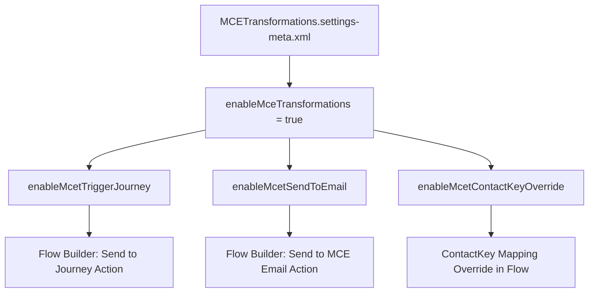

## Architectural Overview

The `MCETransformationsSettings` metadata type manages organization-level feature flags that govern native interactions between Salesforce Flow Builder and Marketing Cloud Engagement (MCE). As enterprise architectures increasingly unite core CRM events with real-time marketing orchestration, Salesforce provides direct declarative flow actions to trigger MCE transactional emails and push contacts into MCE Journeys.

`MCETransformationsSettings` serves as the governance boundary for these direct actions. By standardizing this setting across scratch orgs, sandboxes, and production environments, architects guarantee that automated flow actions dispatching messages via Marketing Cloud Engagement operate consistently without manual Setup toggling post-deployment.



## Directory and File Conventions

In the Salesforce DX project source format, `MCETransformationsSettings` follows the standard org settings decomposition rules. It resides in the `settings/` folder and is packaged under the `Settings` type with member name `MCETransformations`.

| Property | Value |
| :--- | :--- |
| **Metadata Type Name** | `Settings` (member: `MCETransformations`) / `MCETransformationsSettings` |
| **SFDX Directory** | `force-app/main/default/settings/` |
| **File Suffix** | `.settings-meta.xml` |
| **Full File Name** | `MCETransformations.settings-meta.xml` |
| **Scratch Org Setting** | `mceTransformationsSettings` |

## Key Metadata Fields

The `MCETransformationsSettings` schema defines four boolean attributes controlling Flow Builder integration capabilities:

| Field Name | Field Type | Required | Description |
| :--- | :--- | :--- | :--- |
| `enableMceTransformations` | `boolean` | Yes | Master toggle enabling Flow Builder access to Marketing Cloud Engagement sending capabilities. Must be `true` for other flags to take effect. |
| `enableMcetContactKeyOverride` | `boolean` | No | Allows flows to override the default `ContactKey` attribute when dispatching records to an MCE journey. |
| `enableMcetSendToEmail` | `boolean` | No | Enables the declarative *Send to MCE Email* action within Flow Builder. |
| `enableMcetTriggerJourney` | `boolean` | No | Enables the declarative *Send to Journey* action within Flow Builder to initiate customer journeys. |

> [!RELEASE] Winter '27
> `MCETransformationsSettings` is actively supported in API version `68.0`, providing granular control over cross-cloud orchestration between Flow Builder and Marketing Cloud Engagement.

## Declarative XML and Package Manifest Examples

Below is an enterprise configuration enabling full Flow Builder orchestration to Marketing Cloud Engagement:

```xml title="force-app/main/default/settings/MCETransformations.settings-meta.xml"
<?xml version="1.0" encoding="UTF-8"?>
<MCETransformationsSettings xmlns="http://soap.sforce.com/2006/04/metadata">
    <enableMceTransformations>true</enableMceTransformations>
    <enableMcetContactKeyOverride>true</enableMcetContactKeyOverride>
    <enableMcetSendToEmail>true</enableMcetSendToEmail>
    <enableMcetTriggerJourney>true</enableMcetTriggerJourney>
</MCETransformationsSettings>
```

### Package Manifest (`package.xml`)

When using manifest-driven deployments, retrieve or deploy `MCETransformationsSettings` under the parent `Settings` metadata type:

```xml title="manifest/package.xml"
<?xml version="1.0" encoding="UTF-8"?>
<Package xmlns="http://soap.sforce.com/2006/04/metadata">
    <types>
        <members>MCETransformations</members>
        <name>Settings</name>
    </types>
    <version>68.0</version>
</Package>
```

## CLI Retrieval and Deployment Commands

Use the Salesforce CLI (`sf`) to retrieve and deploy `MCETransformationsSettings`:

```bash
# Retrieve MCETransformationsSettings from target org
sf project retrieve start --metadata Settings:MCETransformations

# Deploy MCETransformationsSettings to target org
sf project deploy start --metadata Settings:MCETransformations

# Deploy the entire settings folder
sf project deploy start --source-dir force-app/main/default/settings
```

## Architect Best Practices and Gotchas

- **Deployment Dependency with Flows:** If any [Flow](/docs/metadata/flow-metadata-type/) metadata in your deployment package leverages the *Send to Journey* or *Send to MCE Email* actions, deploy `Settings:MCETransformations` prior to or in the same transaction as the Flow. Deploying dependent flows to an org where `enableMceTransformations` is `false` results in compilation errors.
- **Tenant API Connector Prerequisites:** Turning on `enableMceTransformations` enables the UI actions, but executing calls requires a valid connected app and Marketing Cloud Engagement tenant integration token provisioned in Setup.
- **ContactKey Governance:** Use caution when enabling `enableMcetContactKeyOverride`. Overriding contact keys dynamically in flows can lead to duplicate contacts and billing consumption in Marketing Cloud Engagement if not aligned with your enterprise master data management (MDM) strategy.

> [!TIP]
> Include `MCETransformationsSettings` in your base scratch org definition file under `settings.mceTransformationsSettings` to enable seamless local development and automated CI testing of cross-cloud marketing flows.
