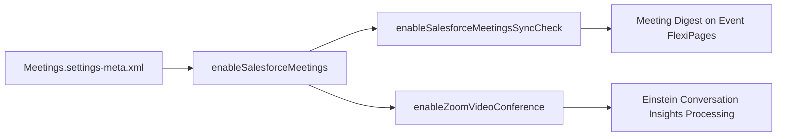

## Architectural Overview

The `MeetingsSettings` metadata type represents the organization-level configuration for Salesforce Meetings. Designed to enrich the sales rep workflow directly within the CRM, Salesforce Meetings delivers the Meeting Digest—an interface on Event records that summarizes meeting participants, past interactions, open opportunity stages, and attendee engagement history prior to client calls.

In enterprise release management, managing `MeetingsSettings` in version control ensures parity across development sandboxes, staging environments, and production. Furthermore, enabling video conferencing synchronization (such as Zoom integration) links call recordings and meeting notes with Einstein Conversation Insights (ECI), facilitating automated coaching and pipeline intelligence.



## Directory and File Conventions

`MeetingsSettings` is managed under the generic `Settings` metadata type. In SFDX source format, settings are stored in individual XML files within the `settings/` folder.

| Property | Value |
| :--- | :--- |
| **Metadata Type Name** | `Settings` (member: `Meetings`) / `MeetingsSettings` |
| **SFDX Directory** | `force-app/main/default/settings/` |
| **File Suffix** | `.settings-meta.xml` |
| **File Name** | `Meetings.settings-meta.xml` |
| **Scratch Org Setting** | `meetingsSettings` |

## Key Metadata Fields

The `MeetingsSettings` metadata schema in API version `68.0` defines the following boolean attributes:

| Field Name | Field Type | Required | Description |
| :--- | :--- | :--- | :--- |
| `enableSalesforceMeetings` | `boolean` | Yes | Toggles the Salesforce Meetings feature across the organization. When enabled, users with appropriate permissions can access Meeting Digest. |
| `enableSalesforceMeetingsSyncCheck` | `boolean` | No | Verifies that an activity synchronization engine (such as Einstein Activity Capture) is active before initializing meetings features. |
| `enableZoomVideoConference` | `boolean` | No | Enables corporate Zoom account linking to Salesforce for recording capture and conversation intelligence. |

> [!NOTE]
> Feature settings components do not support wildcard (`*`) matching in `package.xml` manifests. You must explicitly request `Meetings` as a member of the `Settings` type.

## Declarative XML and Package Manifest Examples

The following example illustrates a standard `Meetings.settings-meta.xml` file configured for enterprise sales teams:

```xml title="force-app/main/default/settings/Meetings.settings-meta.xml"
<?xml version="1.0" encoding="UTF-8"?>
<MeetingsSettings xmlns="http://soap.sforce.com/2006/04/metadata">
    <enableSalesforceMeetings>true</enableSalesforceMeetings>
    <enableSalesforceMeetingsSyncCheck>true</enableSalesforceMeetingsSyncCheck>
    <enableZoomVideoConference>false</enableZoomVideoConference>
</MeetingsSettings>
```

### Package Manifest (`package.xml`)

Include `Meetings` under the `Settings` type when working with manifest files:

```xml title="manifest/package.xml"
<?xml version="1.0" encoding="UTF-8"?>
<Package xmlns="http://soap.sforce.com/2006/04/metadata">
    <types>
        <members>Meetings</members>
        <name>Settings</name>
    </types>
    <version>68.0</version>
</Package>
```

## CLI Retrieval and Deployment Commands

Retrieve and deploy `MeetingsSettings` using the Salesforce CLI (`sf`):

```bash
# Retrieve Meetings settings into your local repository
sf project retrieve start --metadata Settings:Meetings

# Deploy Meetings settings to a sandbox or production org
sf project deploy start --metadata Settings:Meetings

# Verify settings status via Tooling API
sf data query --use-tooling-api --query "SELECT Id, Metadata FROM MeetingsSettings"
```

## Architect Best Practices and Gotchas

- **Prerequisite Activity Sync:** Attempting to deploy `enableSalesforceMeetings: true` to an org without an active calendar/activity sync engine (such as Einstein Activity Capture or Lightning Sync) may trigger validation warnings or degrade user experience.
- **Permission Set Assignments:** Enabling the setting activates the underlying infrastructure, but end users still require the *Salesforce Meetings* user permission assigned via a [PermissionSet](/docs/metadata/permission-set-metadata-type/).
- **Event Layout Modifications:** Ensure that your Event record [FlexiPage](/docs/metadata/flexipage-metadata-type/) and page layouts are updated to include the Meeting Digest standard component for relevant sales profiles.

> [!TIP]
> When configuring scratch org definitions for testing sales workflows, declare `meetingsSettings` inside the `settings` object of `project-scratch-def.json` to have the environment provisioned with Salesforce Meetings pre-activated.
