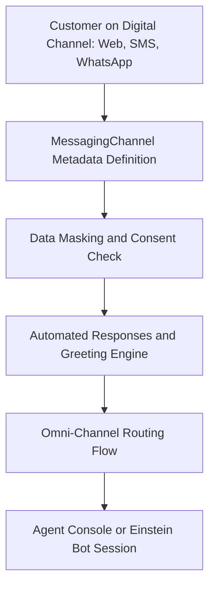

## Architectural Overview

The `MessagingChannel` metadata type represents an inbound and outbound digital communication channel within Service Cloud and Digital Engagement. Modern contact centers interact with customers across diverse modalities—including SMS, WhatsApp, Facebook Messenger, Apple Messages for Business, LINE, Web Chat (Messaging for In-App and Web), and Bring Your Own Channel (BYOC) endpoints.

In enterprise contact center architectures, `MessagingChannel` anchors the end-to-end conversation pipeline. It governs channel identity, data masking rules for sensitive information (e.g., credit card numbers or SSNs), opt-in consent mechanisms, automated greeting/offline responses, and integration with Omni-Channel routing flows. Deploying `MessagingChannel` via CI/CD guarantees consistent channel configuration across sandboxes and production without requiring error-prone manual setup.



## Directory and File Conventions

`MessagingChannel` components are organized into their own directory in the standard Salesforce DX source structure.

| Property | Value |
| :--- | :--- |
| **Metadata Type Name** | `MessagingChannel` |
| **SFDX Directory** | `force-app/main/default/messagingChannels/` |
| **File Suffix** | `.messagingChannel-meta.xml` |
| **Naming Convention** | `<ChannelDeveloperName>.messagingChannel-meta.xml` |
| **Package.xml Wildcard** | Supported (`*`) |

## Key Metadata Fields

The `MessagingChannel` XML definition contains key configuration elements that establish channel behavior:

| Field Name | Field Type | Required | Description |
| :--- | :--- | :--- | :--- |
| `masterLabel` | `string` | Yes | The user-facing label for the channel displayed across Service Console. |
| `description` | `string` | No | Architectural description of the channel and its business purpose. |
| `isDataMaskingEnabled` | `boolean` | No | When `true`, automatically masks sensitive data patterns (e.g., PII or payment details) in conversation transcripts. |
| `routingType` | `string` | No | Dictates the routing mechanism, such as `OmniChannel` or external routing. |
| `sessionTimeout` | `int` | No | Inactivity duration in minutes before an active conversation session is closed. |
| `automatedResponses` | `MessagingChannelAutomatedResponse[]` | No | Array defining automated system responses for greetings, queue hold messages, and session terminations. |

> [!NOTE]
> Third-party social channels (such as WhatsApp Business accounts or Facebook pages) require out-of-band tenant credential handshakes in Setup, while the underlying routing rules, parameters, and policies are controlled via `MessagingChannel` metadata.

## Declarative XML and Package Manifest Examples

The following sample demonstrates an Embedded Messaging Channel definition configured with data masking and automated handling:

```xml title="force-app/main/default/messagingChannels/Web_Support_Channel.messagingChannel-meta.xml"
<?xml version="1.0" encoding="UTF-8"?>
<MessagingChannel xmlns="http://soap.sforce.com/2006/04/metadata">
    <masterLabel>Web Support Channel</masterLabel>
    <description>In-App and Web Messaging channel for premium customer support.</description>
    <isDataMaskingEnabled>true</isDataMaskingEnabled>
    <routingType>OmniChannel</routingType>
    <sessionTimeout>15</sessionTimeout>
    <automatedResponses>
        <responseType>Greeting</responseType>
        <messageText>Thank you for reaching out to customer support. An agent will be with you shortly.</messageText>
    </automatedResponses>
    <automatedResponses>
        <responseType>InactivityWarning</responseType>
        <messageText>Your chat session will close in two minutes due to inactivity.</messageText>
    </automatedResponses>
</MessagingChannel>
```

### Package Manifest (`package.xml`)

Retrieve all messaging channels or specify individual instances using `package.xml`:

```xml title="manifest/package.xml"
<?xml version="1.0" encoding="UTF-8"?>
<Package xmlns="http://soap.sforce.com/2006/04/metadata">
    <types>
        <members>*</members>
        <name>MessagingChannel</name>
    </types>
    <version>68.0</version>
</Package>
```

## CLI Retrieval and Deployment Commands

Manage `MessagingChannel` components with the Salesforce CLI:

```bash
# Retrieve all Messaging Channels
sf project retrieve start --metadata MessagingChannel

# Retrieve a specific Messaging Channel by name
sf project retrieve start --metadata MessagingChannel:Web_Support_Channel

# Deploy Messaging Channels to target org
sf project deploy start --metadata MessagingChannel
```

## Architect Best Practices and Gotchas

- **Omni-Channel Routing Dependencies:** If the channel relies on an Omni-Channel [Flow](/docs/metadata/flow-metadata-type/) for routing, ensure the routing flow is deployed before or alongside the `MessagingChannel`.
- **Digital Engagement Licensing:** Deploying `MessagingChannel` metadata requires that the target environment has active Digital Engagement or Service Cloud Messaging licenses. Scratch orgs must include the `DigitalEngagement` or `ServiceCloud` feature flags.
- **Transcripts and Privacy Compliance:** Always configure `isDataMaskingEnabled` to `true` on public channels to enforce data privacy compliance (GDPR, CCPA, HIPAA) and prevent accidental logging of credit cards or personal identifiers.

> [!TIP]
> Combine `MessagingChannel` configurations with Einstein Bots by linking the channel to an Omni-Channel Flow that evaluates bot triage prior to transferring conversations to live support queues.
