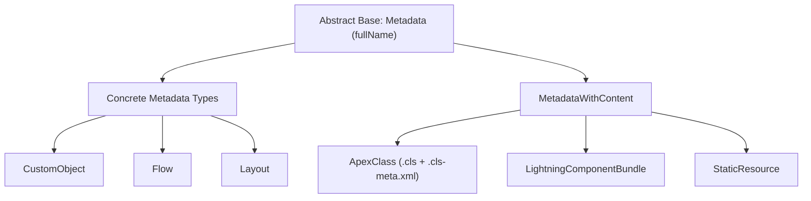

## Architectural Overview

In the Salesforce Platform architecture, `Metadata` is the abstract root base type from which every declarative component type inherits in the Metadata API WSDL. Whether configuring a [CustomObject](/docs/metadata/custom-object-metadata-type/), authoring an [ApexClass](/docs/metadata/apex-class-metadata-type/), designing a [Flow](/docs/metadata/flow-metadata-type/), or provisioning a security profile, every single entity is a specialization of the fundamental `Metadata` complex type.

Understanding `Metadata` as an architectural construct is essential for technical architects, DevOps engineers, and tooling authors. It establishes the global identity contract across the platform—most notably through the `fullName` attribute—which governs how Salesforce uniquely references, retrieves, deploys, deletes, and tracks dependencies among metadata instances across organizations.



## Directory and File Conventions

Because `Metadata` is an abstract base type, it does not exist as an independent file or directory on disk. Instead, its properties are embedded within the XML structures of every concrete metadata type in your Salesforce DX project.

| Property | Value |
| :--- | :--- |
| **Type Characterization** | Abstract Root Complex Type |
| **Direct SFDX Folder** | N/A (Inherited by all concrete metadata types) |
| **File Suffix** | Inherited by derived types (`-meta.xml`) |
| **Primary Base Attribute** | `fullName` |
| **WSDL Namespace** | `http://soap.sforce.com/2006/04/metadata` |

## Key Metadata Fields

The `Metadata` base schema definition establishes the identity and lifecycle properties common to all Salesforce components:

| Field Name | Field Type | Required | Description |
| :--- | :--- | :--- | :--- |
| `fullName` | `string` | Yes | The globally unique identifier and API name for the component within the target org. Often namespaced (e.g., `ns__MyObject__c`). |

### The Contract of `fullName`

The `fullName` attribute acts as the primary key for declarative components in deployment transactions:
- **Dot-Notation Namespacing:** Child metadata components inherit identity hierarchies using dot-notation. For example, a custom field on Account has a `fullName` of `Account.Custom_Field__c`.
- **Destructive Changes:** Destructive manifests (`destructiveChanges.xml`) utilize the `fullName` of components to pinpoint entities targeted for removal.
- **Package Manifest Resolution:** In `package.xml`, each `<members>` entry directly matches the `fullName` of a component.

## Declarative XML and Package Manifest Examples

Every valid metadata file produced by Salesforce CLI declares the Metadata API namespace on its root element, inheriting from `Metadata`:

```xml title="force-app/main/default/objects/Invoice__c/Invoice__c.object-meta.xml"
<?xml version="1.0" encoding="UTF-8"?>
<CustomObject xmlns="http://soap.sforce.com/2006/04/metadata">
    <!-- fullName is derived from file naming in source format or declared explicitly in mdapi -->
    <label>Invoice</label>
    <pluralLabel>Invoices</pluralLabel>
    <sharingModel>ReadWrite</sharingModel>
</CustomObject>
```

### Package Manifest (`package.xml`) Mechanics

When building a `package.xml` manifest, the `<members>` tag references the `fullName` established by the `Metadata` base contract:

```xml title="manifest/package.xml"
<?xml version="1.0" encoding="UTF-8"?>
<Package xmlns="http://soap.sforce.com/2006/04/metadata">
    <types>
        <!-- The member value corresponds to the component fullName -->
        <members>Account.Tax_Exempt__c</members>
        <name>CustomField</name>
    </types>
    <version>68.0</version>
</Package>
```

## CLI Retrieval and Deployment Commands

While you cannot retrieve `Metadata` directly, Tooling API queries inspect the underlying metadata definitions dynamically:

```bash
# Query the Tooling API to inspect metadata container records
sf data query --use-tooling-api --query "SELECT Id, DeveloperName, NamespacePrefix FROM CustomObject WHERE DeveloperName = 'Invoice'"

# Describe all metadata types derived from the Metadata base type
sf org list metadata-types

# Retrieve components by their fullName
sf project retrieve start --metadata CustomObject:Invoice__c
```

## Architect Best Practices and Gotchas

- **Identifier Immutability:** Renaming the `fullName` of an existing metadata component across environments does not execute an in-place rename; Salesforce deploys a new component with the new name, leaving the old component orphaned unless cleaned up with destructive changes.
- **Namespace Collisions:** In managed package development, the platform automatically prefixes `fullName` with the registered namespace (e.g., `pkg__Invoice__c`). Ensure integration code handles both namespaced and non-namespaced variants dynamically.
- **Decomposition in Source Format:** Modern Salesforce DX source format decomposes complex types (such as `CustomObject`) into modular sub-directories (`fields/`, `validationRules/`). The CLI synthesizes the complete XML during deployment, preserving the unified `Metadata` base structure expected by the server.

> [!TIP]
> Use `sf org list metadata-types --api-version 68.0` in CI/CD pipeline scripts to dynamically introspect which concrete types extending `Metadata` are available in your target release environment.
