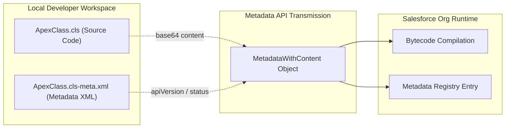

## Architectural Overview

Within the Salesforce Platform Metadata API taxonomy, `MetadataWithContent` is the abstract base type that extends `Metadata` to handle components composed of both structured XML configuration and an associated binary or text payload. While purely declarative entities (like Custom Fields or Sharing Rules) exist entirely as XML trees, programmatic and web assets require actual file bodies—such as Apex source code, Visualforce markup, compiled archives, or email HTML.

`MetadataWithContent` formalizes the dual-artifact model across Salesforce development. During deployments, tools like the Salesforce CLI (`sf`) read the file on disk, serialize its body into a `base64Binary` stream for the `content` field, and bundle it with the corresponding `-meta.xml` companion document.



## Directory and File Conventions

Unlike single-file XML metadata, types extending `MetadataWithContent` follow a paired-file or bundle directory convention in Salesforce DX source format.

| Property | Value |
| :--- | :--- |
| **Type Classification** | Abstract Base Type (extends `Metadata`) |
| **Source Representation** | Paired Content File + XML Meta File |
| **Common Suffixes** | `.cls` / `.cls-meta.xml`, `.resource` / `.resource-meta.xml` |
| **Primary Base Fields** | `fullName`, `content` (`base64Binary`) |
| **WSDL Definition** | `<complexType name="MetadataWithContent">` |

## Concrete Subtypes of `MetadataWithContent`

The following table highlights foundational platform components that inherit from `MetadataWithContent`:

| Derived Metadata Type | Content Payload Type | Companion Metadata File | Description |
| :--- | :--- | :--- | :--- |
| [ApexClass](/docs/metadata/apex-class-metadata-type/) | `.cls` (Apex Code) | `.cls-meta.xml` | Server-side object-oriented Apex class source code. |
| `ApexTrigger` | `.trigger` (Trigger Code) | `.trigger-meta.xml` | Event-driven Apex database execution triggers. |
| `ApexPage` | `.page` (Visualforce Markup) | `.page-meta.xml` | Legacy Visualforce page markup and controller bindings. |
| `StaticResource` | `.resource` (Binary/Zip) | `.resource-meta.xml` | Static CSS, JavaScript libraries, and graphic assets. |
| `EmailTemplate` | `.email` (HTML/Text) | `.email-meta.xml` | Outbound communication email templates and merge fields. |

## Declarative XML and File Structure Examples

In the local file system, an entity derived from `MetadataWithContent` is manifested as a side-by-side file pair:

### Content Source File

```java title="force-app/main/default/classes/OrderProcessor.cls"
public with sharing class OrderProcessor {
    public static void execute() {
        System.debug('Order processing initiated.');
    }
}
```

### Companion Metadata XML File

```xml title="force-app/main/default/classes/OrderProcessor.cls-meta.xml"
<?xml version="1.0" encoding="UTF-8"?>
<ApexClass xmlns="http://soap.sforce.com/2006/04/metadata">
    <apiVersion>68.0</apiVersion>
    <status>Active</status>
</ApexClass>
```

### Manifest File (`package.xml`)

Even though two physical files exist locally, `package.xml` references the entity as a single logical member:

```xml title="manifest/package.xml"
<?xml version="1.0" encoding="UTF-8"?>
<Package xmlns="http://soap.sforce.com/2006/04/metadata">
    <types>
        <members>OrderProcessor</members>
        <name>ApexClass</name>
    </types>
    <version>68.0</version>
</Package>
```

## CLI Retrieval and Deployment Commands

Manage types derived from `MetadataWithContent` using standard CLI commands:

```bash
# Retrieve Apex classes from org
sf project retrieve start --metadata ApexClass

# Deploy specific content component and its metadata companion
sf project deploy start --source-dir force-app/main/default/classes/OrderProcessor.cls

# Retrieve Static Resources
sf project retrieve start --metadata StaticResource
```

## Architect Best Practices and Gotchas

- **Always Commit Both Files:** Never commit a `.cls` or `.resource` file to version control without its accompanying `-meta.xml` file. Deploying an orphan content file without its metadata will cause build failures in CI/CD pipelines.
- **Base64 Payload Size Limits:** In direct SOAP or REST integrations interacting with `MetadataWithContent`, keep payload sizes within platform transaction limits (e.g., maximum 5 MB for static resources, 39 MB for total deployment zip size).
- **Encoding and Character Sets:** Text-based content files (like Apex and Visualforce) must be encoded in UTF-8. Non-UTF-8 characters in strings or comments can lead to compilation errors upon deployment.

> [!TIP]
> When building custom automated migration scripts or Tooling API utilities, remember that `Body` or `Content` fields in REST responses must be decoded from base64 into raw text or binary streams before saving to disk.
