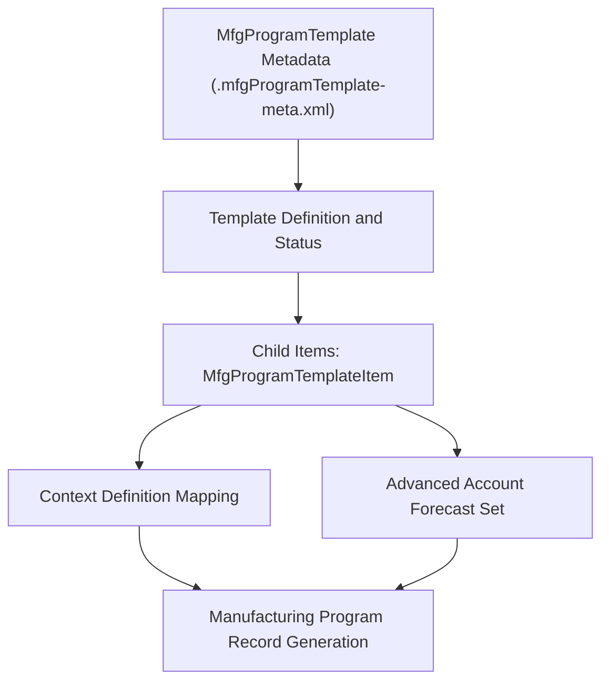

## Architectural Overview

The `MfgProgramTemplate` metadata type represents program templates within Salesforce Manufacturing Cloud. In automotive, aerospace, and industrial component manufacturing, companies operate on multi-year program-based business models. Rather than managing one-off orders, suppliers negotiate long-term agreements covering prototype development, tooling, serial production, and aftermarket parts.

`MfgProgramTemplate` provides the blueprint for these commercial initiatives. It links customer opportunities and manufacturing programs to advanced account forecasting sets, data processing engines, and context definitions. By capturing program templates in version control, architects can deploy standardized program structures across global business units, ensuring consistent forecasting logic and revenue projections.



## Directory and File Conventions

`MfgProgramTemplate` metadata components reside in their dedicated directory within the Salesforce DX project source structure.

| Property | Value |
| :--- | :--- |
| **Metadata Type Name** | `MfgProgramTemplate` |
| **SFDX Directory** | `force-app/main/default/mfgProgramTemplates/` |
| **File Suffix** | `.mfgProgramTemplate-meta.xml` |
| **Manifest Member Name** | `<TemplateDeveloperName>` or `*` |
| **Wildcard Support** | Supported |

## Key Metadata Fields

The `MfgProgramTemplate` schema structure includes high-level template attributes and granular configuration items:

| Field Name | Field Type | Required | Description |
| :--- | :--- | :--- | :--- |
| `programTemplateName` | `string` | Yes | Unique system name identifying the manufacturing program template. |
| `description` | `string` | No | Architectural description explaining the industrial program scope. |
| `status` | `string` | Yes | Operational lifecycle state. Valid values: `Active`, `Draft`, `Inactive`. |
| `programTemplateItems` | `MfgProgramTemplateItem[]` | No | Child array defining linked forecast sets and context definitions. |

### Child Type: `MfgProgramTemplateItem`

| Item Field | Field Type | Description |
| :--- | :--- | :--- |
| `advAccountForecastSet` | `string` | API name of the Advanced Account Forecast Set bound to this item. |
| `contextDefinition` | `string` | Context definition orchestrating data transformations from Opportunities to Programs. |
| `displayOrder` | `int` | Numeric index establishing rendering order in the Manufacturing Cloud UI. |

> [!NOTE]
> Deploying `MfgProgramTemplate` requires that Manufacturing Cloud licenses are provisioned and the *Program-Based Business* feature toggle is enabled in Setup.

## Declarative XML and Package Manifest Examples

The following example defines a program template for high-tech industrial component suppliers:

```xml title="force-app/main/default/mfgProgramTemplates/Industrial_Sensor_Program.mfgProgramTemplate-meta.xml"
<?xml version="1.0" encoding="UTF-8"?>
<MfgProgramTemplate xmlns="http://soap.sforce.com/2006/04/metadata">
    <programTemplateName>Industrial_Sensor_Program</programTemplateName>
    <description>Standardized template for multi-year sensor supply and engineering programs.</description>
    <status>Active</status>
    <programTemplateItems>
        <advAccountForecastSet>Sensor_Revenue_Forecast_Set</advAccountForecastSet>
        <contextDefinition>Mfg_Program_Opportunity_Context</contextDefinition>
        <displayOrder>1</displayOrder>
    </programTemplateItems>
</MfgProgramTemplate>
```

### Package Manifest (`package.xml`)

Include `MfgProgramTemplate` in your deployment manifest:

```xml title="manifest/package.xml"
<?xml version="1.0" encoding="UTF-8"?>
<Package xmlns="http://soap.sforce.com/2006/04/metadata">
    <types>
        <members>*</members>
        <name>MfgProgramTemplate</name>
    </types>
    <version>68.0</version>
</Package>
```

## CLI Retrieval and Deployment Commands

Retrieve and deploy `MfgProgramTemplate` components using the Salesforce CLI:

```bash
# Retrieve all Manufacturing Program Templates
sf project retrieve start --metadata MfgProgramTemplate

# Deploy a specific template to the target environment
sf project deploy start --metadata MfgProgramTemplate:Industrial_Sensor_Program

# Query existing program templates via Tooling API
sf data query --use-tooling-api --query "SELECT Id, DeveloperName, Status FROM MfgProgramTemplate"
```

## Architect Best Practices and Gotchas

- **Dependency Order:** `MfgProgramTemplate` references `AdvAccountForecastSet` and `ContextDefinition` metadata. Ensure those prerequisite components exist in the target org or are included earlier in the deployment pipeline.
- **Scratch Org Definitions:** To test program templates in CI/CD scratch orgs, include `"features": ["ManufacturingProgramBasedBusiness"]` in your `project-scratch-def.json` file.
- **Status Lifecycle:** Maintain newly authored program templates in `Draft` status during sandbox authoring, shifting to `Active` only when associated forecast sets and data pipelines are validated.

> [!TIP]
> Coordinate `MfgProgramTemplate` deployment with custom [Flow](/docs/metadata/flow-metadata-type/) automations that automatically instantiate new Manufacturing Programs when an Opportunity transitions to Closed/Won.
