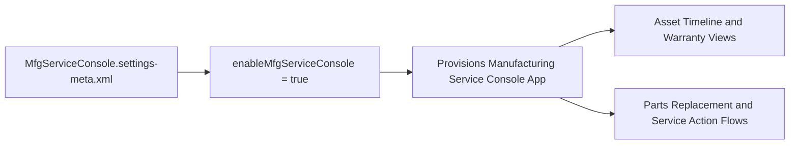

## Architectural Overview

The `MfgServiceConsoleSettings` metadata type represents the organizational toggle for the Service Console for Manufacturing. Built on the Salesforce Lightning Service Console foundation, this industry-specific solution empowers customer service representatives (CSRs) in manufacturing enterprises with a unified 360-degree view of connected assets, active service agreements, extended warranties, related cases, and replacement orders.

From a DevOps and systems architecture standpoint, `MfgServiceConsoleSettings` acts as an essential deployment prerequisite. Attempting to deploy customized Manufacturing Service Console Lightning Record Pages (`FlexiPage`), console navigation tabs, or industry-specific actions into an environment where this setting is disabled triggers dependency validation failures during CI/CD execution.



## Directory and File Conventions

Following the standard Salesforce DX settings pattern, `MfgServiceConsoleSettings` is represented as an XML document located inside the `settings/` directory.

| Property | Value |
| :--- | :--- |
| **Metadata Type Name** | `Settings` (member: `MfgServiceConsole`) / `MfgServiceConsoleSettings` |
| **SFDX Directory** | `force-app/main/default/settings/` |
| **File Suffix** | `.settings-meta.xml` |
| **File Name** | `MfgServiceConsole.settings-meta.xml` |
| **Scratch Org Setting** | `mfgServiceConsoleSettings` |

## Key Metadata Fields

The `MfgServiceConsoleSettings` schema defines the foundational boolean toggle for the application:

| Field Name | Field Type | Required | Description |
| :--- | :--- | :--- | :--- |
| `enableMfgServiceConsole` | `boolean` | Yes | Toggles the Service Console for Manufacturing feature on (`true`) or off (`false`) across the organization. |

> [!NOTE]
> The target Salesforce organization must have Manufacturing Cloud and Service Cloud licenses active before deploying `enableMfgServiceConsole: true`.

## Declarative XML and Package Manifest Examples

Below is the standard XML structure for enabling the Manufacturing Service Console:

```xml title="force-app/main/default/settings/MfgServiceConsole.settings-meta.xml"
<?xml version="1.0" encoding="UTF-8"?>
<MfgServiceConsoleSettings xmlns="http://soap.sforce.com/2006/04/metadata">
    <enableMfgServiceConsole>true</enableMfgServiceConsole>
</MfgServiceConsoleSettings>
```

### Package Manifest (`package.xml`)

Reference `MfgServiceConsole` under the `Settings` type in manifest files:

```xml title="manifest/package.xml"
<?xml version="1.0" encoding="UTF-8"?>
<Package xmlns="http://soap.sforce.com/2006/04/metadata">
    <types>
        <members>MfgServiceConsole</members>
        <name>Settings</name>
    </types>
    <version>68.0</version>
</Package>
```

## CLI Retrieval and Deployment Commands

Use the Salesforce CLI to deploy or inspect `MfgServiceConsoleSettings`:

```bash
# Retrieve MfgServiceConsole settings into local workspace
sf project retrieve start --metadata Settings:MfgServiceConsole

# Deploy settings to target sandbox or production org
sf project deploy start --metadata Settings:MfgServiceConsole

# Deploy entire settings directory
sf project deploy start --source-dir force-app/main/default/settings
```

## Architect Best Practices and Gotchas

- **Pipeline Ordering:** Always deploy `Settings:MfgServiceConsole` prior to deploying any console [FlexiPage](/docs/metadata/flexipage-metadata-type/) components or custom Lightning App definitions that rely on Manufacturing Service Console modules.
- **Scratch Org Configuration:** Ensure your scratch org definition includes the `Manufacturing` and `ServiceCloud` features in `project-scratch-def.json` to prevent deployment rejections.
- **Permission Sets:** Enabling the console provides the foundation; CSR users must also be assigned the *Manufacturing Service Console* user license and appropriate [PermissionSet](/docs/metadata/permission-set-metadata-type/) to view the console tabs.

> [!TIP]
> Combine the console with embedded [Flow](/docs/metadata/flow-metadata-type/) actions so customer service reps can initiate asset warranty claims and order replacement parts without navigating away from the Asset record page.
