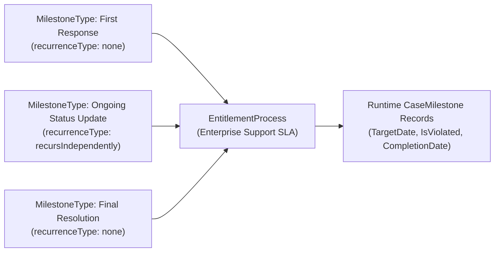

## Why the `MilestoneType` Metadata Type Matters

Before you can build an [EntitlementProcess](/docs/metadata/entitlement-process-metadata-type/) in Service Cloud, you must define the reusable milestone building blocks using **`MilestoneType`** (`milestoneTypes/<Name>.milestoneType-meta.xml`). Each `MilestoneType` represents a contractual checkpoint—such as **First Response**, **4-Hour Status Update**, **Workaround Provided**, or **Final Resolution**—and dictates whether that checkpoint fires once or repeats throughout the lifecycle of a Case or Work Order.



---

## Key Metadata Fields & The Recurrence Naming Inversion

| Field | Type | Required | Description |
|---|---|---|---|
| `description` | `string` | No | Documents when and how this milestone should be completed. |
| `recurrenceType` | `MilestoneTypeRecurrenceType` | No | Controls whether the milestone occurs once or repeats. Valid values: `none`, `recursIndependently`, `recursChained`. |

> [!WARNING]
> **Critical Metadata API Naming Inversion (`recursIndependently` vs. `recursChained`):** In the Salesforce Metadata API and SOQL schema, the enum names are inverted relative to the Setup UI labels:
> - **`none`** = **No Recurrence** (occurs only once on the Case, e.g., *First Response* or *Resolution Time*).
> - **`recursIndependently`** = **Sequential** in the Setup UI (the next occurrence's start time is set only **after** the current occurrence is marked completed).
> - **`recursChained`** = **Independent** in the Setup UI (the next occurrence's start time is chained to the target date of the previous occurrence regardless of when the agent completed it).

---

## Real-World XML Examples

### 1. Non-Recurring Milestone (`milestoneTypes/First Response.milestoneType-meta.xml`)

```xml
<?xml version="1.0" encoding="UTF-8"?>
<MilestoneType xmlns="http://soap.sforce.com/2006/04/metadata">
    <description>Initial human response sent to the customer acknowledging the support request.</description>
    <recurrenceType>none</recurrenceType>
</MilestoneType>
```

### 2. Sequential Recurring Milestone (`milestoneTypes/Executive Status Update.milestoneType-meta.xml`)

```xml
<?xml version="1.0" encoding="UTF-8"?>
<MilestoneType xmlns="http://soap.sforce.com/2006/04/metadata">
    <description>Periodic status update required every 2 hours while a Critical P1 incident remains open.</description>
    <recurrenceType>recursIndependently</recurrenceType>
</MilestoneType>
```

---

## Querying `MilestoneType` and `CaseMilestone` with SOQL

Both `MilestoneType` (the metadata definition) and `CaseMilestone` (the runtime SLA tracker on a Case) are queryable in standard SOQL. This is essential for writing Apex triggers or Record-Triggered Flows that automatically set `CaseMilestone.CompletionDate = System.now()` when an agent sends an email or closes a Case.

### 1. List All Milestone Types Configured in the Org

```sql
SELECT Id, Name, Description, RecurrenceType, LastModifiedDate
FROM MilestoneType
ORDER BY Name ASC
```

### 2. Query Open or Violated Case Milestones for Auto-Completion in Apex/Flow

```sql
SELECT Id, CaseId, Case.CaseNumber, MilestoneType.Name,
       StartDate, TargetDate, CompletionDate,
       IsCompleted, IsViolated, TimeRemainingInMins, ElapsedTimeInMins
FROM CaseMilestone
WHERE CaseId = :targetCaseId
  AND IsCompleted = false
  AND MilestoneType.Name = 'First Response'
```

---

## Senior Architect Best Practices

- **Automate `CaseMilestone.CompletionDate` via Record-Triggered Flow or `EmailMessage` Trigger:** Agents should never have to manually click "Mark Completed" on the Milestone Tracker component. Use an after-insert Flow on `EmailMessage` (where `Incoming = false`) to query open `First Response` and `Executive Status Update` `CaseMilestone` rows and set `CompletionDate = System.now()`.
- **Keep `MilestoneType` Names Concise:** Because `MilestoneType` file names in SFDX (`milestoneTypes/First Response.milestoneType-meta.xml`) preserve spaces and match the exact UI label, avoid punctuation or trailing spaces that complicate CLI scripts.
