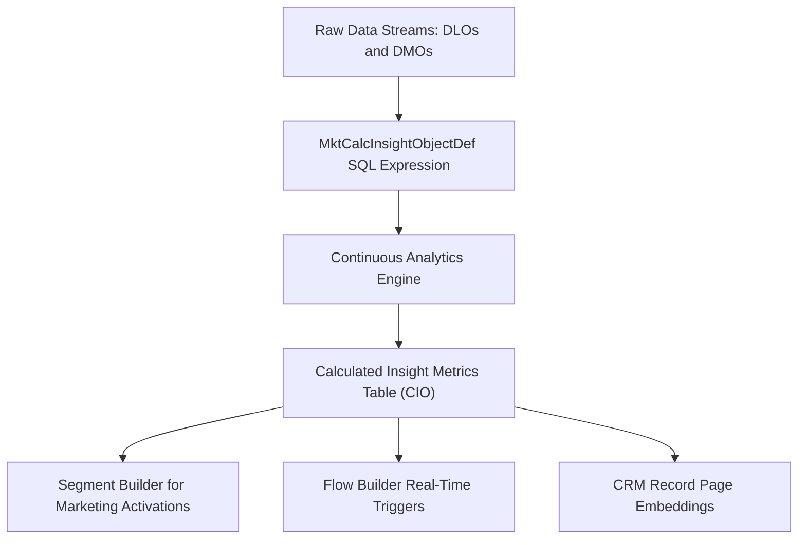

## Architectural Overview

The `MktCalcInsightObjectDef` metadata type defines a Calculated Insight (CI) within Salesforce Data Cloud (formerly Customer 360 Audiences / Genie). Calculated Insights let enterprise data architects transform raw event data and unified customer profiles into actionable metrics—such as Customer Lifetime Value (CLV), recency-frequency-monetary (RFM) scores, net promoter score averages, and churn propensity indices.

By codifying Calculated Insights into `MktCalcInsightObjectDef` metadata files, enterprise teams treat analytical aggregations as code. Insights authored in development orgs can be tested, code-reviewed in Git, and deployed through CI/CD pipelines into staging and production Data Cloud environments without relying on manual re-entry in the Data Cloud UI.



## Directory and File Conventions

Calculated Insight definitions are organized within their dedicated subfolder in the Salesforce DX project structure.

| Property | Value |
| :--- | :--- |
| **Metadata Type Name** | `MktCalcInsightObjectDef` |
| **SFDX Directory** | `force-app/main/default/mktCalcInsightObjectDefs/` |
| **File Suffix** | `.mktCalcInsightObjectDef-meta.xml` |
| **File Naming** | `<DeveloperName>.mktCalcInsightObjectDef-meta.xml` |
| **Wildcard Support** | Supported (`*`) |

## Key Metadata Fields

The XML schema for `MktCalcInsightObjectDef` includes structural fields and the core SQL aggregation expression:

| Field Name | Field Type | Required | Description |
| :--- | :--- | :--- | :--- |
| `masterLabel` | `string` | Yes | The user-friendly label displayed in Data Cloud Segment Builder and UI. |
| `description` | `string` | No | Architectural description detailing the business formula and purpose. |
| `expression` | `string` | Yes | The ANSI SQL statement that performs the metric aggregation across Data Model Objects. |
| `creationType` | `string` | Yes | Indicates the authoring origin. Typically `Custom` for user-defined insights. |
| `system` | `string` | Yes | Distinguishes whether the definition was generated by `System` packages or `Custom` engineering. |

> [!NOTE]
> The SQL expression in `expression` must reference valid Data Model Objects (DMOs) or Data Lake Objects (DLOs) with exact API field names, ending in standard DMO namespaces such as `ssot__Individual__dlm`.

## Declarative XML and Package Manifest Examples

The following example illustrates a Calculated Insight computing the lifetime spending total per individual customer:

```xml title="force-app/main/default/mktCalcInsightObjectDefs/Customer_Lifetime_Spend.mktCalcInsightObjectDef-meta.xml"
<?xml version="1.0" encoding="UTF-8"?>
<MktCalcInsightObjectDef xmlns="http://soap.sforce.com/2006/04/metadata">
    <masterLabel>Customer Lifetime Spend</masterLabel>
    <description>Calculates total historical order spend per individual customer.</description>
    <creationType>Custom</creationType>
    <system>Custom</system>
    <expression>SELECT ssot__SalesOrder__dlm.ssot__SoldToCustomerId__c as customer_id__c, SUM(ssot__SalesOrder__dlm.ssot__GrandTotalAmount__c) as total_spend__c FROM ssot__SalesOrder__dlm GROUP BY ssot__SalesOrder__dlm.ssot__SoldToCustomerId__c</expression>
</MktCalcInsightObjectDef>
```

### Package Manifest (`package.xml`)

Include `MktCalcInsightObjectDef` in your deployment manifest:

```xml title="manifest/package.xml"
<?xml version="1.0" encoding="UTF-8"?>
<Package xmlns="http://soap.sforce.com/2006/04/metadata">
    <types>
        <members>*</members>
        <name>MktCalcInsightObjectDef</name>
    </types>
    <version>68.0</version>
</Package>
```

## CLI Retrieval and Deployment Commands

Use the Salesforce CLI to deploy or retrieve Calculated Insights:

```bash
# Retrieve all Calculated Insight definitions
sf project retrieve start --metadata MktCalcInsightObjectDef

# Deploy a specific Calculated Insight
sf project deploy start --metadata MktCalcInsightObjectDef:Customer_Lifetime_Spend

# Inspect calculated insight records via Data Cloud SOQL/Tooling API
sf data query --use-tooling-api --query "SELECT Id, DeveloperName, MasterLabel FROM MktCalcInsightObjectDef"
```

## Architect Best Practices and Gotchas

- **DMO Dependency Ordering:** Deploy all prerequisite Data Model Objects (DMOs), custom fields, and data mappings prior to deploying dependent `MktCalcInsightObjectDef` components. If a referenced DMO or field is missing, deployment fails with a semantic validation error.
- **SQL Function Compatibility:** Ensure your SQL expression strictly complies with Data Cloud SQL dialect limitations (e.g., supported `SUM`, `AVG`, `COUNT`, `MAX`, `MIN` aggregate functions and mandatory `GROUP BY` dimension keys).
- **Processing Cadence:** Calculated Insights run on a scheduled batch cadence or streaming pipeline depending on the underlying data stream. Do not architect sub-second synchronous requirements around batch Calculated Insights.

> [!TIP]
> Once deployed, Calculated Insight metrics can be exposed back into core CRM record pages using Data Cloud Copy Fields or Flow Builder Data Cloud actions for frontline service and sales visibility.
