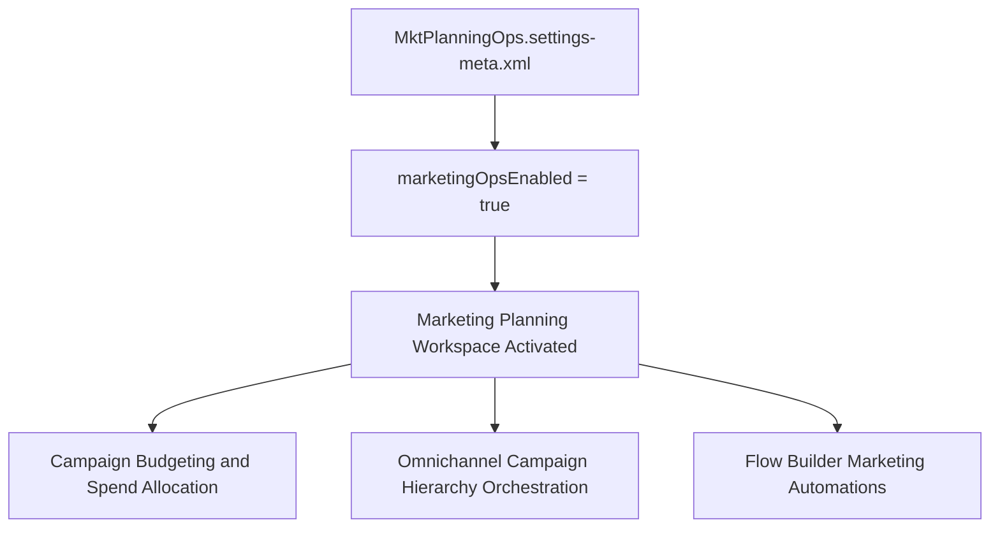

## Architectural Overview

The `MktPlanningOpsSettings` metadata type controls the organizational enablement of Marketing Planning and Operations within Salesforce. As modern marketing teams coordinate omnichannel campaigns across Marketing Cloud Growth, Account Engagement (Pardot), and core CRM campaigns, Marketing Planning and Operations delivers a unified workspace to structure campaign hierarchies, track multi-currency marketing budgets, allocate spend, and measure return on marketing investment (ROMI).

Managing `MktPlanningOpsSettings` as metadata ensures seamless deployment across development sandboxes and production environments. By activating this capability through code, release managers ensure that downstream dependencies—such as custom campaign layouts, marketing planning flows, and reporting dashboards—deploy cleanly without failing on missing core capabilities.



## Directory and File Conventions

`MktPlanningOpsSettings` conforms to the standard Salesforce DX settings convention and is stored within the `settings/` directory.

| Property | Value |
| :--- | :--- |
| **Metadata Type Name** | `Settings` (member: `MktPlanningOps`) / `MktPlanningOpsSettings` |
| **SFDX Directory** | `force-app/main/default/settings/` |
| **File Suffix** | `.settings-meta.xml` |
| **File Name** | `MktPlanningOps.settings-meta.xml` |
| **Scratch Org Setting** | `mktPlanningOpsSettings` |

## Key Metadata Fields

The `MktPlanningOpsSettings` XML structure defines the following boolean attribute:

| Field Name | Field Type | Required | Description |
| :--- | :--- | :--- | :--- |
| `marketingOpsEnabled` | `boolean` | Yes | Toggles Marketing Planning and Operations features on (`true`) or off (`false`) for the organization. |

> [!NOTE]
> Feature settings do not support wildcard (`*`) matching in `package.xml`. You must explicitly specify `MktPlanningOps` inside the manifest members.

## Declarative XML and Package Manifest Examples

The following example shows an active `MktPlanningOps.settings-meta.xml` configuration file:

```xml title="force-app/main/default/settings/MktPlanningOps.settings-meta.xml"
<?xml version="1.0" encoding="UTF-8"?>
<MktPlanningOpsSettings xmlns="http://soap.sforce.com/2006/04/metadata">
    <marketingOpsEnabled>true</marketingOpsEnabled>
</MktPlanningOpsSettings>
```

### Package Manifest (`package.xml`)

Include `MktPlanningOps` under the `Settings` type when deploying with manifest files:

```xml title="manifest/package.xml"
<?xml version="1.0" encoding="UTF-8"?>
<Package xmlns="http://soap.sforce.com/2006/04/metadata">
    <types>
        <members>MktPlanningOps</members>
        <name>Settings</name>
    </types>
    <version>68.0</version>
</Package>
```

## CLI Retrieval and Deployment Commands

Use the Salesforce CLI to deploy and verify `MktPlanningOpsSettings`:

```bash
# Retrieve MktPlanningOps settings from org
sf project retrieve start --metadata Settings:MktPlanningOps

# Deploy settings to target org
sf project deploy start --metadata Settings:MktPlanningOps

# Verify settings status via Tooling API
sf data query --use-tooling-api --query "SELECT Id, Metadata FROM MktPlanningOpsSettings"
```

## Architect Best Practices and Gotchas

- **Prerequisite Cloud Licensing:** Ensure that the target org has the appropriate Marketing Cloud Growth or Marketing Operations licenses enabled before deploying `marketingOpsEnabled: true`.
- **Security & Profile Alignment:** Once enabled, update user [PermissionSet](/docs/metadata/permission-set-metadata-type/) metadata to grant marketing managers and planners access to the planning operational tabs and budget fields.
- **Campaign Architecture:** Use standard Salesforce Campaign hierarchies in conjunction with the planning workspace to aggregate budget rolled-up values across regional and global campaigns.

> [!TIP]
> Include `mktPlanningOpsSettings: { "marketingOpsEnabled": true }` in your scratch org definitions to test marketing budgeting and planning automations in temporary sandbox environments.
