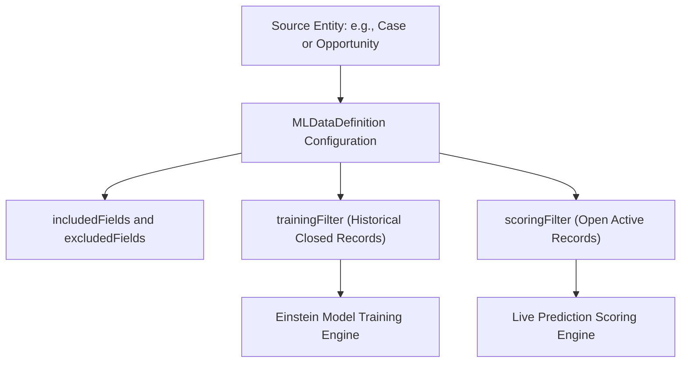

## Architectural Overview

The `MLDataDefinition` metadata type represents a modeling dataset definition within Salesforce Einstein (specifically Einstein Prediction Builder, Einstein Recommendation Builder, and Einstein Studio). Developing machine learning models in enterprise architectures requires rigorous boundaries around training datasets, excluded features (to prevent model bias or data leakage), and target scoring populations.

By declaring dataset configurations through `MLDataDefinition` metadata, enterprise architects maintain reproducible machine learning pipelines. Defining dataset filters and predictor fields in Git ensures that when predictive models move from sandbox evaluation to production scoring, the exact underlying training dataset criteria and ethical AI feature guardrails are preserved across environments.



## Directory and File Conventions

`MLDataDefinition` components reside in the `mlDataDefinitions/` folder in the Salesforce DX source format.

| Property | Value |
| :--- | :--- |
| **Metadata Type Name** | `MLDataDefinition` |
| **SFDX Directory** | `force-app/main/default/mlDataDefinitions/` |
| **File Suffix** | `.mlDataDefinition-meta.xml` |
| **Naming Convention** | `<DeveloperName>.mlDataDefinition-meta.xml` |
| **Wildcard Support** | Supported (`*`) |

## Key Metadata Fields

The `MLDataDefinition` metadata schema captures entity relationships, feature selection, and filtering criteria:

| Field Name | Field Type | Required | Description |
| :--- | :--- | :--- | :--- |
| `developerName` | `string` | Yes | Unique API name for the machine learning data definition. |
| `entityDeveloperName` | `string` | Yes | API name of the target Salesforce object (e.g., `Case`, `Opportunity`). Immutable after creation. |
| `type` | `string` | Yes | Purpose of the dataset definition: `Prediction`, `Candidate`, `Interaction`, or `Recipient`. |
| `includedFields` | `string[]` | No | List of field API names explicitly selected as predictor features for the model. |
| `excludedFields` | `string[]` | No | List of field API names explicitly omitted to eliminate bias, PII, or data leakage. |
| `trainingFilter` | `MLFilter` | No | Logical condition specifying records qualified for training the machine learning algorithm. |
| `scoringFilter` | `MLFilter` | No | Logical condition specifying records eligible to receive real-time prediction scores. |

> [!NOTE]
> Ensure that all fields referenced in `includedFields` and `excludedFields` exist on the target entity in the destination org before deploying `MLDataDefinition`.

## Declarative XML and Package Manifest Examples

The following example defines a prediction dataset on the `Case` object for escalating risk prediction:

```xml title="force-app/main/default/mlDataDefinitions/Case_Escalation_Data_Def.mlDataDefinition-meta.xml"
<?xml version="1.0" encoding="UTF-8"?>
<MLDataDefinition xmlns="http://soap.sforce.com/2006/04/metadata">
    <developerName>Case_Escalation_Data_Def</developerName>
    <entityDeveloperName>Case</entityDeveloperName>
    <type>Prediction</type>
    <includedFields>Origin</includedFields>
    <includedFields>Priority</includedFields>
    <includedFields>Reason</includedFields>
    <includedFields>Type</includedFields>
    <excludedFields>SuppliedEmail</excludedFields>
    <excludedFields>SuppliedPhone</excludedFields>
</MLDataDefinition>
```

### Package Manifest (`package.xml`)

Include `MLDataDefinition` in the package manifest:

```xml title="manifest/package.xml"
<?xml version="1.0" encoding="UTF-8"?>
<Package xmlns="http://soap.sforce.com/2006/04/metadata">
    <types>
        <members>*</members>
        <name>MLDataDefinition</name>
    </types>
    <version>68.0</version>
</Package>
```

## CLI Retrieval and Deployment Commands

Retrieve and deploy `MLDataDefinition` components using the Salesforce CLI:

```bash
# Retrieve all ML Data Definitions
sf project retrieve start --metadata MLDataDefinition

# Deploy a specific ML Data Definition
sf project deploy start --metadata MLDataDefinition:Case_Escalation_Data_Def

# Query ML Data Definitions via Tooling API
sf data query --use-tooling-api --query "SELECT Id, DeveloperName, EntityDeveloperName, Type FROM MLDataDefinition"
```

## Architect Best Practices and Gotchas

- **Preventing Data Leakage:** Ensure fields populated only after an outcome occurs (such as `ClosedDate` or `Resolution_Notes__c`) are explicitly placed in `excludedFields` to avoid artificial 100% predictive accuracy during training.
- **Entity Immutability:** The `entityDeveloperName` field cannot be modified on an existing `MLDataDefinition`. If the base entity changes, delete the existing component and deploy a new definition.
- **Coordination with Prediction Definitions:** `MLDataDefinition` is frequently paired with `MLPredictionDefinition`. Deploy dataset definitions before or alongside prediction definitions to prevent unresolved reference errors.

> [!TIP]
> Audit feature inclusion lists regularly to comply with enterprise AI ethics standards, ensuring sensitive protected demographic attributes are excluded from automated scoring algorithms.
