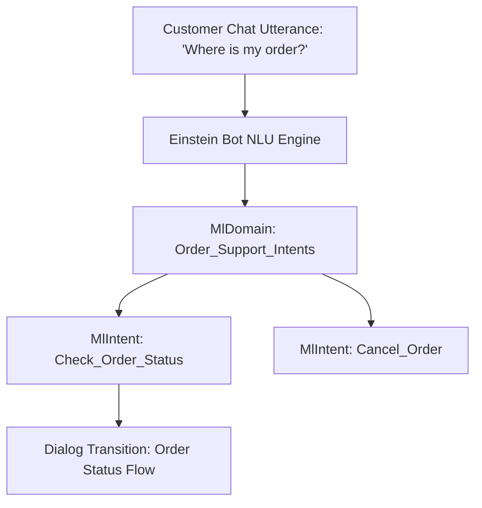

## Architectural Overview

The `MlDomain` metadata type represents an Einstein Intent Set—the natural language understanding (NLU) knowledge domain that powers Einstein Bots and conversational service experiences. Rather than hard-coding customer phrases into individual bot dialogs, enterprise architectures employ Intent Sets as reusable, modular natural language models.

By defining `MlDomain` components in version control, conversational architects and developers manage conversational intents, sample customer utterances, and entity slot classes with standard Git workflows. When deploying updates to production, Intent Sets ensure conversational models remain consistent across multiple bot channels (such as Web Chat, WhatsApp, and SMS).



## Directory and File Conventions

`MlDomain` files are stored in the `mlDomains/` folder in standard Salesforce DX source format.

| Property | Value |
| :--- | :--- |
| **Metadata Type Name** | `MlDomain` |
| **SFDX Directory** | `force-app/main/default/mlDomains/` |
| **File Suffix** | `.mlDomain-meta.xml` |
| **Naming Convention** | `<DomainName>.mlDomain-meta.xml` |
| **Wildcard Support** | Supported (`*`) |

## Key Metadata Fields

The `MlDomain` schema encapsulates domain labels, intents, and training data structures:

| Field Name | Field Type | Required | Description |
| :--- | :--- | :--- | :--- |
| `label` | `string` | Yes | Display name for the Einstein Intent Set. |
| `description` | `string` | No | Architectural description of the conversational scope and supported intents. |
| `mlIntents` | `MlIntent[]` | No | Array of intents representing distinct customer goals. |
| `mlSlotClasses` | `MlSlotClass[]` | No | Array of entity extraction classes (slot types) for parsing parameters from text. |

### Child Type: `MlIntent`

| Intent Field | Field Type | Required | Description |
| :--- | :--- | :--- | :--- |
| `developerName` | `string` | Yes | Unique API identifier for the specific intent. |
| `label` | `string` | Yes | UI label for the intent. |
| `mlIntentUtterances` | `MlIntentUtterance[]` | No | List of sample phrases (`<text>`) used to train the machine learning classifier. |

> [!NOTE]
> Training an Einstein Intent Set requires a minimum number of balanced utterances (typically at least 20 diverse utterances per intent) to produce accurate classification metrics.

## Declarative XML and Package Manifest Examples

The following example defines an Intent Set for customer order inquiries:

```xml title="force-app/main/default/mlDomains/Order_Support_Domain.mlDomain-meta.xml"
<?xml version="1.0" encoding="UTF-8"?>
<MlDomain xmlns="http://soap.sforce.com/2006/04/metadata">
    <label>Order Support Domain</label>
    <description>Intent set handling order tracking, status, and shipping inquiries.</description>
    <mlIntents>
        <developerName>Check_Order_Status</developerName>
        <label>Check Order Status</label>
        <mlIntentUtterances>
            <text>Where is my recent shipment?</text>
        </mlIntentUtterances>
        <mlIntentUtterances>
            <text>Track my delivery package</text>
        </mlIntentUtterances>
        <mlIntentUtterances>
            <text>When will my order arrive?</text>
        </mlIntentUtterances>
    </mlIntents>
</MlDomain>
```

### Package Manifest (`package.xml`)

Include `MlDomain` in your deployment manifest:

```xml title="manifest/package.xml"
<?xml version="1.0" encoding="UTF-8"?>
<Package xmlns="http://soap.sforce.com/2006/04/metadata">
    <types>
        <members>*</members>
        <name>MlDomain</name>
    </types>
    <version>68.0</version>
</Package>
```

## CLI Retrieval and Deployment Commands

Manage `MlDomain` components with the Salesforce CLI:

```bash
# Retrieve all Intent Sets
sf project retrieve start --metadata MlDomain

# Deploy a specific Intent Set to target org
sf project deploy start --metadata MlDomain:Order_Support_Domain

# Inspect existing ML domains via Tooling API
sf data query --use-tooling-api --query "SELECT Id, DeveloperName, MasterLabel FROM MlDomain"
```

## Architect Best Practices and Gotchas

- **Model Retraining:** Deploying an updated `MlDomain` with new utterances updates the metadata definitions in the target org, but you must trigger model retraining (either programmatically or via Setup) to build the active classification model.
- **Intent Overlap:** Avoid duplicate or semantically identical utterances across different intents within the same domain, as this lowers model confidence and leads to bot fallback errors.
- **Bot Dependency:** When deploying Einstein Bots, ensure referenced `MlDomain` intent sets are included in the deployment package to avoid broken intent links.

> [!TIP]
> Group related intents into distinct domains (e.g., `Billing_Intents`, `Support_Intents`) to allow independent versioning and parallel team contributions.
