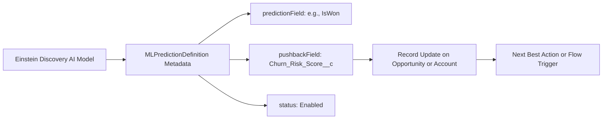

## Architectural Overview

The `MLPredictionDefinition` metadata type represents the operational configuration of an AI/ML predictive model in Salesforce Einstein (including Einstein Discovery and Einstein Prediction Builder). In modern enterprise CRM architectures, organizations use predictive intelligence to forecast deal closure likelihood, predict customer churn, estimate customer lifetime value, and score support ticket escalation risk.

`MLPredictionDefinition` binds high-level machine learning models to the core Salesforce data model. It defines the parent AI application context, the predictive problem type (`BinaryClassification`, `Regression`), operational status (`Enabled`, `Disabled`), and the target custom field (`pushbackField`) where calculated scores and top predictive factors are written back to standard or custom records.



## Directory and File Conventions

`MLPredictionDefinition` components reside in the `mlPredictionDefinitions/` folder in standard Salesforce DX source format.

| Property | Value |
| :--- | :--- |
| **Metadata Type Name** | `MLPredictionDefinition` |
| **SFDX Directory** | `force-app/main/default/mlPredictionDefinitions/` |
| **File Suffix** | `.mlPredictionDefinition-meta.xml` |
| **Naming Convention** | `<DeveloperName>.mlPredictionDefinition-meta.xml` |
| **Wildcard Support** | Supported (`*`) |

## Key Metadata Fields

The `MLPredictionDefinition` XML schema establishes the predictive parameters and destination fields:

| Field Name | Field Type | Required | Description |
| :--- | :--- | :--- | :--- |
| `developerName` | `string` | Yes | Unique system API name for the prediction definition. |
| `masterLabel` | `string` | Yes | The user-facing label identifying the prediction across Einstein Setup. |
| `aiApplicationDeveloperName` | `string` | Yes | API name of the parent AI application container. |
| `status` | `string` | Yes | Current operational status: `Enabled`, `Disabled`, or `Draft`. |
| `type` | `string` | Yes | Statistical prediction paradigm: `BinaryClassification`, `Regression`, `MulticlassClassification`, or `ScoringSpecificOutcome`. |
| `predictionField` | `string` | No | Source field representing the historical outcome or prediction target. |
| `pushbackField` | `string` | No | Custom field on the record where live prediction scores are written back. |

> [!NOTE]
> When configuring `pushbackField`, ensure that the custom field on the target entity has appropriate data type (typically `Number` or `Percent`) and write permissions for the automated scoring system user.

## Declarative XML and Package Manifest Examples

The following example shows an active prediction definition scoring opportunity win propensity:

```xml title="force-app/main/default/mlPredictionDefinitions/Opportunity_Win_Prediction.mlPredictionDefinition-meta.xml"
<?xml version="1.0" encoding="UTF-8"?>
<MLPredictionDefinition xmlns="http://soap.sforce.com/2006/04/metadata">
    <developerName>Opportunity_Win_Prediction</developerName>
    <masterLabel>Opportunity Win Propensity</masterLabel>
    <aiApplicationDeveloperName>Sales_AI_Application</aiApplicationDeveloperName>
    <status>Enabled</status>
    <type>BinaryClassification</type>
    <predictionField>IsWon</predictionField>
    <pushbackField>Win_Propensity_Score__c</pushbackField>
</MLPredictionDefinition>
```

### Package Manifest (`package.xml`)

Include `MLPredictionDefinition` in your deployment manifest:

```xml title="manifest/package.xml"
<?xml version="1.0" encoding="UTF-8"?>
<Package xmlns="http://soap.sforce.com/2006/04/metadata">
    <types>
        <members>*</members>
        <name>MLPredictionDefinition</name>
    </types>
    <version>68.0</version>
</Package>
```

## CLI Retrieval and Deployment Commands

Manage `MLPredictionDefinition` metadata using the Salesforce CLI:

```bash
# Retrieve all Prediction Definitions
sf project retrieve start --metadata MLPredictionDefinition

# Deploy a specific Prediction Definition
sf project deploy start --metadata MLPredictionDefinition:Opportunity_Win_Prediction

# Query existing prediction definitions via Tooling API
sf data query --use-tooling-api --query "SELECT Id, DeveloperName, Status, Type, PushbackField FROM MLPredictionDefinition"
```

## Architect Best Practices and Gotchas

- **Pushback Field Permissions:** Verify that the field referenced in `pushbackField` has Field-Level Security (FLS) configured to allow the Einstein automated process user to write scores without throwing execution faults.
- **Parent AI Application Existence:** `MLPredictionDefinition` requires an existing `aiApplicationDeveloperName`. Ensure the parent AI application is deployed prior to or alongside the prediction definition.
- **Model Activation:** When migrating to a production org, deploying an `Enabled` prediction activates automated scoring pipelines. Verify historical training datasets are adequate before enabling live record updates.

> [!TIP]
> Use the populated `pushbackField` as a trigger condition in record-triggered [Flows](/docs/metadata/flow-metadata-type/) to alert account executives when high-value opportunities drop below critical win probabilities.
