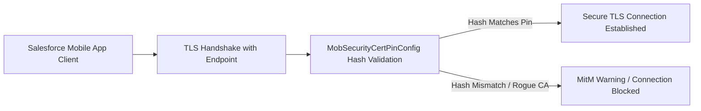

## Architectural Overview

The `MobSecurityCertPinConfig` metadata type configures SSL/TLS certificate pinning for Salesforce Mobile and Mobile Publisher applications under Enhanced Mobile Security. Under standard TLS negotiation, a mobile client trusts any certificate signed by a root Certificate Authority (CA) installed in the operating system's trust store. However, in hostile network environments (such as untrusted public Wi-Fi or compromised cellular networks), rogue CAs or fraudulent certificates could facilitate Man-in-the-Middle (MitM) eavesdropping.

Certificate pinning eliminates this attack vector. By using `MobSecurityCertPinConfig`, security architects hard-pin the cryptographic public key hash of trusted Salesforce authentication servers and custom API endpoints directly into the mobile client's runtime security policy. The mobile app strictly terminates connection attempts if the server's certificate hash fails to match the pinned configuration.



## Directory and File Conventions

`MobSecurityCertPinConfig` components are stored within their dedicated folder in the Salesforce DX project source structure.

| Property | Value |
| :--- | :--- |
| **Metadata Type Name** | `MobSecurityCertPinConfig` |
| **SFDX Directory** | `force-app/main/default/mobSecurityCertPinConfigs/` |
| **File Suffix** | `.mobSecurityCertPinConfig-meta.xml` |
| **Naming Convention** | `<PinConfigDeveloperName>.mobSecurityCertPinConfig-meta.xml` |
| **Wildcard Support** | Supported (`*`) |

## Key Metadata Fields

The `MobSecurityCertPinConfig` schema establishes the cryptographic parameters and domain boundaries for pinning:

| Field Name | Field Type | Required | Description |
| :--- | :--- | :--- | :--- |
| `domainName` | `string` | Yes | Target Fully Qualified Domain Name (FQDN) bound to the certificate pinning rule (e.g., `login.salesforce.com` or custom domain). |
| `certificateHash` | `string` | Yes | The cryptographic SHA-256 base64-encoded fingerprint/hash of the target certificate public key. |
| `isEnabled` | `boolean` | Yes | Controls whether certificate pinning is actively enforced (`true`) on mobile devices. |
| `isSubdomainIncluded` | `boolean` | No | Dictates whether pinning rules apply recursively to all subdomains under `domainName`. |
| `mobilePlatform` | `string` | Yes | Target operating system: `iOS`, `Android`, or `Both`. |
| `severityLevel` | `string` | Yes | Action taken upon pin mismatch: `Critical` (block connection), `Warn`, or `Audit`. |

> [!WARNING]
> Ensure backup pin hashes (intermediate or root CAs) are included before enabling strict pinning. If an endpoint rotates certificates without an updated pin in metadata, mobile apps will lose connectivity to Salesforce.

## Declarative XML and Package Manifest Examples

The following example configures a certificate pin rule for a corporate My Domain login endpoint:

```xml title="force-app/main/default/mobSecurityCertPinConfigs/MyDomain_Login_Pin.mobSecurityCertPinConfig-meta.xml"
<?xml version="1.0" encoding="UTF-8"?>
<MobSecurityCertPinConfig xmlns="http://soap.sforce.com/2006/04/metadata">
    <domainName>acmecorp.my.salesforce.com</domainName>
    <certificateHash>sha256/WoiWRyIOVNa9ihaBciRSC7XHjliYS9VwUGOIud4PB18=</certificateHash>
    <isEnabled>true</isEnabled>
    <isSubdomainIncluded>false</isSubdomainIncluded>
    <mobilePlatform>Both</mobilePlatform>
    <severityLevel>Critical</severityLevel>
</MobSecurityCertPinConfig>
```

### Package Manifest (`package.xml`)

Include `MobSecurityCertPinConfig` in the deployment manifest:

```xml title="manifest/package.xml"
<?xml version="1.0" encoding="UTF-8"?>
<Package xmlns="http://soap.sforce.com/2006/04/metadata">
    <types>
        <members>*</members>
        <name>MobSecurityCertPinConfig</name>
    </types>
    <version>68.0</version>
</Package>
```

## CLI Retrieval and Deployment Commands

Manage certificate pinning metadata with the Salesforce CLI:

```bash
# Retrieve all Certificate Pinning configurations
sf project retrieve start --metadata MobSecurityCertPinConfig

# Deploy a specific pinning configuration
sf project deploy start --metadata MobSecurityCertPinConfig:MyDomain_Login_Pin

# Query pinning configurations via Tooling API
sf data query --use-tooling-api --query "SELECT Id, DeveloperName, DomainName, IsEnabled, SeverityLevel FROM MobSecurityCertPinConfig"
```

## Architect Best Practices and Gotchas

- **Certificate Rotation Operations:** Establish a coordinated rotation protocol. Deploy the new certificate pin configuration to your Salesforce org well in advance of updating the public TLS certificates on your origin reverse proxy or identity provider.
- **Enhanced Mobile App Security Dependency:** Deploying `MobSecurityCertPinConfig` requires an active Enhanced Mobile App Security license in the target org.
- **Test with Warn Severity First:** When rolling out new certificate pins in staging environments, set `severityLevel` to `Warn` to verify that client mobile traffic connects cleanly before switching to `Critical` enforcement.

> [!TIP]
> Pin the Subject Public Key Information (SPKI) hash rather than the entire certificate. This allows certificates to be renewed with the same key pair without breaking existing client pin configurations.
