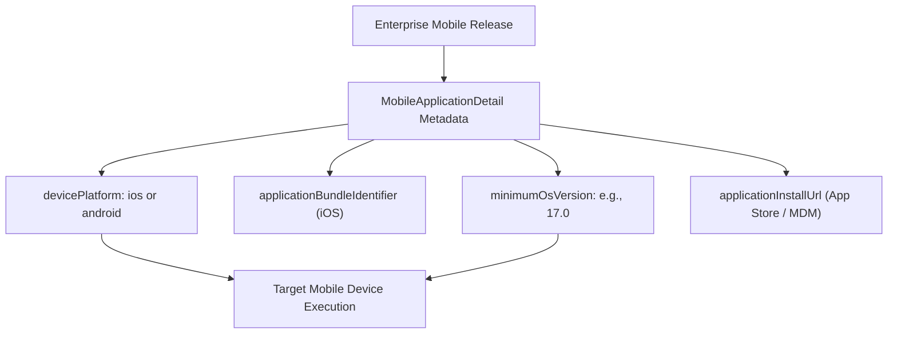

## Architectural Overview

The `MobileApplicationDetail` metadata type defines packaging, versioning, and distribution parameters for mobile connected applications in Salesforce (including Mobile Publisher apps and enterprise custom apps built with the Salesforce Mobile SDK). In enterprise mobile deployments, organizations distribute branded iOS and Android native apps with strict controls over minimum operating system requirements, application binaries, and private enterprise app store distribution channels.

Managing `MobileApplicationDetail` via the Metadata API enables mobile release engineers to automate mobile app version management. By keeping bundle identifiers, install URLs, and platform versions checked into Git, DevOps pipelines can coordinate mobile binary releases alongside backend CRM API updates, preventing legacy mobile clients from accessing incompatible backend schemas.



## Directory and File Conventions

`MobileApplicationDetail` components are stored in the `mobileApplicationDetails/` directory within your Salesforce DX repository.

| Property | Value |
| :--- | :--- |
| **Metadata Type Name** | `MobileApplicationDetail` |
| **SFDX Directory** | `force-app/main/default/mobileApplicationDetails/` |
| **File Suffix** | `.mobileApplicationDetail-meta.xml` |
| **Naming Convention** | `<AppDeveloperName>_<Platform>.mobileApplicationDetail-meta.xml` |
| **Wildcard Support** | Not Supported (Explicit member names required) |

## Key Metadata Fields

The XML schema for `MobileApplicationDetail` contains platform and binary distribution properties:

| Field Name | Field Type | Required | Description |
| :--- | :--- | :--- | :--- |
| `devicePlatform` | `string` | Yes | Target mobile platform: `ios` or `android`. |
| `version` | `string` | Yes | Semantic release version string of the mobile client app (e.g., `2.4.0`). |
| `applicationBundleIdentifier` | `string` | No | Unique Apple bundle identifier (e.g., `com.company.salesforce.fieldrep`). Specific to iOS. |
| `minimumOsVersion` | `string` | No | Minimum supported mobile OS version required to run the client application. |
| `applicationInstallUrl` | `string` | No | Direct URL for mobile installation from Apple App Store, Google Play, or enterprise MDM. |
| `privateApp` | `boolean` | No | Indicates whether the mobile app is restricted to internal corporate distribution (`true`). |
| `deviceType` | `string` | No | Supported form factors: `phone`, `tablet`, or `minitablet`. |

> [!NOTE]
> Unlike many other metadata types, `MobileApplicationDetail` does not support the asterisk (`*`) wildcard in `package.xml`. You must specify each mobile app component explicitly.

## Declarative XML and Package Manifest Examples

The following example defines an enterprise iOS mobile application detail component:

```xml title="force-app/main/default/mobileApplicationDetails/Field_Service_Rep_iOS.mobileApplicationDetail-meta.xml"
<?xml version="1.0" encoding="UTF-8"?>
<MobileApplicationDetail xmlns="http://soap.sforce.com/2006/04/metadata">
    <devicePlatform>ios</devicePlatform>
    <version>3.1.0</version>
    <applicationBundleIdentifier>com.enterprise.fieldrep</applicationBundleIdentifier>
    <minimumOsVersion>17.0</minimumOsVersion>
    <applicationInstallUrl>https://apps.apple.com/app/id123456789</applicationInstallUrl>
    <privateApp>true</privateApp>
    <deviceType>phone</deviceType>
</MobileApplicationDetail>
```

### Package Manifest (`package.xml`)

Explicitly specify the member name in `package.xml`:

```xml title="manifest/package.xml"
<?xml version="1.0" encoding="UTF-8"?>
<Package xmlns="http://soap.sforce.com/2006/04/metadata">
    <types>
        <members>Field_Service_Rep_iOS</members>
        <name>MobileApplicationDetail</name>
    </types>
    <version>68.0</version>
</Package>
```

## CLI Retrieval and Deployment Commands

Retrieve and deploy `MobileApplicationDetail` using explicit component names:

```bash
# Retrieve specific mobile application detail component
sf project retrieve start --metadata MobileApplicationDetail:Field_Service_Rep_iOS

# Deploy mobile application detail component to target environment
sf project deploy start --metadata MobileApplicationDetail:Field_Service_Rep_iOS

# Query mobile application detail via Tooling API
sf data query --use-tooling-api --query "SELECT Id, DeveloperName, DevicePlatform, Version FROM MobileApplicationDetail"
```

## Architect Best Practices and Gotchas

- **Explicit Manifest Declaration:** Because wildcards are unsupported, always declare each `MobileApplicationDetail` member explicitly in deployment manifests and CI/CD script generators.
- **Pairing with Connected Apps:** `MobileApplicationDetail` works in conjunction with a [ConnectedApp](/docs/metadata/connected-app-metadata-type/). Ensure OAuth scopes, session policies, and refresh token parameters are coordinated between the two metadata types.
- **OS Deprecation Strategy:** Raising `minimumOsVersion` prevents devices on older operating systems from running the app. Coordinate metadata updates with field communications and MDM push notifications.

> [!TIP]
> Maintain separate `MobileApplicationDetail` files for iOS and Android variants of the same application (e.g., `Field_Rep_iOS` and `Field_Rep_Android`) to accommodate platform-specific release schedules.
