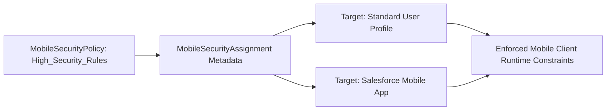

## Architectural Overview

The `MobileSecurityAssignment` metadata type represents the security binding layer in Salesforce Enhanced Mobile App Security. While individual security rules (such as biometric unlock requirements, jailbreak detection, and clipboard copy restrictions) are declared inside `MobileSecurityPolicy`, enterprises rarely enforce uniform security rules across every mobile user. Executive teams or field sales reps handling sensitive financial records often require stricter controls than internal knowledge workers.

`MobileSecurityAssignment` connects defined security policies to specific target entities—such as standard or custom [Profiles](/docs/metadata/profile-metadata-type/) or mobile [ConnectedApps](/docs/metadata/connected-app-metadata-type/). Managing these assignments as code guarantees that mobile governance boundaries are applied systematically across development, testing, and production environments.



## Directory and File Conventions

`MobileSecurityAssignment` components reside in the `mobileSecurityAssignments/` directory in standard Salesforce DX source format.

| Property | Value |
| :--- | :--- |
| **Metadata Type Name** | `MobileSecurityAssignment` |
| **SFDX Directory** | `force-app/main/default/mobileSecurityAssignments/` |
| **File Suffix** | `.mobileSecurityAssignment-meta.xml` |
| **Naming Convention** | `<AssignmentName>.mobileSecurityAssignment-meta.xml` |
| **Wildcard Support** | Supported (`*`) |

## Key Metadata Fields

The `MobileSecurityAssignment` XML structure establishes the relationship between policies and platform targets:

| Field Name | Field Type | Required | Description |
| :--- | :--- | :--- | :--- |
| `masterLabel` | `string` | Yes | The user-friendly label identifying the assignment in Setup. |
| `description` | `string` | No | Architectural description explaining the compliance rationale. |
| `mobileSecurityPolicy` | `string` | Yes | API name of the target `MobileSecurityPolicy` being assigned. |
| `targetEntity` | `string` | Yes | API name of the profile or connected app to which the policy is bound. |
| `isActive` | `boolean` | Yes | Dictates whether the assignment is actively enforced on mobile devices (`true`). |

> [!NOTE]
> Deploying `MobileSecurityAssignment` requires that the referenced `MobileSecurityPolicy` and target profile/connected app already exist in the target org or are included in the same deployment transaction.

## Declarative XML and Package Manifest Examples

The following example assigns an executive mobile security policy to the Custom Executive Profile:

```xml title="force-app/main/default/mobileSecurityAssignments/Executive_Mobile_Assignment.mobileSecurityAssignment-meta.xml"
<?xml version="1.0" encoding="UTF-8"?>
<MobileSecurityAssignment xmlns="http://soap.sforce.com/2006/04/metadata">
    <masterLabel>Executive Mobile Assignment</masterLabel>
    <description>Enforces strict biometric and screen blur policies for executive users.</description>
    <mobileSecurityPolicy>Executive_Strict_Security_Policy</mobileSecurityPolicy>
    <targetEntity>Custom_Executive_Profile</targetEntity>
    <isActive>true</isActive>
</MobileSecurityAssignment>
```

### Package Manifest (`package.xml`)

Include `MobileSecurityAssignment` in the deployment manifest:

```xml title="manifest/package.xml"
<?xml version="1.0" encoding="UTF-8"?>
<Package xmlns="http://soap.sforce.com/2006/04/metadata">
    <types>
        <members>*</members>
        <name>MobileSecurityAssignment</name>
    </types>
    <types>
        <members>*</members>
        <name>MobileSecurityPolicy</name>
    </types>
    <version>68.0</version>
</Package>
```

## CLI Retrieval and Deployment Commands

Retrieve and deploy `MobileSecurityAssignment` components using the Salesforce CLI:

```bash
# Retrieve all Mobile Security Assignments
sf project retrieve start --metadata MobileSecurityAssignment

# Deploy a specific assignment
sf project deploy start --metadata MobileSecurityAssignment:Executive_Mobile_Assignment

# Query existing assignments via Tooling API
sf data query --use-tooling-api --query "SELECT Id, DeveloperName, TargetEntity, IsActive FROM MobileSecurityAssignment"
```

## Architect Best Practices and Gotchas

- **Enhanced Mobile App Security Licensing:** The target org must have the Enhanced Mobile App Security add-on license provisioned. Deployment will fail in orgs without this capability enabled.
- **Assignment Precedence:** When a user belongs to multiple profiles or groups with conflicting assignments, the most restrictive security policy takes precedence on the client device.
- **Deployment Coupling:** Always deploy `MobileSecurityPolicy` before or alongside `MobileSecurityAssignment` to avoid dependency resolution failures during CI/CD execution.

> [!TIP]
> Pair `MobileSecurityAssignment` with automated MDM enrollment policies to enforce multi-layered defense-in-depth across corporate mobile devices.
