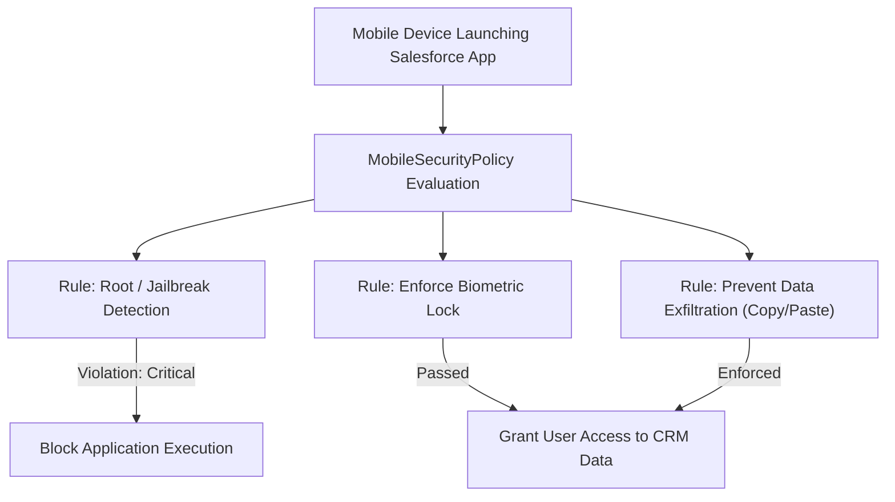

## Architectural Overview

The `MobileSecurityPolicy` metadata type defines individual device-level security policies under Salesforce Enhanced Mobile App Security. As enterprise workforces become mobile-first, securing enterprise data on corporate and BYOD (Bring Your Own Device) smartphones is paramount. Compliance standards (such as ISO 27001, SOC 2, HIPAA, and GDPR) mandate controls that mitigate data exfiltration and unauthorized access on mobile endpoints.

`MobileSecurityPolicy` establishes enforceable rules on the Salesforce Mobile app and Mobile Publisher apps. These rules detect jailbroken or rooted devices, enforce hardware biometric authentication (Face ID, Touch ID, Android Biometrics), block clipboard copying to external applications, blur the mobile screen snapshot when the app enters the background switcher, and mandate local offline data encryption. Managing policies as metadata allows security teams to audit and deploy security rules alongside application code.



## Directory and File Conventions

`MobileSecurityPolicy` files are stored in the `mobileSecurityPolicies/` folder in standard Salesforce DX source format.

| Property | Value |
| :--- | :--- |
| **Metadata Type Name** | `MobileSecurityPolicy` |
| **SFDX Directory** | `force-app/main/default/mobileSecurityPolicies/` |
| **File Suffix** | `.mobileSecurityPolicy-meta.xml` |
| **Naming Convention** | `<PolicyName>.mobileSecurityPolicy-meta.xml` |
| **Wildcard Support** | Supported (`*`) |

## Key Metadata Fields

The `MobileSecurityPolicy` XML schema outlines the policy enforcement mechanism, target platform, and action rules:

| Field Name | Field Type | Required | Description |
| :--- | :--- | :--- | :--- |
| `masterLabel` | `string` | Yes | The administrative label displayed in Enhanced Mobile App Security setup. |
| `description` | `string` | No | Architectural explanation of the policy intent and compliance scope. |
| `isEnabled` | `boolean` | Yes | Controls whether the security rule is actively enforced (`true`) or inactive. |
| `mobilePlatform` | `string` | Yes | Target operating system: `iOS` or `Android`. |
| `severityLevel` | `string` | Yes | Enforcement action upon policy violation: `Critical` (block app), `Error`, `Warn`, or `Info`. |
| `ruleValue` | `string` | No | Threshold or configuration parameter governing rule triggers (e.g., maximum background minutes before biometric re-prompt). |

> [!NOTE]
> Enhanced Mobile App Security requires an add-on license and the *Enforce Enhanced Mobile App Security* user permission assigned via a [PermissionSet](/docs/metadata/permission-set-metadata-type/).

## Declarative XML and Package Manifest Examples

The following example defines a critical jailbreak detection security policy for iOS devices:

```xml title="force-app/main/default/mobileSecurityPolicies/Block_Jailbroken_iOS.mobileSecurityPolicy-meta.xml"
<?xml version="1.0" encoding="UTF-8"?>
<MobileSecurityPolicy xmlns="http://soap.sforce.com/2006/04/metadata">
    <masterLabel>Block Jailbroken iOS Devices</masterLabel>
    <description>Immediately blocks access if the mobile operating system has been modified or jailbroken.</description>
    <isEnabled>true</isEnabled>
    <mobilePlatform>iOS</mobilePlatform>
    <severityLevel>Critical</severityLevel>
</MobileSecurityPolicy>
```

### Package Manifest (`package.xml`)

Include `MobileSecurityPolicy` in your deployment manifest:

```xml title="manifest/package.xml"
<?xml version="1.0" encoding="UTF-8"?>
<Package xmlns="http://soap.sforce.com/2006/04/metadata">
    <types>
        <members>*</members>
        <name>MobileSecurityPolicy</name>
    </types>
    <version>68.0</version>
</Package>
```

## CLI Retrieval and Deployment Commands

Use the Salesforce CLI to retrieve and deploy `MobileSecurityPolicy` components:

```bash
# Retrieve all Mobile Security Policies
sf project retrieve start --metadata MobileSecurityPolicy

# Deploy a specific policy
sf project deploy start --metadata MobileSecurityPolicy:Block_Jailbroken_iOS

# Query mobile security policies via Tooling API
sf data query --use-tooling-api --query "SELECT Id, DeveloperName, MobilePlatform, SeverityLevel, IsEnabled FROM MobileSecurityPolicy"
```

## Architect Best Practices and Gotchas

- **Severity Level Selection:** Be judicious when selecting `Critical` severity. A `Critical` policy triggers immediate app termination if a violation is detected. For non-catastrophic scenarios (such as an outdated minor OS version), consider `Warn` or `Error` to permit temporary grace periods.
- **Platform Separation:** Author distinct policies for iOS and Android when managing OS-specific behaviors (such as Android USB debugging detection or iOS jailbreak heuristics).
- **Coordinate with Assignments:** A `MobileSecurityPolicy` does not take effect until mapped to users, profiles, or apps via a `MobileSecurityAssignment`. Deploy both metadata types together in CI/CD pipelines.

> [!TIP]
> Combine biometric unlock policies (`ruleValue` configured for immediate lockout) with clipboard restrictions to prevent sensitive CRM contact information from being copied into personal mobile messaging apps.
