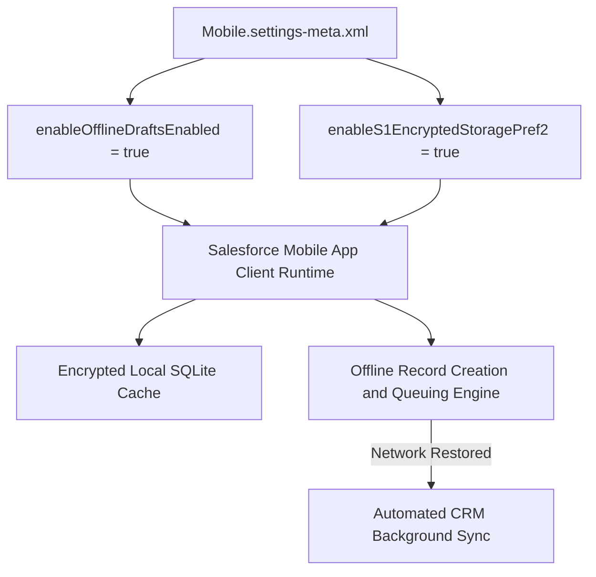

## Architectural Overview

The `MobileSettings` metadata type represents organization-wide configurations and operational preferences for the Salesforce Mobile application. In distributed enterprise operations—such as field sales, field service, and logistics—reliable mobile access in environments with intermittent or zero internet connectivity is essential to maintain business continuity.

`MobileSettings` manages core mobile caching and data persistence capabilities. It enables offline record drafting (allowing reps to create, edit, and queue updates offline), enforces client-side encrypted storage on mobile hardware, and governs whether device address books can be synchronized with Salesforce Contacts. Tracking `MobileSettings` in version control ensures parity across development sandboxes, staging environments, and production.



## Directory and File Conventions

Like other org-level settings, `MobileSettings` is grouped under the parent `Settings` metadata type in Salesforce DX project source format.

| Property | Value |
| :--- | :--- |
| **Metadata Type Name** | `Settings` (member: `Mobile`) / `MobileSettings` |
| **SFDX Directory** | `force-app/main/default/settings/` |
| **File Suffix** | `.settings-meta.xml` |
| **File Name** | `Mobile.settings-meta.xml` |
| **Scratch Org Setting Key** | `mobileSettings` |

## Key Metadata Fields

The `MobileSettings` XML schema defines parameters governing caching, offline data drafting, and client-side encryption:

| Field Name | Field Type | Required | Description |
| :--- | :--- | :--- | :--- |
| `enableOfflineDraftsEnabled` | `boolean` | No | Enables offline drafts in the mobile app, allowing users to create and edit records without network connectivity. |
| `enableS1EncryptedStoragePref2` | `boolean` | No | Enforces client-side database encryption for cached records stored locally on iOS and Android devices. |
| `enableMobileLite` | `boolean` | No | Legacy toggle for classic mobile lite access across the organization. |

> [!NOTE]
> Like all settings metadata components, `MobileSettings` does not support wildcards (`*`) in `package.xml`. Specify `Mobile` explicitly under the `Settings` type.

## Declarative XML and Package Manifest Examples

The following example shows an enterprise `Mobile.settings-meta.xml` file configured for offline resilience and local data encryption:

```xml title="force-app/main/default/settings/Mobile.settings-meta.xml"
<?xml version="1.0" encoding="UTF-8"?>
<MobileSettings xmlns="http://soap.sforce.com/2006/04/metadata">
    <enableOfflineDraftsEnabled>true</enableOfflineDraftsEnabled>
    <enableS1EncryptedStoragePref2>true</enableS1EncryptedStoragePref2>
</MobileSettings>
```

### Package Manifest (`package.xml`)

Include `Mobile` under the `Settings` type in `package.xml`:

```xml title="manifest/package.xml"
<?xml version="1.0" encoding="UTF-8"?>
<Package xmlns="http://soap.sforce.com/2006/04/metadata">
    <types>
        <members>Mobile</members>
        <name>Settings</name>
    </types>
    <version>68.0</version>
</Package>
```

## CLI Retrieval and Deployment Commands

Retrieve and deploy `MobileSettings` using the Salesforce CLI:

```bash
# Retrieve Mobile settings from target org
sf project retrieve start --metadata Settings:Mobile

# Deploy Mobile settings to target org
sf project deploy start --metadata Settings:Mobile

# Verify mobile settings via Tooling API
sf data query --use-tooling-api --query "SELECT Id, Metadata FROM MobileSettings"
```

## Architect Best Practices and Gotchas

- **Encrypted Local Storage:** Always enable `enableS1EncryptedStoragePref2` in production orgs handling sensitive customer or financial data to ensure that local cached records are protected against device-theft forensic extraction.
- **Offline Layout Dependencies:** Enabling offline drafts allows records to be edited offline, but complex custom Lightning Web Components (LWCs) or Flows on record pages must be specifically architected using the Briefcase Builder and LWC Offline runtime to work without connectivity.
- **Scratch Org Definitions:** To test offline mobile flows in scratch orgs, declare `mobileSettings` in `project-scratch-def.json`:
  ```json
  "settings": {
    "mobileSettings": {
      "enableOfflineDraftsEnabled": true,
      "enableS1EncryptedStoragePref2": true
    }
  }
  ```

> [!TIP]
> Combine `MobileSettings` with Salesforce Briefcase Builder to selectively pre-cache relevant Account, Contact, and Opportunity records onto reps' devices prior to entering low-connectivity field areas.
