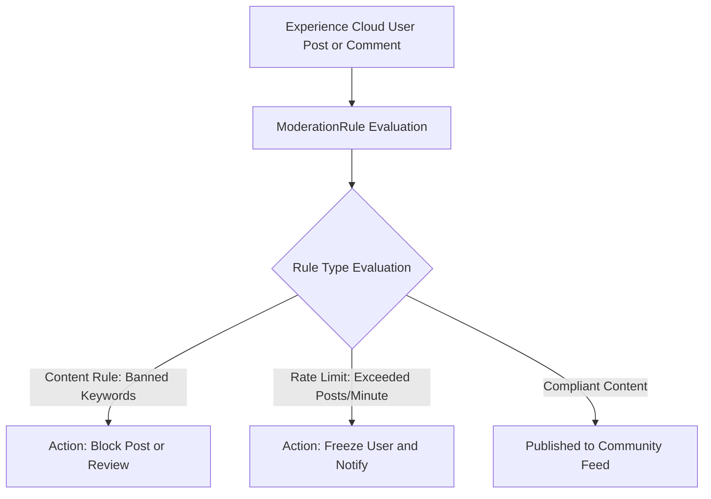

## Architectural Overview

The `ModerationRule` metadata type represents automated content and behavior moderation rules within Salesforce Experience Cloud (formerly Community Cloud). Public-facing customer and partner portals require proactive safeguards against spam bots, inappropriate language, sensitive data disclosures (such as credentials or financial numbers), and rapid denial-of-service posting attacks.

`ModerationRule` automates governance across Experience Cloud feed items, feed comments, direct messages, and uploaded files. When incoming content matches specified keyword criteria or when a user exceeds velocity rate limits, the rule automatically executes preconfigured remediation actions—such as blocking the post, holding it for community manager review, flagging it for inspection, or freezing the malicious user account. Capturing these rules in version control guarantees uniform moderation standards across digital properties.



## Directory and File Conventions

`ModerationRule` components are stored under the `moderation/` folder in Salesforce DX project source format. The file name links the target site to the rule name.

| Property | Value |
| :--- | :--- |
| **Metadata Type Name** | `ModerationRule` |
| **SFDX Directory** | `force-app/main/default/moderation/` |
| **File Suffix** | `.rule-meta.xml` |
| **Naming Pattern** | `<CommunityName>.<RuleDeveloperName>.rule-meta.xml` |
| **Wildcard Support** | Supported (`*`) |

## Key Metadata Fields

The `ModerationRule` XML schema outlines the evaluation criteria, targeted entities, and enforced actions:

| Field Name | Field Type | Required | Description |
| :--- | :--- | :--- | :--- |
| `masterLabel` | `string` | Yes | The user-friendly label displayed in Experience Workspaces. |
| `developerName` | `string` | Yes | Unique API name for the rule. |
| `action` | `string` | Yes | Remediation action: `Block`, `Flag`, `FreezeAndNotify`, or `Review`. |
| `type` | `string` | Yes | Classification of the rule: `Content` (keyword matching) or `Rate` (velocity limits). |
| `entitiesAndFields` | `ModerationRuleEntity[]` | Yes | Specifies targeted entities (`FeedItem`, `FeedComment`) and inspected fields. |
| `userCriteria` | `string` | No | Reference to `KeywordList` or specific member criteria to which the rule applies. |
| `timePeriod` | `string` | No | Time window (e.g., `Short`, `Medium`) used for `Rate` limiting calculations. |

> [!NOTE]
> `ModerationRule` components with type `Content` typically reference `KeywordList` metadata components that contain the actual lists of banned words and regex patterns.

## Declarative XML and Package Manifest Examples

The following example defines a content rule that automatically blocks prohibited phrases in community posts:

```xml title="force-app/main/default/moderation/Customer_Support_Portal.Block_Banned_Words.rule-meta.xml"
<?xml version="1.0" encoding="UTF-8"?>
<ModerationRule xmlns="http://soap.sforce.com/2006/04/metadata">
    <masterLabel>Block Banned Words</masterLabel>
    <action>Block</action>
    <type>Content</type>
    <entitiesAndFields>
        <entityName>FeedItem</entityName>
        <fieldName>Body</fieldName>
        <keywordList>Customer_Support_Portal.Prohibited_Words</keywordList>
    </entitiesAndFields>
    <entitiesAndFields>
        <entityName>FeedComment</entityName>
        <fieldName>CommentBody</fieldName>
        <keywordList>Customer_Support_Portal.Prohibited_Words</keywordList>
    </entitiesAndFields>
    <description>Automatically blocks community posts containing prohibited terms.</description>
</ModerationRule>
```

### Package Manifest (`package.xml`)

Include `ModerationRule` and companion `KeywordList` in your deployment manifest:

```xml title="manifest/package.xml"
<?xml version="1.0" encoding="UTF-8"?>
<Package xmlns="http://soap.sforce.com/2006/04/metadata">
    <types>
        <members>*</members>
        <name>ModerationRule</name>
    </types>
    <types>
        <members>*</members>
        <name>KeywordList</name>
    </types>
    <version>68.0</version>
</Package>
```

## CLI Retrieval and Deployment Commands

Retrieve and deploy `ModerationRule` metadata using the Salesforce CLI:

```bash
# Retrieve all Moderation Rules
sf project retrieve start --metadata ModerationRule

# Deploy moderation rules for a specific portal
sf project deploy start --metadata ModerationRule:Customer_Support_Portal.Block_Banned_Words

# Query existing moderation rules via Tooling API
sf data query --use-tooling-api --query "SELECT Id, DeveloperName, Action, Type FROM ModerationRule"
```

## Architect Best Practices and Gotchas

- **Site Naming Prefix:** The file name must match the target Experience Cloud site or network name prefix (e.g., `<CommunityName>.<RuleName>`). Deploying a rule with an unresolvable community name will result in deployment failures.
- **Pair with Keyword Lists:** If your moderation rule references a `KeywordList`, deploy the `KeywordList` metadata alongside or before the rule.
- **Review Queues:** When utilizing the `Review` action, ensure community moderators are assigned appropriate moderation permissions and email alerts are configured so flagged posts do not languish indefinitely.

> [!TIP]
> Implement rate-limiting rules (`type: Rate`) targeting new community members to proactively stop automated spam bots from flooding community discussion forums.
