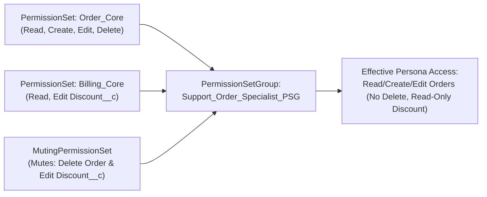

## Why the `MutingPermissionSet` Metadata Type Prevents "Permission Set Sprawl"

In a persona-based security architecture built on [PermissionSetGroup](/docs/metadata/permission-set-group-metadata-type/), you assemble reusable feature [PermissionSets](/docs/metadata/permission-set-metadata-type/) (for example, `Order_Management_Core` and `Billing_Invoicing_Core`). But what happens when an **Auditor** or **Junior Support Agent** persona needs 95% of `Order_Management_Core`, **except** the ability to `Delete` orders or edit the `Discount_Percentage__c` field?

Without **`MutingPermissionSet`** (`mutingpermissionsets/<Name>.mutingpermissionset-meta.xml`), you would have to clone and maintain duplicate Permission Sets. With `MutingPermissionSet`, you attach a single muting rule to the `PermissionSetGroup` to subtract specific permissions while keeping your core Permission Sets untouched.



---

## The Counter-Intuitive XML Rule: `<allowDelete>true</allowDelete>` Means **Muted**!

Because `MutingPermissionSet` extends `PermissionSet`, it uses the exact same XML tags (`objectPermissions`, `fieldPermissions`, `userPermissions`, `customPermissions`, `classAccesses`).

> [!WARNING]
> **Critical XML Syntax Inversion:** Inside a `.mutingpermissionset-meta.xml` file, setting a boolean tag to **`true`** means **"Mute (Disable) this permission"**, and setting it to **`false`** means **"Do NOT mute this permission."**
> For example, to mute **Delete** and **Modify All** on `Order__c` while leaving **Read**, **Create**, and **Edit** active in the Permission Set Group, you set `allowDelete` and `modifyAllRecords` to `true` and set `allowRead`, `allowCreate`, and `allowEdit` to `false`!

---

## Real-World XML Example (`mutingpermissionsets/Support_Agent_Muted.mutingpermissionset-meta.xml`)

```xml
<?xml version="1.0" encoding="UTF-8"?>
<MutingPermissionSet xmlns="http://soap.sforce.com/2006/04/metadata">
    <description>Mutes Delete access on Orders and Edit access on Margin_Percent__c for Support Agents.</description>
    <fieldPermissions>
        <editable>true</editable>
        <field>Order__c.Margin_Percent__c</field>
        <readable>false</readable>
    </fieldPermissions>
    <label>Support Agent Muted</label>
    <objectPermissions>
        <allowCreate>false</allowCreate>
        <allowDelete>true</allowDelete>
        <allowEdit>false</allowEdit>
        <allowRead>false</allowRead>
        <modifyAllRecords>true</modifyAllRecords>
        <object>Order__c</object>
        <viewAllRecords>false</viewAllRecords>
    </objectPermissions>
    <userPermissions>
        <enabled>true</enabled>
        <name>ExportReport</name>
    </userPermissions>
</MutingPermissionSet>
```

---

## Querying `MutingPermissionSet` via SOQL

In the Salesforce database, a `MutingPermissionSet` is stored in the `PermissionSet` table with `PermissionSetGroupId != null`.

### 1. List All Muting Permission Sets and Their Parent Permission Set Groups

```sql
SELECT Id, Name, Label, PermissionSetGroupId,
       PermissionSetGroup.DeveloperName, PermissionSetGroup.Status,
       LastModifiedDate
FROM PermissionSet
WHERE PermissionSetGroupId != null
ORDER BY PermissionSetGroup.DeveloperName ASC
```

### 2. Inspect Muted Object Permissions Inside a `MutingPermissionSet`

```sql
SELECT Parent.Name, Parent.PermissionSetGroup.DeveloperName,
       SobjectType, PermissionsRead, PermissionsCreate,
       PermissionsEdit, PermissionsDelete, PermissionsModifyAllRecords
FROM ObjectPermissions
WHERE Parent.PermissionSetGroupId != null
ORDER BY Parent.Name, SobjectType
```

---

## Senior Architect Best Practices

- **One `MutingPermissionSet` Per `PermissionSetGroup`:** Each `PermissionSetGroup` can reference at most one `<mutingPermissionSets>` entry. Name it consistently as `<PSG_DeveloperName>_Muted`.
- **Muting Only Affects the Specific `PermissionSetGroup`:** If a user is assigned `Order_Core` directly (or via a second `PermissionSetGroup` that does not mute `Delete`), the user still retains `Delete` permission. Muting is scoped strictly to the `PermissionSetGroup` that contains the `MutingPermissionSet`.

