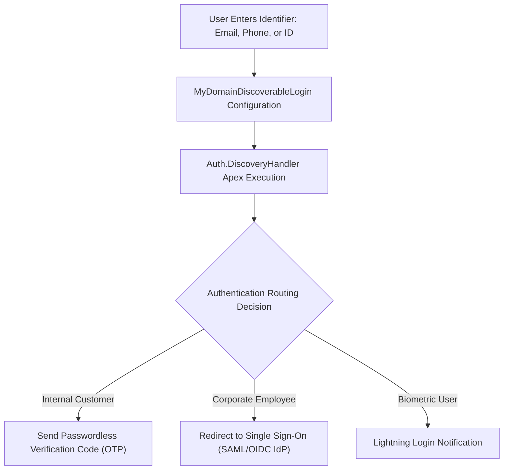

## Architectural Overview

The `MyDomainDiscoverableLogin` metadata type represents the configuration for Discoverable Login (also known as passwordless or identifier-first authentication) on a Salesforce My Domain login page. Rather than prompting users for both a username and password upfront, discoverable login presents a single input field where users enter an identifier—such as an email address, phone number, federation ID, or loyalty number.

`MyDomainDiscoverableLogin` routes the provided identifier to a custom [ApexClass](/docs/metadata/apex-class-metadata-type/) implementing the `Auth.DiscoveryHandler` interface. The Apex handler inspects the identifier, resolves the matching User record, and determines the appropriate authentication mechanism—such as sending a one-time verification passcode (OTP) via SMS/email, triggering Lightning Login, or redirecting the user to an external identity provider (IdP) via SAML or OpenID Connect. Codifying this configuration in metadata ensures seamless identity governance across sandboxes and production environments.



## Directory and File Conventions

`MyDomainDiscoverableLogin` components are organized inside the `myDomainDiscoverableLogins/` folder in Salesforce DX project source format.

| Property | Value |
| :--- | :--- |
| **Metadata Type Name** | `MyDomainDiscoverableLogin` |
| **SFDX Directory** | `force-app/main/default/myDomainDiscoverableLogins/` |
| **File Suffix** | `.myDomainDiscoverableLogin-meta.xml` |
| **Naming Convention** | `<DiscoverableLoginName>.myDomainDiscoverableLogin-meta.xml` |
| **Wildcard Support** | Supported (`*`) |

## Key Metadata Fields

The `MyDomainDiscoverableLogin` XML schema defines the Apex handler bindings and execution context:

| Field Name | Field Type | Required | Description |
| :--- | :--- | :--- | :--- |
| `developerName` | `string` | Yes | Unique API name identifying the discoverable login configuration. |
| `masterLabel` | `string` | Yes | Administrative label displayed in My Domain authentication settings. |
| `apexHandler` | `string` | Yes | The API name of the custom Apex class implementing `Auth.DiscoveryHandler`. |
| `executeAsUser` | `string` | Yes | The username of the internal Salesforce user under whose context the discovery handler executes. |
| `description` | `string` | No | Architectural description of the authentication routing logic. |

> [!NOTE]
> The user specified in `executeAsUser` must have permissions to query User records and execute the referenced Apex discovery handler class.

## Declarative XML and Package Manifest Examples

The following example shows an enterprise discoverable login configuration routing users through an Apex discovery handler:

```xml title="force-app/main/default/myDomainDiscoverableLogins/Enterprise_Discoverable_Login.myDomainDiscoverableLogin-meta.xml"
<?xml version="1.0" encoding="UTF-8"?>
<MyDomainDiscoverableLogin xmlns="http://soap.sforce.com/2006/04/metadata">
    <developerName>Enterprise_Discoverable_Login</developerName>
    <masterLabel>Enterprise Discoverable Login</masterLabel>
    <apexHandler>CustomLoginDiscoveryHandler</apexHandler>
    <executeAsUser>identity.service@enterprise.com</executeAsUser>
    <description>Passwordless discoverable login routing users to SAML SSO or email OTP.</description>
</MyDomainDiscoverableLogin>
```

### Companion Apex Discovery Handler Interface

```java title="force-app/main/default/classes/CustomLoginDiscoveryHandler.cls"
global class CustomLoginDiscoveryHandler implements Auth.DiscoveryHandler {
    global PageReference discover(String identifier, String startUrl, Map<String, String> requestAttributes) {
        List<User> users = [SELECT Id, Email, FederationIdentifier FROM User WHERE Email = :identifier LIMIT 1];
        if (!users.isEmpty() && users[0].FederationIdentifier != null) {
            // Route corporate employees to corporate SAML IdP
            return Auth.SessionManagement.finishLoginDiscovery(Auth.DiscoveryCustomLogicType.SAML, users[0].Id, null, startUrl);
        }
        // Fall back to passwordless verification code
        return Auth.SessionManagement.finishLoginDiscovery(Auth.DiscoveryCustomLogicType.EMAIL, users.isEmpty() ? null : users[0].Id, null, startUrl);
    }
}
```

### Package Manifest (`package.xml`)

Include `MyDomainDiscoverableLogin` and the Apex class in `package.xml`:

```xml title="manifest/package.xml"
<?xml version="1.0" encoding="UTF-8"?>
<Package xmlns="http://soap.sforce.com/2006/04/metadata">
    <types>
        <members>*</members>
        <name>MyDomainDiscoverableLogin</name>
    </types>
    <types>
        <members>CustomLoginDiscoveryHandler</members>
        <name>ApexClass</name>
    </types>
    <version>68.0</version>
</Package>
```

## CLI Retrieval and Deployment Commands

Manage discoverable login configurations using the Salesforce CLI:

```bash
# Retrieve all Discoverable Login configurations
sf project retrieve start --metadata MyDomainDiscoverableLogin

# Deploy a specific Discoverable Login configuration
sf project deploy start --metadata MyDomainDiscoverableLogin:Enterprise_Discoverable_Login

# Query discoverable login configurations via Tooling API
sf data query --use-tooling-api --query "SELECT Id, DeveloperName, ApexHandler, ExecuteAsUser FROM MyDomainDiscoverableLogin"
```

## Architect Best Practices and Gotchas

- **Apex Class Dependency:** Deploy the Apex class implementing `Auth.DiscoveryHandler` before or in the same transaction as `MyDomainDiscoverableLogin`. If the class is missing, deployment fails with an unresolved identifier error.
- **Execute As User Security:** Ensure the user account configured in `executeAsUser` is a dedicated integration service user with a strong password, multi-factor authentication (MFA) exemption for API execution, and least-privilege permissions.
- **Handling Ambiguous Identifiers:** If multiple active users share the same email address, the discovery handler must incorporate secondary disambiguation (such as asking for username or tenant domain) to avoid authentication deadlocks.

> [!TIP]
> Test discoverable login flows thoroughly across all user personas (SAML SSO users, external community members, and password-authenticated administrators) before binding it to your primary My Domain login page.
