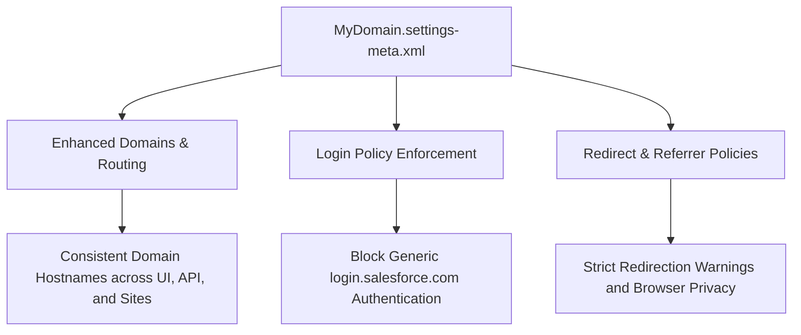

## Architectural Overview

`MyDomainSettings` controls the identity, branding, and network routing perimeter of a Salesforce tenant. It defines your organization-specific subdomain, enforces login endpoint policies, dictates redirection behaviors, and enables critical platform networking features such as Enhanced Domains and Salesforce Edge Network.

From a Technical Architect perspective, `MyDomainSettings` sits at the nexus of Single Sign-On (SSO), Experience Cloud, API integrations, and browser security. Changes to this metadata type directly influence authentication flows for Connected Apps, cross-origin resource sharing (CORS), and trust boundaries between sandbox and production instances.



## Directory and File Conventions

In SFDX source format, `MyDomainSettings` is a singleton settings type placed in the `settings/` directory and retrieved using the `Settings:MyDomain` moniker.

| Property | Value |
| :--- | :--- |
| **Metadata Type Name** | `Settings` (member: `MyDomain`) / `MyDomainSettings` |
| **SFDX Folder** | `force-app/main/default/settings/` |
| **File Name** | `MyDomain.settings-meta.xml` |
| **Scratch Org Setting Key** | `myDomainSettings` |

## Key Metadata Fields

The XML schema for `MyDomainSettings` exposes high-impact networking and security flags:

| Field Name | Field Type | Required | Architectural Description |
| :--- | :--- | :--- | :--- |
| `canOnlyLoginWithMyDomainUrl` | `boolean` | No | When `true`, prevents standard users from logging in via generic `login.salesforce.com` or `test.salesforce.com`. |
| `myDomainName` | `string` | No | The custom subdomain name assigned to the Salesforce instance. |
| `doesHideBrowserReferrer` | `boolean` | No | Suppresses HTTP referrer headers when users click links pointing to external sites. |
| `doesWarnOnExternalRedirect` | `boolean` | No | Presents an interstitial warning dialog when a link or redirect navigates outside your trusted domains. |
| `useEdge` | `boolean` | No | Routes web traffic through Salesforce Edge Network for optimized latency and global CDN caching. |
| `useEnhancedDomains` | `boolean` | No | Standardizes URL formats across Experience Cloud, Visualforce, and content delivery services to meet modern browser cookie standards. |

> [!NOTE]
> Setting `canOnlyLoginWithMyDomainUrl` to `true` hardens the org against credential stuffing and phishing, but requires all SSO identity provider (IdP) metadata and external API clients to target the tenant-specific endpoint.

## Declarative XML and Package Manifest Examples

Below is a production-grade configuration enforcing zero-trust login boundaries and privacy headers:

```xml title="force-app/main/default/settings/MyDomain.settings-meta.xml"
<?xml version="1.0" encoding="UTF-8"?>
<MyDomainSettings xmlns="http://soap.sforce.com/2006/04/metadata">
    <canOnlyLoginWithMyDomainUrl>true</canOnlyLoginWithMyDomainUrl>
    <doesHideBrowserReferrer>true</doesHideBrowserReferrer>
    <doesWarnOnExternalRedirect>true</doesWarnOnExternalRedirect>
    <useEdge>true</useEdge>
    <useEnhancedDomains>true</useEnhancedDomains>
</MyDomainSettings>
```

### Scratch Org Configuration (`config/project-scratch-def.json`)

```json title="config/project-scratch-def.json"
{
  "orgName": "Enterprise Identity Scratch Org",
  "edition": "Enterprise",
  "settings": {
    "myDomainSettings": {
      "canOnlyLoginWithMyDomainUrl": false,
      "doesHideBrowserReferrer": true,
      "doesWarnOnExternalRedirect": true,
      "useEdge": true
    }
  }
}
```

### Package Manifest (`package.xml`)

```xml title="manifest/package.xml"
<?xml version="1.0" encoding="UTF-8"?>
<Package xmlns="http://soap.sforce.com/2006/04/metadata">
    <types>
        <members>MyDomain</members>
        <name>Settings</name>
    </types>
    <version>68.0</version>
</Package>
```

## CLI Retrieval and Deployment Commands

Manage `MyDomainSettings` using standard Salesforce CLI commands:

```bash
# Retrieve MyDomain settings from the authorized org
sf project retrieve start --metadata Settings:MyDomain

# Deploy MyDomain settings to target environment
sf project deploy start --metadata Settings:MyDomain
```

## Architect Best Practices and Gotchas

- **CI/CD Authentication Lockouts:** Avoid deploying `canOnlyLoginWithMyDomainUrl: true` into scratch orgs or sandboxes if automated pipeline credentials use generic login URLs. Always ensure JWT bearer flows target the exact `instanceUrl` matching your configured My Domain.
- **Enhanced Domain Cutover:** Renaming a My Domain or toggling Enhanced Domains triggers URL shifts across Visualforce, Experience Cloud sites, and Content Builder URLs. Verify integrations and third-party firewalls prior to deployment.
- **Redirection Rules:** Plan redirection deprecation rules when migrating legacy domain prefixes. Use the Salesforce event log files (`LoginHistory` and `UriEventStream`) to detect traffic hitting obsolete hostnames before disabling redirects.

> [!WARNING]
> Enforcing `canOnlyLoginWithMyDomainUrl` in production without verifying your SSO Identity Provider (IdP) ACS URLs can lock all federated users out of the organization simultaneously.
