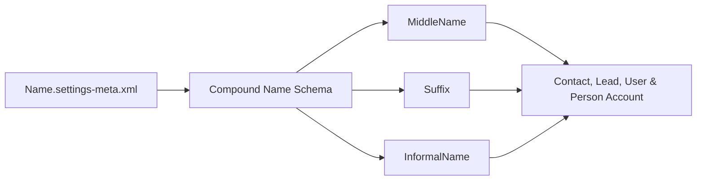

## Architectural Overview

`NameSettings` is an org-level metadata type that controls the constituent subfields of compound name fields across Salesforce. By default, core entities represent a person's name via `Salutation`, `FirstName`, and `LastName`. Deploying `NameSettings` expands the standard name schema to support `MiddleName`, `Suffix`, and `InformalName` across `Contact`, `Lead`, `User`, `PersonAccount`, and related person-centric tables.

From an enterprise data architecture perspective, enabling these fields aligns Salesforce data models with international naming conventions, KYC compliance mandates, and downstream identity federation systems.



## Directory and File Conventions

`NameSettings` files reside in the `settings/` directory and are identified by the `Name` member name.

| Property | Value |
| :--- | :--- |
| **Metadata Type Name** | `Settings` (member: `Name`) / `NameSettings` |
| **SFDX Folder** | `force-app/main/default/settings/` |
| **File Name** | `Name.settings-meta.xml` |
| **Scratch Org Setting Key** | `nameSettings` |

## Key Metadata Fields

The configuration fields exposed by `NameSettings` are:

| Field Name | Field Type | Required | Architectural Description |
| :--- | :--- | :--- | :--- |
| `enableInformalName` | `boolean` | No | Enables the `InformalName` field (nickname) on standard person entities and includes it in search indexing. |
| `enableMiddleName` | `boolean` | No | Exposes the `MiddleName` field on Contact, Lead, User, and Person Account compound names. |
| `enableNameSuffix` | `boolean` | No | Exposes the `Suffix` field (e.g., Jr., III, Ph.D.) on standard person entities. |

> [!NOTE]
> Once enabled, `MiddleName` and `Suffix` become queryable in SOQL as standalone fields (`SELECT FirstName, MiddleName, LastName, Suffix FROM Contact`) while remaining aggregated inside the compound `Name` field.

## Declarative XML and Package Manifest Examples

A standard production `Name.settings-meta.xml` manifest enabling full compound name capabilities:

```xml title="force-app/main/default/settings/Name.settings-meta.xml"
<?xml version="1.0" encoding="UTF-8"?>
<NameSettings xmlns="http://soap.sforce.com/2006/04/metadata">
    <enableInformalName>true</enableInformalName>
    <enableMiddleName>true</enableMiddleName>
    <enableNameSuffix>true</enableNameSuffix>
</NameSettings>
```

### Scratch Org Configuration (`config/project-scratch-def.json`)

To replicate compound name fields in scratch orgs, add `nameSettings` to the definitions:

```json title="config/project-scratch-def.json"
{
  "orgName": "Global Identity Scratch Org",
  "edition": "Enterprise",
  "settings": {
    "nameSettings": {
      "enableMiddleName": true,
      "enableNameSuffix": true,
      "enableInformalName": true
    }
  }
}
```

### Package Manifest (`package.xml`)

```xml title="manifest/package.xml"
<?xml version="1.0" encoding="UTF-8"?>
<Package xmlns="http://soap.sforce.com/2006/04/metadata">
    <types>
        <members>Name</members>
        <name>Settings</name>
    </types>
    <version>68.0</version>
</Package>
```

## CLI Retrieval and Deployment Commands

Retrieve and deploy `NameSettings` using the Salesforce CLI:

```bash
# Retrieve Name settings from the org
sf project retrieve start --metadata Settings:Name

# Deploy Name settings to the target org
sf project deploy start --metadata Settings:Name
```

## Architect Best Practices and Gotchas

- **Dependency Ordering in CI/CD:** Any page layouts, FlexiPages, validation rules, or Apex classes referencing `MiddleName` or `Suffix` will fail deployment if `NameSettings` is not deployed first. Include `Name.settings-meta.xml` in base infrastructure deployments.
- **Data Integration Payloads:** Upstream CRM or ERP integrations that map single string names to `FirstName` and `LastName` may split or truncate names unpredictably once `MiddleName` is active. Audit inbound REST/SOAP schemas before enabling.
- **Reporting and Formulas:** Formulas referencing `Name` automatically concatenate active name elements (`Salutation`, `FirstName`, `MiddleName`, `LastName`, `Suffix`). Verify that customer communication templates do not inadvertently duplicate suffixes or middle names.

> [!WARNING]
> Disabling `enableMiddleName` or `enableNameSuffix` in an environment where records contain data hides those subfields from layouts and standard SOQL, potentially severing downstream sync pipelines.
