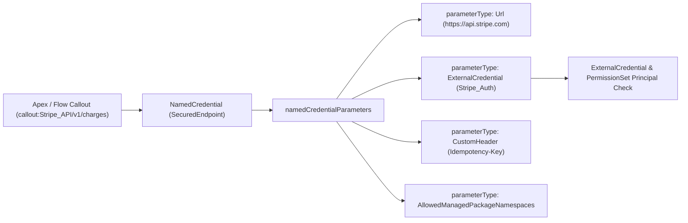

## Overview

The `NamedCredential` metadata type (`namedCredentials/<Name>.namedCredential-meta.xml`) defines the URL endpoint, callout options, custom HTTP headers, and authentication binding for outbound Apex `HttpRequest`, External Services, and Flow HTTP Callouts. When your code invokes `req.setEndpoint('callout:Stripe_Gateway/v1/charges')`, Salesforce resolves the `Stripe_Gateway` `NamedCredential` metadata, verifies the running user's permission set access, signs or injects the authentication header, and dispatches the callout.

Since API version `56.0`, Salesforce's `NamedCredential` schema supports two architectures:
- **Modern Extensible (`<namedCredentialType>SecuredEndpoint</namedCredentialType>`):** Stores the endpoint URL, linked [ExternalCredential](/docs/metadata/external-credential-metadata-type/), allowed managed package namespaces, and custom HTTP headers inside a flexible `<namedCredentialParameters>` array. **Always use `SecuredEndpoint` for new integrations.**
- **Legacy (`<namedCredentialType>Legacy</namedCredentialType>`):** Uses top-level `<endpoint>`, `<protocol>`, and `<principalType>` tags. Retained only for backward compatibility.



As shown in the diagram above, a modern `SecuredEndpoint` `NamedCredential` delegates all endpoint and header settings to typed `<namedCredentialParameters>` items and links directly to an `ExternalCredential`.

## Prerequisites

- **Permissions:** "Customize Application" and "View Setup and Configuration" permissions.
- **External Credential Dependency:** The [ExternalCredential](/docs/metadata/external-credential-metadata-type/) referenced in `namedCredentialParameters` must exist in the target org or be deployed in the same manifest.
- **API Version:** Introduced in API version 33.0; extensible `SecuredEndpoint` introduced in API version 56.0. Verified against API version `68.0` (Winter '27).

## Modern `NamedCredentialParameter` Types (API v56.0+)

When `<namedCredentialType>SecuredEndpoint</namedCredentialType>` is set, configure the credential using `<namedCredentialParameters>` entries:

| `parameterType` | Required Fields | Purpose & Example |
| :--- | :--- | :--- |
| `Url` | `parameterName` (`Url`), `parameterValue` | Base root URL of the external endpoint (`https://api.stripe.com`). |
| `ExternalCredential` | `parameterName` (`ExternalCredential`), `externalCredential` | API name of the linked [ExternalCredential](/docs/metadata/external-credential-metadata-type/) (`Stripe_Auth`). |
| `CustomHeader` | `parameterName` (Header Name), `parameterValue` (Formula), `sequenceNumber` | Injects custom HTTP headers evaluated at runtime (e.g., `'SF-' & $Organization.Id`). |
| `AllowedManagedPackageNamespaces` | `parameterName`, `parameterValue` | Comma-separated list of managed package namespaces permitted to make callouts through this Named Credential. |
| `OutboundNetworkConnection` | `parameterName`, `outboundNetworkConnection` | Used when `namedCredentialType` is `PrivateEndpoint` for AWS PrivateLink routing. |
| `ClientCertificate` | `parameterName`, `certificate` | Mutual TLS (mTLS) client certificate name from Certificate and Key Management. |

> [!TIP]
> Use the `<calloutStatus>` element (`Enabled` or `Disabled`, introduced in API version `59.0`) in your post-sandbox-refresh CLI script to immediately disable production endpoints in newly refreshed sandboxes before testing begins.

## Querying NamedCredential via SOQL

The `NamedCredential` object is available in **standard SOQL** and **Tooling API**.

### 1. Audit All Named Credentials in the Org (Standard SOQL)
```soql
SELECT Id, DeveloperName, MasterLabel, Endpoint,
       PrincipalType, CalloutOptionsGenerateAuthorizationHeader,
       CalloutOptionsAllowMergeFieldsInHeader, LastModifiedDate
FROM NamedCredential
ORDER BY DeveloperName ASC
```

### 2. Inspect Extensible `NamedCredentialParameter` Configurations (Tooling API)
Run with `sf data query --use-tooling-api` to inspect URLs, linked External Credentials, and custom headers on modern `SecuredEndpoint` credentials:

```soql
SELECT NamedCredential.DeveloperName, ParameterName, ParameterType,
       ParameterValue, ExternalCredential.DeveloperName, Certificate.DeveloperName
FROM NamedCredentialParameter
ORDER BY NamedCredential.DeveloperName ASC, SequenceNumber ASC
```

## Example

The following `Stripe_Payment_Gateway.namedCredential-meta.xml` defines a modern `SecuredEndpoint` Named Credential with `calloutStatus` enabled, linked to the `Stripe_Auth` External Credential, a mutual TLS client certificate, and a runtime custom header that passes the Salesforce Organization ID.

```xml title="force-app/main/default/namedCredentials/Stripe_Payment_Gateway.namedCredential-meta.xml"
<?xml version="1.0" encoding="UTF-8"?>
<NamedCredential xmlns="http://soap.sforce.com/2006/04/metadata">
    <allowMergeFieldsInBody>false</allowMergeFieldsInBody>
    <allowMergeFieldsInHeader>false</allowMergeFieldsInHeader>
    <calloutStatus>Enabled</calloutStatus>
    <description>Production Stripe API v1 endpoint with mTLS and Org ID tracing header.</description>
    <generateAuthorizationHeader>true</generateAuthorizationHeader>
    <label>Stripe Payment Gateway</label>
    <namedCredentialParameters>
        <parameterName>Url</parameterName>
        <parameterType>Url</parameterType>
        <parameterValue>https://api.stripe.com</parameterValue>
    </namedCredentialParameters>
    <namedCredentialParameters>
        <externalCredential>Stripe_Auth</externalCredential>
        <parameterName>ExternalCredential</parameterName>
        <parameterType>ExternalCredential</parameterType>
    </namedCredentialParameters>
    <namedCredentialParameters>
        <parameterName>X-Salesforce-Org-Id</parameterName>
        <parameterType>CustomHeader</parameterType>
        <parameterValue>&apos;OrgId=&apos; &amp; $Organization.Id</parameterValue>
        <sequenceNumber>1</sequenceNumber>
    </namedCredentialParameters>
    <namedCredentialType>SecuredEndpoint</namedCredentialType>
</NamedCredential>
```

Deploy the `NamedCredential` and its companion `ExternalCredential` together:

```bash
sf project deploy start \
  --metadata ExternalCredential:Stripe_Auth NamedCredential:Stripe_Payment_Gateway \
  --target-org UATSandbox
```

## Limits and Gotchas

- **Never Mix Legacy and `SecuredEndpoint` Tags:** Including legacy tags (`<endpoint>`, `<principalType>`, `<protocol>`) alongside `<namedCredentialType>SecuredEndpoint</namedCredentialType>` causes a Metadata API deployment validation error.
- **No Remote Site Setting Required:** Endpoints defined in a `NamedCredential` automatically bypass `RemoteSiteSetting` checks; you do not need to deploy a duplicate `RemoteSiteSetting` for the same domain.
- **URL Path Preservation:** Do not include a trailing slash (`/`) at the end of the `Url` `parameterValue` (`https://api.stripe.com`) if your Apex callout path begins with a leading slash (`callout:Stripe_Payment_Gateway/v1/charges`), or the resolved URL will contain a double slash (`//v1/charges`).

## Related Official Documentation

- [NamedCredential Metadata API Reference](https://developer.salesforce.com/docs/atlas.en-us.api_meta.meta/api_meta/meta_namedcredential.htm): Complete XML specification for `NamedCredential` and `NamedCredentialParameter`.
- [Named Credentials and Secure Callout Architecture](/docs/integration/named-credentials-callouts/): End-to-end Apex callout implementation guide.

