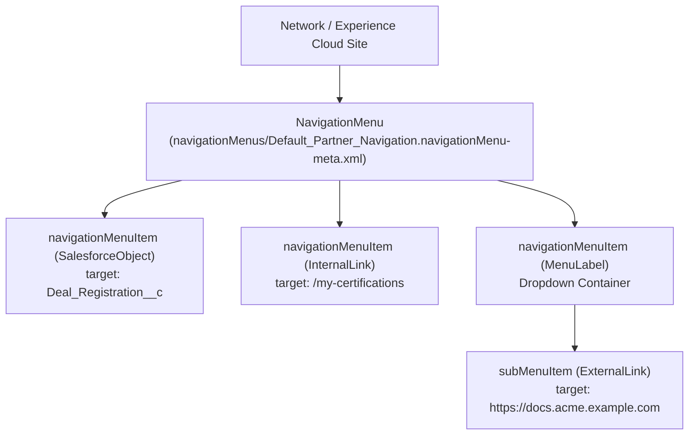

## Why the `NavigationMenu` Metadata Type Matters

In Experience Cloud sites (Aura and LWR), navigation bars, tile menus, and footer links are powered by **`NavigationMenu`** (`navigationMenus/<MenuName>.navigationMenu-meta.xml`). Prior to API version 47.0, navigation menus were embedded inside the monolithic [Network](/docs/metadata/network-metadata-type/) metadata file as `navigationLinkSet`. Extracting `NavigationMenu` into a standalone metadata type allows developers to version and deploy site navigation changes independently of member security settings.



---

## Key Metadata Fields on `NavigationMenu` & `NavigationMenuItem`

| Field | Type | Required | Description |
|---|---|---|---|
| `network` | `string` | Yes | Developer name of the parent Experience Cloud [Network](/docs/metadata/network-metadata-type/). |
| `container` | `string` | Yes | Name of the site container. |
| `containerType` | `string` | Yes | Typically `Network`. |
| `label` | `string` | Yes | Display name of the Navigation Menu in Experience Builder. |
| `navigationMenuItem.label` | `string` | Yes | User-facing text of the menu link. |
| `navigationMenuItem.position` | `int` | Yes | 1-based sort order of the menu item in the navigation bar. |
| `navigationMenuItem.type` | `string` | Yes | `SalesforceObject`, `InternalLink`, `ExternalLink`, `MenuLabel`, `GlobalAction`, `NavigationalTopic`, `SystemLink`, `Event`, or `Modal`. |
| `navigationMenuItem.target` | `string` | Conditional | Object API name (`Account`), relative path (`/support-cases`), or external URL (`https://...`). Omit when `type` is `MenuLabel`. |
| `navigationMenuItem.targetPreference` | `string` | No | `None`, `OpenInExternalTab` (opens external link in a new browser tab), or `OpenExternalLinkInSameTab`. |
| `navigationMenuItem.publiclyAvailable` | `boolean` | No | When `true`, guest (unauthenticated) users can see this menu item. |
| `navigationMenuItem.subMenu` | `NavigationSubMenu` | No | Nested child `navigationMenuItem` entries under a `MenuLabel` header. |

---

## Real-World XML Example (`navigationMenus/Partner_Header_Menu.navigationMenu-meta.xml`)

```xml
<?xml version="1.0" encoding="UTF-8"?>
<NavigationMenu xmlns="http://soap.sforce.com/2006/04/metadata">
    <container>Partner Portal</container>
    <containerType>Network</containerType>
    <label>Partner Header Menu</label>
    <navigationMenuItem>
        <defaultListViewId>All_Open_Deals</defaultListViewId>
        <label>Deal Registrations</label>
        <position>1</position>
        <publiclyAvailable>false</publiclyAvailable>
        <target>Deal_Registration__c</target>
        <type>SalesforceObject</type>
    </navigationMenuItem>
    <navigationMenuItem>
        <label>Resources</label>
        <position>2</position>
        <publiclyAvailable>true</publiclyAvailable>
        <subMenu>
            <navigationMenuItem>
                <label>Price Books</label>
                <position>0</position>
                <publiclyAvailable>false</publiclyAvailable>
                <target>/price-books</target>
                <type>InternalLink</type>
            </navigationMenuItem>
            <navigationMenuItem>
                <label>Developer API Portal</label>
                <position>1</position>
                <publiclyAvailable>true</publiclyAvailable>
                <target>https://api.acme.example.com</target>
                <targetPreference>OpenInExternalTab</targetPreference>
                <type>ExternalLink</type>
            </navigationMenuItem>
        </subMenu>
        <type>MenuLabel</type>
    </navigationMenuItem>
</NavigationMenu>
```

---

## Querying `NavigationLinkSet` and `NavigationMenuItem` via SOQL

In SOQL, a `NavigationMenu` is stored in the `NavigationLinkSet` object, and its individual links are stored in `NavigationMenuItem`.

### 1. List All Experience Cloud Navigation Menus

```sql
SELECT Id, DeveloperName, MasterLabel, NetworkId, Network.Name
FROM NavigationLinkSet
ORDER BY Network.Name, MasterLabel
```

### 2. Inspect Live vs. Draft Navigation Menu Items

```sql
SELECT Id, Label, Type, Target, Position, Status,
       AccessRestriction, NavigationLinkSet.DeveloperName
FROM NavigationMenuItem
WHERE Status = 'Live'
ORDER BY NavigationLinkSet.DeveloperName, Position ASC
```

> [!TIP]
> **Why `NavigationMenuItem` Shows Duplicate Rows in SOQL:** Experience Builder maintains both a `Draft` and a `Live` row for every menu item in `NavigationMenuItem`. Always filter by `Status = 'Live'` when querying active portal links in Apex or SOQL!
