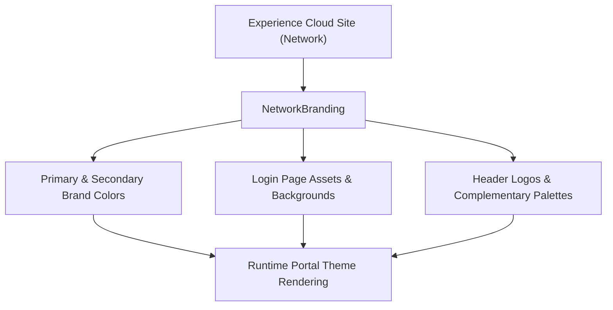

## Architectural Overview

`NetworkBranding` defines the aesthetic and visual presentation layer for Salesforce Experience Cloud sites (formerly Community Cloud). It encapsulates color tokens, login backgrounds, brand logos, and color palettes that skin the authentication screens and portal interfaces.

From a solution architecture perspective, `NetworkBranding` decouples styling assets from portal business logic. By managing visual branding as declarative metadata, organizations can ensure that customer and partner digital experiences reflect corporate design system guidelines across sandboxes, staging environments, and production.



## Directory and File Conventions

`NetworkBranding` records reside in the `networkBranding/` folder in modern SFDX source format.

| Property | Value |
| :--- | :--- |
| **Metadata Type Name** | `NetworkBranding` |
| **SFDX Folder** | `force-app/main/default/networkBranding/` |
| **File Suffix** | `.networkBranding-meta.xml` |
| **Parent Entity** | `Network` |

## Key Metadata Fields

The `NetworkBranding` metadata schema contains hex color tokens and asset references:

| Field Name | Field Type | Required | Architectural Description |
| :--- | :--- | :--- | :--- |
| `networkLogo` | `string` | No | Path or static resource reference to the primary logo displayed in site navigation headers. |
| `loginLogo` | `string` | No | Path or asset reference for the logo displayed on login and password reset pages. |
| `loginBackgroundColor` | `string` | No | Hex code (e.g., `#FFFFFF`) for the login page background. |
| `primaryColor` | `string` | No | Hex code for the primary brand color applied to action buttons and primary UI elements. |
| `secondaryColor` | `string` | No | Hex code for secondary UI highlights and accented components. |
| `tertiaryColor` | `string` | No | Hex code utilized for neutral backgrounds and subtle card borders. |
| `quaternaryColor` | `string` | No | Hex code applied to body text or dark contrast interface boundaries. |

> [!NOTE]
> Asset references in `networkLogo` and `loginLogo` often link to static resources, Content Documents, or Asset Files that must be deployed alongside or prior to the branding file.

## Declarative XML and Package Manifest Examples

Below is an example of an enterprise customer portal branding definition:

```xml title="force-app/main/default/networkBranding/Customer_Portal.networkBranding-meta.xml"
<?xml version="1.0" encoding="UTF-8"?>
<NetworkBranding xmlns="http://soap.sforce.com/2006/04/metadata">
    <loginBackgroundColor>#F4F6F9</loginBackgroundColor>
    <loginLogo>portal_assets/login_logo.png</loginLogo>
    <networkLogo>portal_assets/header_logo.png</networkLogo>
    <primaryColor>#004488</primaryColor>
    <primaryComplementColor>#FFFFFF</primaryComplementColor>
    <quaternaryColor>#181818</quaternaryColor>
    <quaternaryComplementColor>#F3F3F3</quaternaryComplementColor>
    <secondaryColor>#2E7D32</secondaryColor>
    <tertiaryColor>#E0E0E0</tertiaryColor>
    <tertiaryComplementColor>#333333</tertiaryComplementColor>
    <zerothColor>#002B5C</zerothColor>
    <zerothComplementColor>#FFFFFF</zerothComplementColor>
</NetworkBranding>
```

### Package Manifest (`package.xml`)

```xml title="manifest/package.xml"
<?xml version="1.0" encoding="UTF-8"?>
<Package xmlns="http://soap.sforce.com/2006/04/metadata">
    <types>
        <members>Customer_Portal</members>
        <name>NetworkBranding</name>
    </types>
    <types>
        <members>Customer_Portal</members>
        <name>Network</name>
    </types>
    <version>68.0</version>
</Package>
```

## CLI Retrieval and Deployment Commands

Retrieve and deploy `NetworkBranding` alongside your Experience Cloud components:

```bash
# Retrieve branding for a specific portal
sf project retrieve start --metadata NetworkBranding:Customer_Portal

# Deploy branding with its related site network
sf project deploy start --metadata NetworkBranding:Customer_Portal --metadata Network:Customer_Portal
```

## Architect Best Practices and Gotchas

- **Asset Dependencies:** If `networkLogo` or `loginLogo` points to a static resource, ensure the static resource is present in the deployment payload. Missing asset dependencies cause deployment validation failures.
- **Site Activation Synchronization:** Deploying branding updates to an active site takes effect immediately for end users. Test theme updates in a staging sandbox with representative user roles before migrating to production.
- **Contrast and Accessibility (WCAG 2.1):** Validate that `primaryColor` and `primaryComplementColor` satisfy WCAG AA 4.5:1 contrast ratios. Automated pipelines can audit these hex values to avoid compliance regressions.

> [!TIP]
> Group `Network`, `NetworkBranding`, `CustomSite`, and `ExperienceBundle` into cohesive deployment suites to avoid partial visual configurations during CI/CD releases.
