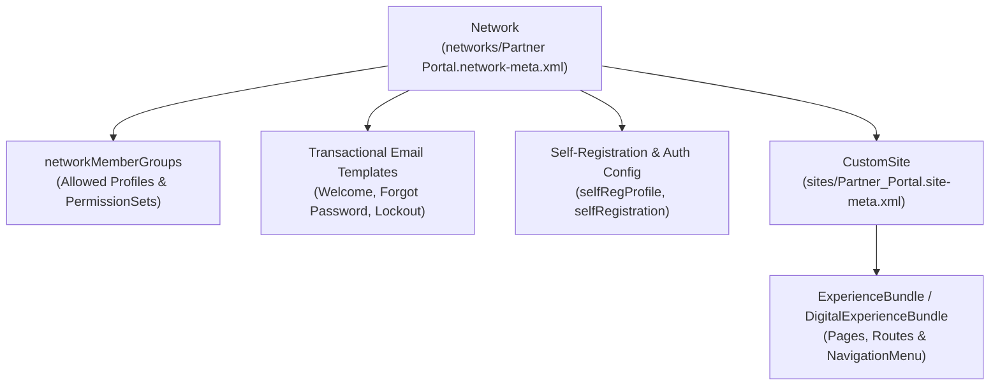

## Why the `Network` Metadata Type Is the Security Backbone of Experience Cloud

Every Experience Cloud site in Salesforce is powered by three interconnected metadata types:
1. **[`CustomSite`](/docs/metadata/custom-site-metadata-type/):** Defines the low-level URL path prefix, Guest User Profile, and HTTP domain routing.
2. **[`ExperienceBundle`](/docs/metadata/experience-bundle-metadata-type/) / [`DigitalExperienceBundle`](/docs/metadata/digital-experience-bundle-metadata-type/):** Stores the Experience Builder pages, components, and branding.
3. **`Network` (`networks/<SiteName>.network-meta.xml`):** Controls **Workspaces Administration**—who can log into the portal (`networkMemberGroups`), self-registration rules, password reset emails, Chatter/Topic settings, and whether the site is `Live`, `DownForMaintenance`, or `UnderConstruction`.



---

## Key Metadata Fields on `Network`

| Field | Type | Description |
|---|---|---|
| `status` | `NetworkStatus` | `Live`, `UnderConstruction`, or `DownForMaintenance`. |
| `picassoSite` | `string` | Links the `Network` to its corresponding `CustomSite` (`Partner_Portal1`). |
| `networkMemberGroups` | `NetworkMemberGroup` | Lists `<profile>` and `<permissionSet>` entries that grant login access to the Experience Cloud site. |
| `sendWelcomeEmail` | `boolean` | Controls whether new site members automatically receive the welcome email when granted a member profile/permission set! |
| `welcomeTemplate` | `string` | Developer name of the [EmailTemplate](/docs/metadata/email-template-metadata-type/) sent to new members. |
| `forgotPasswordTemplate` | `string` | Email template used for password reset requests. |
| `selfRegistration` | `boolean` | Enables external users to self-register on the site. |
| `selfRegProfile` | `string` | Default profile assigned to self-registering external users. |
| `navigationLinkSet` | `NavigationLinkSet` | Legacy inline navigation menu items (replaced by standalone [NavigationMenu](/docs/metadata/navigation-menu-metadata-type/) in API v47.0+). |
| `disablePvtPagesForPwdResetInLWR` | `boolean` | *(API v67.0+)* Prevents users with an expired/temporary password from bypassing password reset to access private pages in LWR sites. |
| `emailDomainSubstitutionEnabled` | `boolean` | *(API v68.0+)* Substitutes the email sender domain with the Experience Cloud site domain to improve DMARC compliance. |

---

## Real-World XML Example (`networks/Partner Portal.network-meta.xml`)

```xml
<?xml version="1.0" encoding="UTF-8"?>
<Network xmlns="http://soap.sforce.com/2006/04/metadata">
    <allowInternalUserLogin>true</allowInternalUserLogin>
    <allowMembersToFlag>false</allowMembersToFlag>
    <changePasswordTemplate>unfiled$public/CommunityChangePasswordEmailTemplate</changePasswordTemplate>
    <disablePvtPagesForPwdResetInLWR>true</disablePvtPagesForPwdResetInLWR>
    <emailDomainSubstitutionEnabled>true</emailDomainSubstitutionEnabled>
    <emailSenderAddress>support@acme-partners.example.com</emailSenderAddress>
    <emailSenderName>Acme Partner Support</emailSenderName>
    <enableCustomVFErrorPageOverrides>false</enableCustomVFErrorPageOverrides>
    <enableGuestChatter>false</enableGuestChatter>
    <enableTalkingAboutStats>false</enableTalkingAboutStats>
    <enableTopicAssignmentRules>true</enableTopicAssignmentRules>
    <forgotPasswordTemplate>unfiled$public/CommunityForgotPasswordEmailTemplate</forgotPasswordTemplate>
    <gatherCustomerSentimentData>false</gatherCustomerSentimentData>
    <networkMemberGroups>
        <permissionSet>Partner_Portal_Member_Access</permissionSet>
        <profile>admin</profile>
    </networkMemberGroups>
    <picassoSite>Partner_Portal1</picassoSite>
    <selfRegistration>false</selfRegistration>
    <sendWelcomeEmail>false</sendWelcomeEmail>
    <site>Partner_Portal</site>
    <status>Live</status>
    <tabs>
        <defaultTab>home</defaultTab>
        <standardTab>Chatter</standardTab>
    </tabs>
    <urlPathPrefix>partners</urlPathPrefix>
    <welcomeTemplate>unfiled$public/CommunityWelcomeEmailTemplate</welcomeTemplate>
</Network>
```

> [!WARNING]
> **The Mass Welcome Email Trap (`sendWelcomeEmail`):** Never deploy a new `<permissionSet>` or `<profile>` inside `networkMemberGroups` to Production while `<sendWelcomeEmail>true</sendWelcomeEmail>` is enabled if users are already assigned that Profile or Permission Set! Salesforce will immediately blast welcome emails to thousands of existing users the moment the `Network` deployment finishes.

---

## Querying `Network` and `NetworkMember` via SOQL

Both `Network` and its user membership junction object `NetworkMember` are standard SOQL objects.

### 1. Audit All Experience Cloud Sites and Their Status

```sql
SELECT Id, Name, Status, UrlPathPrefix, EmailSenderAddress,
       OptionsSelfRegistrationEnabled, OptionsSendWelcomeEmail,
       LastModifiedDate
FROM Network
ORDER BY Name ASC
```

### 2. Count Active Members per Experience Cloud Site

```sql
SELECT Network.Name, COUNT(Id) totalMembers
FROM NetworkMember
WHERE Member.IsActive = true
GROUP BY Network.Name
```

---

## Senior Architect Best Practices

- **Use Permission Sets Instead of Profiles in `networkMemberGroups`:** Listing Profiles in `networkMemberGroups` tightly couples site membership to user profiles and forces every profile into your deployment package. Instead, list only `admin` under `<profile>` and manage all customer/partner membership via dedicated `<permissionSet>` entries.
- **Environment-Specific `emailSenderAddress`:** Use SFDX string replacements (`sfdx-project.json` `replacements`) for `<emailSenderAddress>` across Sandboxes and Production, and remember that changing `emailSenderAddress` on an existing site requires clicking the verification link sent to that inbox.
