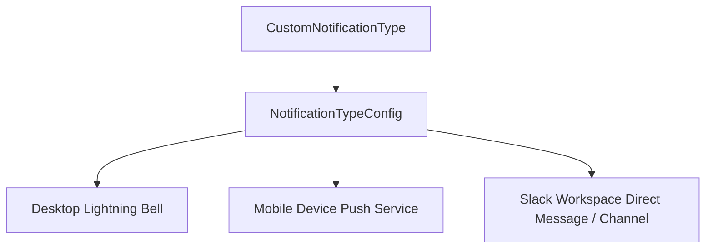

## Architectural Overview

`NotificationTypeConfig` configures the delivery channels enabled for individual notification types in Salesforce. While `CustomNotificationType` defines the semantic entity representing a business alert (such as High Priority Escalation or Deal Won), `NotificationTypeConfig` specifies the downstream delivery matrix: whether the event broadcasts to desktop Lightning notifications, mobile push devices, or Slack workspaces.

Architecturally, separating the notification schema from its channel delivery configuration allows DevOps teams to customize alerting destinations by environment, prevent unwanted push notifications in development tiers, and govern multi-channel messaging policies declaratively.



## Directory and File Conventions

`NotificationTypeConfig` files are located in the `notificationTypeConfigs/` folder within modern SFDX source trees.

| Property | Value |
| :--- | :--- |
| **Metadata Type Name** | `NotificationTypeConfig` |
| **SFDX Folder** | `force-app/main/default/notificationTypeConfigs/` |
| **File Suffix** | `.notificationTypeConfig-meta.xml` |

## Key Metadata Fields

The configuration fields defined in `NotificationTypeConfig` include:

| Field Name | Field Type | Required | Architectural Description |
| :--- | :--- | :--- | :--- |
| `notificationType` | `string` | Yes | Developer name of the associated standard or `CustomNotificationType`. |
| `desktopEnabled` | `boolean` | No | Enables delivery to the desktop Lightning Experience notification bell. |
| `mobileEnabled` | `boolean` | No | Enables delivery to mobile devices via Apple APNS and Google FCM push gateways. |
| `slackEnabled` | `boolean` | No | Routes the notification payload to connected Slack apps and user channels. |

> [!NOTE]
> For Slack delivery to succeed, the target org must have an active Slack connection configured in Setup, and users must map their Salesforce identities to their Slack member IDs.

## Declarative XML and Package Manifest Examples

Below is an enterprise notification configuration delivering critical case escalations across desktop, mobile, and Slack:

```xml title="force-app/main/default/notificationTypeConfigs/Case_Escalation.notificationTypeConfig-meta.xml"
<?xml version="1.0" encoding="UTF-8"?>
<NotificationTypeConfig xmlns="http://soap.sforce.com/2006/04/metadata">
    <notificationType>Case_Escalation</notificationType>
    <desktopEnabled>true</desktopEnabled>
    <mobileEnabled>true</mobileEnabled>
    <slackEnabled>true</slackEnabled>
</NotificationTypeConfig>
```

### Package Manifest (`package.xml`)

```xml title="manifest/package.xml"
<?xml version="1.0" encoding="UTF-8"?>
<Package xmlns="http://soap.sforce.com/2006/04/metadata">
    <types>
        <members>Case_Escalation</members>
        <name>CustomNotificationType</name>
    </types>
    <types>
        <members>Case_Escalation</members>
        <name>NotificationTypeConfig</name>
    </types>
    <version>68.0</version>
</Package>
```

## CLI Retrieval and Deployment Commands

Manage notification channel configurations with the Salesforce CLI:

```bash
# Retrieve custom notification types and their configs
sf project retrieve start --metadata NotificationTypeConfig:Case_Escalation

# Deploy all notification configurations
sf project deploy start --metadata NotificationTypeConfig
```

## Architect Best Practices and Gotchas

- **Deploy Pre-requisites:** Always bundle `NotificationTypeConfig` with its corresponding `CustomNotificationType`. Deploying a config referencing a non-existent notification type triggers deployment failure.
- **Alert Fatigue Governance:** Avoid enabling mobile push and Slack channels indiscriminately across all automated events. Reserve high-interrupt channels (mobile and Slack) for SLA violations, security alerts, and high-urgency assignments.
- **Org-Wide Notification Prerequisite:** Ensure `NotificationsSettings` has `enableMobilePushDelivery: true` if `mobileEnabled` is set to `true` in `NotificationTypeConfig`, otherwise mobile delivery remains suppressed.

> [!TIP]
> Use Flow trigger filters to prevent sending redundant notifications when multiple updates occur on the same parent record within a brief time window.
