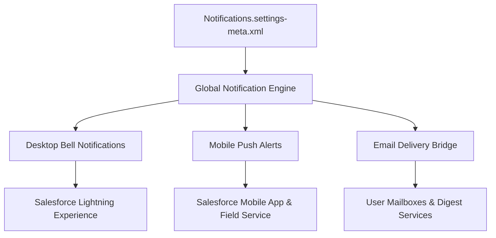

## Architectural Overview

`NotificationsSettings` is an org-level settings metadata type that governs the global delivery infrastructure for alerts, push notifications, and notification badges across Salesforce. It controls whether end users receive real-time bell notifications in the desktop application, mobile push notifications on iOS and Android devices, and synchronized email notifications.

In large-scale enterprise deployments, notification architecture directly impacts user productivity and platform engagement. Orchestrating `NotificationsSettings` ensures consistent communication policies across scratch orgs, sandboxes, and production while preventing notification storming in non-production environments.



## Directory and File Conventions

`NotificationsSettings` is stored in the `settings/` folder as a singleton settings file.

| Property | Value |
| :--- | :--- |
| **Metadata Type Name** | `Settings` (member: `Notifications`) / `NotificationsSettings` |
| **SFDX Folder** | `force-app/main/default/settings/` |
| **File Name** | `Notifications.settings-meta.xml` |
| **Scratch Org Setting Key** | `notificationsSettings` |

## Key Metadata Fields

The `NotificationsSettings` schema defines global delivery flags:

| Field Name | Field Type | Required | Architectural Description |
| :--- | :--- | :--- | :--- |
| `enableNotifications` | `boolean` | No | Master switch controlling the in-app notification bell and platform notification delivery services. |
| `enableMobilePushDelivery` | `boolean` | No | Enables push notifications to connected mobile devices running the Salesforce mobile application suite. |
| `enableEmailDelivery` | `boolean` | No | Directs alert notifications to user corporate email addresses in addition to in-app bell messages. |

> [!NOTE]
> Fine-grained control over individual notification events (such as Chatter mentions, Task assignments, or Custom Notification Types) is managed via `NotificationTypeConfig` and user profile preferences rather than this global toggle.

## Declarative XML and Package Manifest Examples

Below is a standard production configuration enabling in-app and mobile alerts:

```xml title="force-app/main/default/settings/Notifications.settings-meta.xml"
<?xml version="1.0" encoding="UTF-8"?>
<NotificationsSettings xmlns="http://soap.sforce.com/2006/04/metadata">
    <enableEmailDelivery>true</enableEmailDelivery>
    <enableMobilePushDelivery>true</enableMobilePushDelivery>
    <enableNotifications>true</enableNotifications>
</NotificationsSettings>
```

### Scratch Org Configuration (`config/project-scratch-def.json`)

To configure notification capabilities during scratch org creation:

```json title="config/project-scratch-def.json"
{
  "orgName": "Mobile Field Operations Scratch Org",
  "edition": "Enterprise",
  "settings": {
    "notificationsSettings": {
      "enableNotifications": true,
      "enableMobilePushDelivery": true,
      "enableEmailDelivery": false
    }
  }
}
```

### Package Manifest (`package.xml`)

```xml title="manifest/package.xml"
<?xml version="1.0" encoding="UTF-8"?>
<Package xmlns="http://soap.sforce.com/2006/04/metadata">
    <types>
        <members>Notifications</members>
        <name>Settings</name>
    </types>
    <version>68.0</version>
</Package>
```

## CLI Retrieval and Deployment Commands

Use the Salesforce CLI to retrieve and deploy `NotificationsSettings`:

```bash
# Retrieve notification settings
sf project retrieve start --metadata Settings:Notifications

# Deploy notification settings to an environment
sf project deploy start --metadata Settings:Notifications
```

## Architect Best Practices and Gotchas

- **Sandbox Data Migration Safeguards:** When running large-scale data loading or mock scenario runs in staging sandboxes, consider deploying `enableEmailDelivery: false` or setting org email deliverability to system-only to avoid sending test notifications to real users.
- **Mobile Fleet Management:** If `enableMobilePushDelivery` is disabled, field agents using the Salesforce Mobile app or Field Service app will not receive dispatch assignments in real time.
- **Apex and Flow Execution Resilience:** Disabling `enableNotifications` does not cause standard `Messaging.CustomNotification` Apex invocations to throw unhandled exceptions, but the notification will be silently dropped by the delivery pipeline.

> [!TIP]
> Ensure `NotificationsSettings` is deployed before configuring custom notification workflows in Flow or Apex to ensure event listeners are active.
