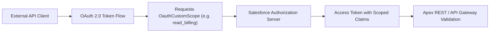

## Architectural Overview

`OauthCustomScope` enables architects to define fine-grained, organization-specific OAuth authorization scopes beyond standard Salesforce scopes like `api`, `web`, `refresh_token`, or `full`. In modern enterprise architectures, granting `api` access provides indiscriminate access to all REST and SOAP endpoints that a user's permissions allow. 

By contrast, `OauthCustomScope` pairs with Connected Apps and External Client Apps (ECA) to implement the Principle of Least Privilege. When third-party microservices or mobile clients authenticate via OAuth 2.0 flows, they request these tailored custom scopes, which are then verified at API gateways, Apex REST services, or token introspection endpoints.



## Directory and File Conventions

`OauthCustomScope` metadata is stored in the `oauthCustomScopes/` folder.

| Property | Value |
| :--- | :--- |
| **Metadata Type Name** | `OauthCustomScope` |
| **SFDX Folder** | `force-app/main/default/oauthCustomScopes/` |
| **File Suffix** | `.oauthCustomScope-meta.xml` |

## Key Metadata Fields

The XML definition of `OauthCustomScope` contains identifying and authorization metadata:

| Field Name | Field Type | Required | Architectural Description |
| :--- | :--- | :--- | :--- |
| `developerName` | `string` | Yes | Unique API name representing the scope token in OAuth query strings and headers. |
| `masterLabel` | `string` | Yes | Human-readable name displayed on OAuth user consent and approval screens. |
| `description` | `string` | No | Clear explanation of the business permissions and data accessed under this scope. |
| `isPublic` | `boolean` | No | Dictates whether this scope can be requested by external public client applications. |

> [!NOTE]
> Custom scopes can be assigned to Connected Apps or packaged into External Client Apps to govern third-party integration access contracts.

## Declarative XML and Package Manifest Examples

Below is a declarative XML definition for a custom financial audit scope:

```xml title="force-app/main/default/oauthCustomScopes/Billing_Read_Scope.oauthCustomScope-meta.xml"
<?xml version="1.0" encoding="UTF-8"?>
<OauthCustomScope xmlns="http://soap.sforce.com/2006/04/metadata">
    <developerName>Billing_Read_Scope</developerName>
    <masterLabel>Billing Read Access</masterLabel>
    <description>Grants read-only access to customer invoices, payment transactions, and billing ledgers.</description>
    <isPublic>false</isPublic>
</OauthCustomScope>
```

### Package Manifest (`package.xml`)

```xml title="manifest/package.xml"
<?xml version="1.0" encoding="UTF-8"?>
<Package xmlns="http://soap.sforce.com/2006/04/metadata">
    <types>
        <members>Billing_Read_Scope</members>
        <name>OauthCustomScope</name>
    </types>
    <version>68.0</version>
</Package>
```

## CLI Retrieval and Deployment Commands

Use the Salesforce CLI to deploy custom OAuth scopes:

```bash
# Retrieve custom scopes from the org
sf project retrieve start --metadata OauthCustomScope

# Deploy a specific custom OAuth scope
sf project deploy start --metadata OauthCustomScope:Billing_Read_Scope
```

## Architect Best Practices and Gotchas

- **Deployment Sequence:** Deploy `OauthCustomScope` before deploying Connected Apps or External Client Apps that reference the scope in their `scopes` or OAuth attributes.
- **Apex Scope Enforcement:** Creating an `OauthCustomScope` does not automatically restrict standard SOQL or REST API endpoints. You must enforce the scope inside Apex REST handlers by inspecting `Auth.SessionManagement` or validating incoming Bearer token claims via JWT verification.
- **Consent Screen Transparency:** Provide explicit and user-friendly descriptions in `description`. When authorization code flows display the approval page to end users, clear descriptions reduce authentication drop-off and support security audits.

> [!WARNING]
> Renaming or deleting an `OauthCustomScope` in production immediately invalidates OAuth handshake flows for integrations requesting that specific scope string.
