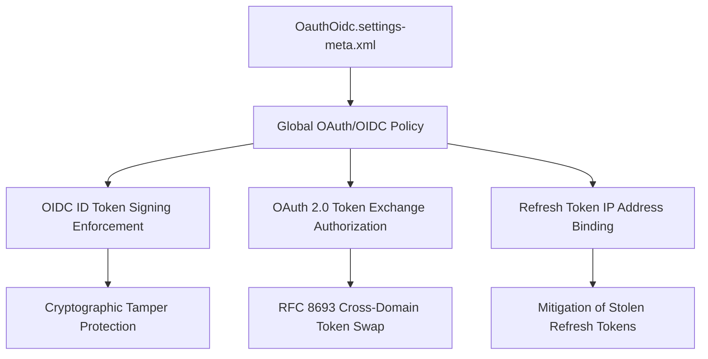

## Architectural Overview

`OauthOidcSettings` is an org-level settings metadata type that enforces global authentication and token security policies for OAuth 2.0 and OpenID Connect (OIDC) protocols. As enterprise identity architectures evolve toward zero trust, this metadata type establishes tenant-wide rules for cryptographic token signing, Token Exchange flows (RFC 8693), and refresh token IP address validation.

For Enterprise Architects, configuring `OauthOidcSettings` ensures that Connected Apps and External Client Apps adhere to strict cryptographic baselines, mitigate token replay attacks, and integrate cleanly with modern Identity Providers such as Okta, Microsoft Entra ID, and PingFederate.



## Directory and File Conventions

`OauthOidcSettings` is configured as a singleton settings file under `settings/`.

| Property | Value |
| :--- | :--- |
| **Metadata Type Name** | `Settings` (member: `OauthOidc`) / `OauthOidcSettings` |
| **SFDX Folder** | `force-app/main/default/settings/` |
| **File Name** | `OauthOidc.settings-meta.xml` |
| **Scratch Org Setting Key** | `oauthOidcSettings` |

## Key Metadata Fields

The XML schema defines organization-wide token and identity controls:

| Field Name | Field Type | Required | Architectural Description |
| :--- | :--- | :--- | :--- |
| `enableOauthOidcApi` | `boolean` | No | Master flag permitting API-driven OAuth and OpenID Connect introspection and user info endpoints. |
| `enableTokenExchangeFlow` | `boolean` | No | Activates the OAuth 2.0 Token Exchange framework for programmatic cross-domain token federation. |
| `enableOauthRefreshTokenIpCheck` | `boolean` | No | Restricts refresh token redemption to the IP address range where the token was initially issued. |
| `enableOidcIdTokenSigning` | `boolean` | No | Mandates cryptographic signing (e.g., RS256) on OpenID Connect ID tokens issued by Salesforce. |

> [!NOTE]
> Setting `enableOauthRefreshTokenIpCheck` to `true` significantly bolsters security, but can disrupt mobile clients roaming across cellular and Wi-Fi networks if split tunneling or dynamic IPs are common.

## Declarative XML and Package Manifest Examples

A hardened enterprise configuration for OAuth and OIDC security:

```xml title="force-app/main/default/settings/OauthOidc.settings-meta.xml"
<?xml version="1.0" encoding="UTF-8"?>
<OauthOidcSettings xmlns="http://soap.sforce.com/2006/04/metadata">
    <enableOauthOidcApi>true</enableOauthOidcApi>
    <enableOauthRefreshTokenIpCheck>false</enableOauthRefreshTokenIpCheck>
    <enableOidcIdTokenSigning>true</enableOidcIdTokenSigning>
    <enableTokenExchangeFlow>true</enableTokenExchangeFlow>
</OauthOidcSettings>
```

### Scratch Org Configuration (`config/project-scratch-def.json`)

To enable token exchange testing in ephemeral development scratch orgs:

```json title="config/project-scratch-def.json"
{
  "orgName": "Identity Federation Scratch Org",
  "edition": "Enterprise",
  "settings": {
    "oauthOidcSettings": {
      "enableOauthOidcApi": true,
      "enableTokenExchangeFlow": true,
      "enableOidcIdTokenSigning": true
    }
  }
}
```

### Package Manifest (`package.xml`)

```xml title="manifest/package.xml"
<?xml version="1.0" encoding="UTF-8"?>
<Package xmlns="http://soap.sforce.com/2006/04/metadata">
    <types>
        <members>OauthOidc</members>
        <name>Settings</name>
    </types>
    <version>68.0</version>
</Package>
```

## CLI Retrieval and Deployment Commands

Use the Salesforce CLI to retrieve and deploy `OauthOidcSettings`:

```bash
# Retrieve OAuth OIDC settings
sf project retrieve start --metadata Settings:OauthOidc

# Deploy settings to target environment
sf project deploy start --metadata Settings:OauthOidc
```

## Architect Best Practices and Gotchas

- **Token Exchange Prerequisites:** If your architecture leverages `OauthTokenExchangeHandler`, you must deploy `OauthOidcSettings` with `enableTokenExchangeFlow: true` first, or the token exchange endpoint will reject incoming exchange requests with HTTP 400 errors.
- **IdP Certificate Rotations:** When utilizing OIDC ID token verification, ensure downstream services integrate with Salesforce's discovery document (`.well-known/openid-configuration`) to automatically ingest rotated public verification keys.
- **Mobile Client Re-authentication:** Enabling refresh token IP checks will cause mobile users to encounter session expirations whenever their cellular carrier shifts gateway IPs. Evaluate device management strategies (MDM/VPN) before enabling.

> [!WARNING]
> Toggling OIDC token signing requirements without updating legacy consumer applications that expect unsigned tokens will break active single sign-on flows.
