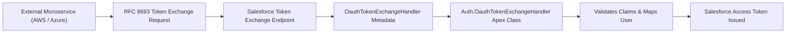

## Architectural Overview

`OauthTokenExchangeHandler` metadata configures custom token exchange capabilities conforming to the OAuth 2.0 Token Exchange specification (IETF RFC 8693). This pattern allows external identity tokens (such as AWS IAM tokens, Azure AD tokens, or JWTs issued by external microservices) to be directly exchanged for Salesforce access tokens without requiring user credentials or pre-configured SAML assertions.

The metadata binds an incoming token type to an Apex class implementing `Auth.OauthTokenExchangeHandler`. The custom Apex class parses the subject token, validates its digital signature and issuer claims against a trusted certificate or public JWKS, matches or provisions a Salesforce user, and returns an authenticated session context.



## Directory and File Conventions

`OauthTokenExchangeHandler` files reside in the `oauthTokenExchangeHandlers/` directory.

| Property | Value |
| :--- | :--- |
| **Metadata Type Name** | `OauthTokenExchangeHandler` |
| **SFDX Folder** | `force-app/main/default/oauthTokenExchangeHandlers/` |
| **File Suffix** | `.oauthTokenExchangeHandler-meta.xml` |

## Key Metadata Fields

The configuration fields defined in `OauthTokenExchangeHandler` include:

| Field Name | Field Type | Required | Architectural Description |
| :--- | :--- | :--- | :--- |
| `developerName` | `string` | Yes | Unique API name identifying the token exchange handler. |
| `masterLabel` | `string` | Yes | User-facing label displayed in identity administration consoles. |
| `apexClass` | `string` | Yes | The name of the Apex class implementing the `Auth.OauthTokenExchangeHandler` interface. |
| `tokenType` | `string` | Yes | Token type identifier accepted by this handler (e.g., `urn:ietf:params:oauth:token-type:jwt`). |
| `isEnabled` | `boolean` | Yes | Toggles whether the handler actively processes inbound token exchange requests. |
| `description` | `string` | No | Architectural documentation regarding the trusted external issuer and purpose. |

> [!NOTE]
> The target org must have the Token Exchange flow enabled in `OauthOidcSettings` (`enableTokenExchangeFlow: true`) for this metadata handler to execute.

## Declarative XML and Package Manifest Examples

Below is a declarative XML definition registering an AWS STS JWT token exchange handler:

```xml title="force-app/main/default/oauthTokenExchangeHandlers/Aws_Sts_Exchange_Handler.oauthTokenExchangeHandler-meta.xml"
<?xml version="1.0" encoding="UTF-8"?>
<OauthTokenExchangeHandler xmlns="http://soap.sforce.com/2006/04/metadata">
    <developerName>Aws_Sts_Exchange_Handler</developerName>
    <masterLabel>AWS STS Token Exchange Handler</masterLabel>
    <apexClass>AwsStsTokenExchangeHandler</apexClass>
    <tokenType>urn:ietf:params:oauth:token-type:jwt</tokenType>
    <isEnabled>true</isEnabled>
    <description>Exchanges AWS STS IAM tokens for Salesforce API session tokens for microservices.</description>
</OauthTokenExchangeHandler>
```

### Package Manifest (`package.xml`)

```xml title="manifest/package.xml"
<?xml version="1.0" encoding="UTF-8"?>
<Package xmlns="http://soap.sforce.com/2006/04/metadata">
    <types>
        <members>AwsStsTokenExchangeHandler</members>
        <name>ApexClass</name>
    </types>
    <types>
        <members>Aws_Sts_Exchange_Handler</members>
        <name>OauthTokenExchangeHandler</name>
    </types>
    <version>68.0</version>
</Package>
```

## CLI Retrieval and Deployment Commands

Retrieve and deploy token exchange handlers with the Salesforce CLI:

```bash
# Retrieve handlers from the org
sf project retrieve start --metadata OauthTokenExchangeHandler

# Deploy the handler alongside its backing Apex class
sf project deploy start --metadata OauthTokenExchangeHandler:Aws_Sts_Exchange_Handler --metadata ApexClass:AwsStsTokenExchangeHandler
```

## Architect Best Practices and Gotchas

- **Apex Class Dependency:** Deploy the backing [ApexClass](/docs/metadata/apex-class-metadata-type/) first or together with `OauthTokenExchangeHandler`. The deployment will fail if the class does not exist or does not implement `Auth.OauthTokenExchangeHandler`.
- **Cryptographic Validation in Apex:** Never trust incoming token claims blindly. Ensure your Apex handler verifies the token's JSON Web Signature (JWS) against public JWKS endpoints or static certificates stored in Salesforce Named Credentials or Keystores.
- **Service Account Mapping:** When mapping external tokens to Salesforce users, map to dedicated Integration Users with restricted Permission Sets rather than System Administrators.

> [!WARNING]
> Failing to validate the `aud` (audience) and `iss` (issuer) claims in your token exchange Apex handler can expose your org to confused deputy attacks across multi-tenant cloud environments.
