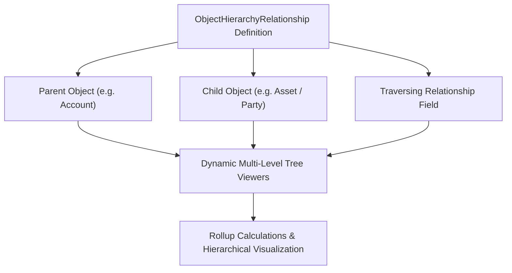

## Architectural Overview

`ObjectHierarchyRelationship` defines structural and recursive parent-child associations between objects, enabling Salesforce Industry Clouds (such as Financial Services Cloud, Manufacturing Cloud, and Automotive Cloud) and core platform features to traverse multi-tiered data trees.

While standard relationship fields (`Lookup` and `Master-Detail`) create point-to-point associations between database tables, `ObjectHierarchyRelationship` registers semantic hierarchies. This allows out-of-the-box components—such as Account and Asset tree viewers, rollup summarization pipelines, and forecasting engines—to dynamically render and traverse deep relational structures without custom Apex recursions.



## Directory and File Conventions

`ObjectHierarchyRelationship` files are stored in the `objectHierarchyRelationships/` directory.

| Property | Value |
| :--- | :--- |
| **Metadata Type Name** | `ObjectHierarchyRelationship` |
| **SFDX Folder** | `force-app/main/default/objectHierarchyRelationships/` |
| **File Suffix** | `.objectHierarchyRelationship-meta.xml` |

## Key Metadata Fields

The XML schema for `ObjectHierarchyRelationship` provides the structural linkage parameters:

| Field Name | Field Type | Required | Architectural Description |
| :--- | :--- | :--- | :--- |
| `parentObject` | `string` | Yes | API name of the parent standard or custom object in the hierarchy. |
| `childObject` | `string` | Yes | API name of the child standard or custom object. |
| `relationshipFieldName` | `string` | Yes | The API name of the lookup or master-detail field linking the child to the parent. |
| `hierarchyType` | `string` | Yes | Semantic category of the hierarchy (e.g., `AccountTree`, `AssetStructure`, `GenericHierarchy`). |
| `usageType` | `string` | No | Operational context defining whether the hierarchy is used for analytics, UI trees, or rollups. |

> [!NOTE]
> Custom objects and custom fields specified in `parentObject`, `childObject`, and `relationshipFieldName` must use complete API names including namespace or `__c` suffixes.

## Declarative XML and Package Manifest Examples

An architectural definition modeling complex multi-tiered vehicle and component asset hierarchies:

```xml title="force-app/main/default/objectHierarchyRelationships/Asset_Component_Hierarchy.objectHierarchyRelationship-meta.xml"
<?xml version="1.0" encoding="UTF-8"?>
<ObjectHierarchyRelationship xmlns="http://soap.sforce.com/2006/04/metadata">
    <parentObject>Asset</parentObject>
    <childObject>Asset</childObject>
    <relationshipFieldName>ParentId</relationshipFieldName>
    <hierarchyType>AssetStructure</hierarchyType>
    <usageType>AssetHierarchyRollup</usageType>
</ObjectHierarchyRelationship>
```

### Package Manifest (`package.xml`)

```xml title="manifest/package.xml"
<?xml version="1.0" encoding="UTF-8"?>
<Package xmlns="http://soap.sforce.com/2006/04/metadata">
    <types>
        <members>Asset_Component_Hierarchy</members>
        <name>ObjectHierarchyRelationship</name>
    </types>
    <version>68.0</version>
</Package>
```

## CLI Retrieval and Deployment Commands

Manage `ObjectHierarchyRelationship` definitions using the Salesforce CLI:

```bash
# Retrieve hierarchy relationships from an org
sf project retrieve start --metadata ObjectHierarchyRelationship

# Deploy a specific hierarchy relationship
sf project deploy start --metadata ObjectHierarchyRelationship:Asset_Component_Hierarchy
```

## Architect Best Practices and Gotchas

- **Schema Dependencies:** Both `parentObject` and `childObject`, as well as the connecting relationship field, must be deployed prior to or in the same transaction as `ObjectHierarchyRelationship`.
- **Circular Reference Safeguards:** When defining self-referential hierarchies (where `parentObject` and `childObject` are the same, such as parent-child accounts or assets), enforce validation rules to prevent circular loops that could crash recursive rollup jobs.
- **Data Skew Considerations:** In deeply nested hierarchies, avoid linking tens of thousands of child records to a single parent node, as updates can trigger row lock contention across hierarchical rollups.

> [!TIP]
> Pair `ObjectHierarchyRelationship` with custom Lightning Web Components using `lightning-tree-grid` to deliver intuitive, high-performance hierarchical representations.
