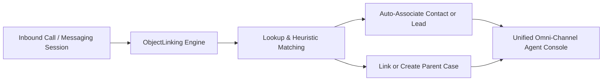

## Architectural Overview

`ObjectLinkingSettings` governs the automated and recommended association behaviors between real-time interaction channels—such as Service Cloud Voice calls, In-App and Web Messaging sessions, and Live Chat transcripts—and core CRM business entities (such as `Contact`, `Lead`, `Account`, and `Case`).

In modern omnichannel contact centers, agents waste critical handling seconds manually searching and linking caller phone numbers or chat identifiers to CRM records. Deploying `ObjectLinkingSettings` activates platform heuristics and declarative matching rules that automatically attach communication sessions to existing customer records upon channel connection.



## Directory and File Conventions

`ObjectLinkingSettings` is configured as a singleton settings type in the `settings/` directory.

| Property | Value |
| :--- | :--- |
| **Metadata Type Name** | `Settings` (member: `ObjectLinking`) / `ObjectLinkingSettings` |
| **SFDX Folder** | `force-app/main/default/settings/` |
| **File Name** | `ObjectLinking.settings-meta.xml` |
| **Scratch Org Setting Key** | `objectLinkingSettings` |

## Key Metadata Fields

The XML schema for `ObjectLinkingSettings` controls platform linking behaviors:

| Field Name | Field Type | Required | Architectural Description |
| :--- | :--- | :--- | :--- |
| `enableObjectLinking` | `boolean` | No | Master activation switch for the Einstein and Service Object Linking framework. |
| `enableAutomatedLinking` | `boolean` | No | Automatically links records when a confident unique match is detected, bypassing manual agent confirmation. |

> [!NOTE]
> Object Linking configurations work in conjunction with individual channel setups (Voice Call routing, Messaging Channel definitions) and Omni-Channel Flow routing actions.

## Declarative XML and Package Manifest Examples

A standard production settings file enabling automated object linking for contact center workflows:

```xml title="force-app/main/default/settings/ObjectLinking.settings-meta.xml"
<?xml version="1.0" encoding="UTF-8"?>
<ObjectLinkingSettings xmlns="http://soap.sforce.com/2006/04/metadata">
    <enableAutomatedLinking>true</enableAutomatedLinking>
    <enableObjectLinking>true</enableObjectLinking>
</ObjectLinkingSettings>
```

### Scratch Org Configuration (`config/project-scratch-def.json`)

To enable object linking in a Service Cloud scratch org:

```json title="config/project-scratch-def.json"
{
  "orgName": "Service Cloud Voice Scratch Org",
  "edition": "Enterprise",
  "features": ["ServiceCloudVoice", "LiveMessage"],
  "settings": {
    "objectLinkingSettings": {
      "enableObjectLinking": true,
      "enableAutomatedLinking": true
    }
  }
}
```

### Package Manifest (`package.xml`)

```xml title="manifest/package.xml"
<?xml version="1.0" encoding="UTF-8"?>
<Package xmlns="http://soap.sforce.com/2006/04/metadata">
    <types>
        <members>ObjectLinking</members>
        <name>Settings</name>
    </types>
    <version>68.0</version>
</Package>
```

## CLI Retrieval and Deployment Commands

Manage `ObjectLinkingSettings` using the Salesforce CLI:

```bash
# Retrieve Object Linking settings
sf project retrieve start --metadata Settings:ObjectLinking

# Deploy Object Linking settings
sf project deploy start --metadata Settings:ObjectLinking
```

## Architect Best Practices and Gotchas

- **Ambiguous Match Strategy:** When `enableAutomatedLinking` is active, multiple records sharing the same phone number or email will suppress auto-linking and present a candidate picklist to the agent to avoid corrupting relationship data.
- **Service Cloud Feature Licensing:** In scratch orgs or sandboxes, deploying `ObjectLinkingSettings` will fail if the org lacks prerequisite features like `LiveMessage`, `ServiceCloudVoice`, or Omni-Channel licensing.
- **Downstream Automation Sequencing:** Ensure Record-Triggered Flows on `VoiceCall` or `MessagingSession` anticipate that `ContactId` or `CaseId` may be populated asynchronously immediately following session creation.

> [!TIP]
> Combine Object Linking with Omni-Channel Flows to inject verified customer identifiers directly into routing variables before the agent accepts the interaction.
