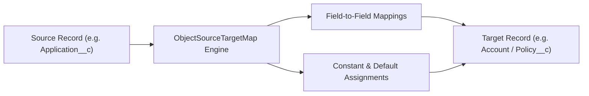

## Architectural Overview

`ObjectSourceTargetMap` is a declarative data transformation metadata type that defines schema mappings between a source object and a target object. It establishes field-level mappings, constant assignments, and conversion rules used by Salesforce Business Rules Engine (BRE), Data Processing Engine (DPE), and Industry Cloud record generation services.

In enterprise integration and document intake workflows, transitioning data across distinct operational schemas (e.g., transforming a Lead or Application record into an Account, Contact, or Policy) often requires custom Apex scripts. `ObjectSourceTargetMap` standardizes this transformation layer into version-controlled metadata, eliminating custom code and simplifying CI/CD deployment pipelines.



## Directory and File Conventions

`ObjectSourceTargetMap` records are stored in the `objectSourceTargetMaps/` folder within SFDX source trees.

| Property | Value |
| :--- | :--- |
| **Metadata Type Name** | `ObjectSourceTargetMap` |
| **SFDX Folder** | `force-app/main/default/objectSourceTargetMaps/` |
| **File Suffix** | `.objectSourceTargetMap-meta.xml` |

## Key Metadata Fields

The `ObjectSourceTargetMap` XML definition defines source, target, and field mapping collections:

| Field Name | Field Type | Required | Architectural Description |
| :--- | :--- | :--- | :--- |
| `developerName` | `string` | Yes | Unique programmatic identifier for the mapping configuration. |
| `masterLabel` | `string` | Yes | Human-readable label displayed in setup and transformation builders. |
| `sourceObjectName` | `string` | Yes | API name of the source entity supplying input data. |
| `targetObjectName` | `string` | Yes | API name of the target entity receiving transformed records. |
| `mappingType` | `string` | Yes | Category of mapping (e.g., `FieldMapping`, `CalculationMapping`, `IngestionMapping`). |
| `fieldMappings` | `FieldMapping[]` | No | Child collection defining individual source-to-target field pairings. |

### Child Structure: `fieldMappings`

| Child Field | Field Type | Description |
| :--- | :--- | :--- |
| `sourceField` | `string` | API name of the field on the source object. |
| `targetField` | `string` | API name of the field on the target object. |

> [!NOTE]
> When mapping between custom objects, verify that both the `sourceObjectName` and `targetObjectName` append their complete package namespace or `__c` API suffixes.

## Declarative XML and Package Manifest Examples

An architectural mapping definition transforming an intake application into an active business account:

```xml title="force-app/main/default/objectSourceTargetMaps/Application_To_Account_Map.objectSourceTargetMap-meta.xml"
<?xml version="1.0" encoding="UTF-8"?>
<ObjectSourceTargetMap xmlns="http://soap.sforce.com/2006/04/metadata">
    <developerName>Application_To_Account_Map</developerName>
    <masterLabel>Application to Account Mapping</masterLabel>
    <sourceObjectName>Intake_Application__c</sourceObjectName>
    <targetObjectName>Account</targetObjectName>
    <mappingType>FieldMapping</mappingType>
    <fieldMappings>
        <sourceField>Legal_Entity_Name__c</sourceField>
        <targetField>Name</targetField>
    </fieldMappings>
    <fieldMappings>
        <sourceField>Tax_Identifier__c</sourceField>
        <targetField>AccountNumber</targetField>
    </fieldMappings>
    <fieldMappings>
        <sourceField>Corporate_Email__c</sourceField>
        <targetField>Company_Email__c</targetField>
    </fieldMappings>
</ObjectSourceTargetMap>
```

### Package Manifest (`package.xml`)

```xml title="manifest/package.xml"
<?xml version="1.0" encoding="UTF-8"?>
<Package xmlns="http://soap.sforce.com/2006/04/metadata">
    <types>
        <members>Application_To_Account_Map</members>
        <name>ObjectSourceTargetMap</name>
    </types>
    <version>68.0</version>
</Package>
```

## CLI Retrieval and Deployment Commands

Use the Salesforce CLI to retrieve and deploy object maps:

```bash
# Retrieve all object source target maps
sf project retrieve start --metadata ObjectSourceTargetMap

# Deploy a specific mapping file
sf project deploy start --metadata ObjectSourceTargetMap:Application_To_Account_Map
```

## Architect Best Practices and Gotchas

- **Schema Precedence:** Ensure both the source and target [CustomObject](/docs/metadata/custom-object-metadata-type/) definitions and their respective fields are included in the deployment bundle. Any missing target field will cause deployment failure.
- **Type Compatibility:** Verify that source and target data types match (e.g., text to text, number to number). Mapping incompatible types (such as an arbitrary Text field into a Date or Picklist field) can result in runtime transformation exceptions.
- **Null Handling Policies:** Ensure downstream target field validation rules and triggers account for optional source fields that may map null values into required target fields.

> [!WARNING]
> Renaming a custom field without updating dependent `ObjectSourceTargetMap` definitions causes deployment failures and halts automated data generation flows in production.
