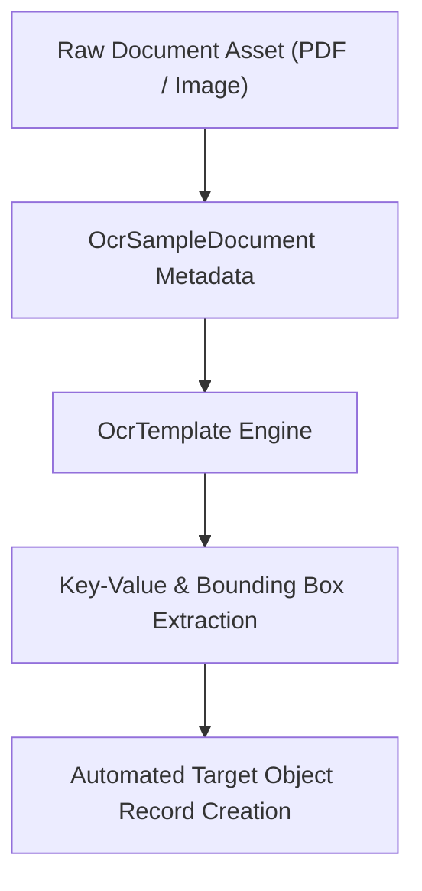

## Architectural Overview

`OcrSampleDocument` represents sample file assets (such as identity cards, tax forms, invoices, and bank statements) used to calibrate and train Salesforce Intelligent Document Reader and Einstein OCR models. It stores reference payloads, MIME types, and document structures against which optical recognition algorithms map bounding boxes and key-value pairs.

In document intake pipelines across Public Sector Solutions, Health Cloud, and Financial Services Cloud, reliable extraction begins with pristine baseline documents. By managing sample documents as metadata, organizations can programmatically promote trained OCR baselines across development, UAT, and production environments without manual document re-uploads.



## Directory and File Conventions

`OcrSampleDocument` metadata definitions are stored in the `ocrSampleDocuments/` directory.

| Property | Value |
| :--- | :--- |
| **Metadata Type Name** | `OcrSampleDocument` |
| **SFDX Folder** | `force-app/main/default/ocrSampleDocuments/` |
| **File Suffix** | `.ocrSampleDocument-meta.xml` |

## Key Metadata Fields

The XML schema for `OcrSampleDocument` encapsulates document properties:

| Field Name | Field Type | Required | Architectural Description |
| :--- | :--- | :--- | :--- |
| `developerName` | `string` | Yes | Unique programmatic identifier for the sample document record. |
| `masterLabel` | `string` | Yes | User-facing display label for the sample document in template design consoles. |
| `mimeType` | `string` | Yes | MIME type of the underlying file (e.g., `application/pdf`, `image/png`, `image/jpeg`). |
| `description` | `string` | No | Functional notes describing document revision, layout version, and issuing authority. |

> [!NOTE]
> The sample document file content is linked to the metadata record and managed alongside template bounding coordinates to enable automated parsing tests in CI/CD.

## Declarative XML and Package Manifest Examples

An architectural definition of an identity card sample document for automated document intake:

```xml title="force-app/main/default/ocrSampleDocuments/Passport_Intake_Sample.ocrSampleDocument-meta.xml"
<?xml version="1.0" encoding="UTF-8"?>
<OcrSampleDocument xmlns="http://soap.sforce.com/2006/04/metadata">
    <developerName>Passport_Intake_Sample</developerName>
    <masterLabel>Standard Passport Intake Sample</masterLabel>
    <mimeType>application/pdf</mimeType>
    <description>Ground-truth calibration passport document for Intelligent Document Reader extraction.</description>
</OcrSampleDocument>
```

### Package Manifest (`package.xml`)

```xml title="manifest/package.xml"
<?xml version="1.0" encoding="UTF-8"?>
<Package xmlns="http://soap.sforce.com/2006/04/metadata">
    <types>
        <members>Passport_Intake_Sample</members>
        <name>OcrSampleDocument</name>
    </types>
    <version>68.0</version>
</Package>
```

## CLI Retrieval and Deployment Commands

Retrieve and deploy sample documents with the Salesforce CLI:

```bash
# Retrieve OCR sample documents from the target org
sf project retrieve start --metadata OcrSampleDocument

# Deploy a specific OCR sample document
sf project deploy start --metadata OcrSampleDocument:Passport_Intake_Sample
```

## Architect Best Practices and Gotchas

- **File Quality and Resolution:** Ensure sample documents adhere to recommended OCR resolutions (minimum 300 DPI for scans). Poor baseline resolution degrades extraction confidence score thresholds across dependent templates.
- **Data Privacy and Redaction (PII/PHI):** Never check real customer personally identifiable information into source control. Always utilize synthetic or masked sample documents when committing `OcrSampleDocument` files to Git.
- **Co-Deployment with Templates:** Deploy `OcrSampleDocument` before or in the same manifest as `OcrTemplate` to avoid unresolved reference errors during validation.

> [!TIP]
> Maintain versioned sample documents (e.g., `W2_Form_2025`, `W2_Form_2026`) when regulatory bodies update physical form layouts, enabling parallel template calibration.
