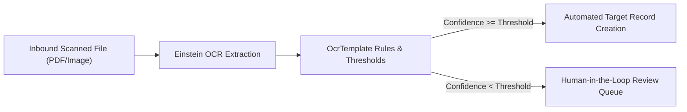

## Architectural Overview

`OcrTemplate` metadata governs the extraction logic and target schema mappings for Salesforce Intelligent Document Reader and Einstein OCR. It configures the rules by which text, dates, currency, and tabular data extracted from scanned documents (such as invoices, loan applications, and medical claims) are converted into structured records on target Salesforce entities.

By defining field mapping rules, data normalization logic, and confidence score thresholds declaratively, `OcrTemplate` enables touchless document ingestion. It allows architects to establish automated Straight-Through Processing (STP) pipelines while routing low-confidence extractions to human-in-the-loop review queues.



## Directory and File Conventions

`OcrTemplate` metadata records reside in the `ocrTemplates/` directory.

| Property | Value |
| :--- | :--- |
| **Metadata Type Name** | `OcrTemplate` |
| **SFDX Folder** | `force-app/main/default/ocrTemplates/` |
| **File Suffix** | `.ocrTemplate-meta.xml` |

## Key Metadata Fields

The XML schema for `OcrTemplate` defines target schemas, confidence gates, and field assignments:

| Field Name | Field Type | Required | Architectural Description |
| :--- | :--- | :--- | :--- |
| `developerName` | `string` | Yes | Programmatic identifier for invoking the template from Flow or REST APIs. |
| `masterLabel` | `string` | Yes | Descriptive label displayed to administrators in Document Reader setup. |
| `targetObject` | `string` | Yes | API name of the target entity (standard or custom) receiving extracted records. |
| `confidenceThreshold` | `integer` | No | Minimum extraction confidence percentage (e.g., `85`) required for straight-through processing. |
| `ocrSampleDocument` | `string` | Yes | Developer name of the reference `OcrSampleDocument` used to calibrate coordinate bounds. |
| `ocrTemplateFields` | `OcrTemplateField[]` | No | Array of mapped fields linking document keys to target record fields. |

### Child Structure: `ocrTemplateFields`

| Child Field | Field Type | Description |
| :--- | :--- | :--- |
| `sourceKey` | `string` | Document label or extracted key text identified on the physical form. |
| `targetField` | `string` | Target field API name on the destination entity. |
| `isRequired` | `boolean` | Flags whether extraction of this key is mandatory for a valid document. |

> [!NOTE]
> Custom target fields must include their complete `__c` suffix. Standard objects such as `Lead`, `Contact`, `Account`, or industry objects such as `Claim` are supported.

## Declarative XML and Package Manifest Examples

An architectural definition of an invoice extraction template targeting a custom financial ledger:

```xml title="force-app/main/default/ocrTemplates/Vendor_Invoice_Extraction.ocrTemplate-meta.xml"
<?xml version="1.0" encoding="UTF-8"?>
<OcrTemplate xmlns="http://soap.sforce.com/2006/04/metadata">
    <developerName>Vendor_Invoice_Extraction</developerName>
    <masterLabel>Vendor Invoice Extraction Template</masterLabel>
    <targetObject>Vendor_Invoice__c</targetObject>
    <confidenceThreshold>85</confidenceThreshold>
    <ocrSampleDocument>Vendor_Invoice_Sample</ocrSampleDocument>
    <ocrTemplateFields>
        <sourceKey>Invoice Number</sourceKey>
        <targetField>Invoice_Number__c</targetField>
        <isRequired>true</isRequired>
    </ocrTemplateFields>
    <ocrTemplateFields>
        <sourceKey>Total Amount Due</sourceKey>
        <targetField>Total_Amount__c</targetField>
        <isRequired>true</isRequired>
    </ocrTemplateFields>
    <ocrTemplateFields>
        <sourceKey>Due Date</sourceKey>
        <targetField>Payment_Due_Date__c</targetField>
        <isRequired>false</isRequired>
    </ocrTemplateFields>
</OcrTemplate>
```

### Package Manifest (`package.xml`)

```xml title="manifest/package.xml"
<?xml version="1.0" encoding="UTF-8"?>
<Package xmlns="http://soap.sforce.com/2006/04/metadata">
    <types>
        <members>Vendor_Invoice_Sample</members>
        <name>OcrSampleDocument</name>
    </types>
    <types>
        <members>Vendor_Invoice_Extraction</members>
        <name>OcrTemplate</name>
    </types>
    <version>68.0</version>
</Package>
```

## CLI Retrieval and Deployment Commands

Use the Salesforce CLI to retrieve and deploy OCR templates:

```bash
# Retrieve all OCR templates from the org
sf project retrieve start --metadata OcrTemplate

# Deploy a specific OCR template
sf project deploy start --metadata OcrTemplate:Vendor_Invoice_Extraction
```

## Architect Best Practices and Gotchas

- **Calibration Baseline Dependency:** `OcrTemplate` requires an existing `OcrSampleDocument`. Always retrieve and deploy them as a paired unit in version control.
- **Data Validation Handshake:** Do not rely solely on OCR extraction confidence to prevent bad data. Configure Record-Triggered Flows or Apex triggers on the target object to validate extracted data formats (e.g., date ranges, tax ID regex) before finalizing records.
- **Confidence Threshold Tuning:** Avoid setting `confidenceThreshold` to 100%, as slight scanner skews, handwritten notes, or low contrast will force virtually every document into manual review queues. 80-85% is a proven enterprise starting baseline.

> [!WARNING]
> Deploying an `OcrTemplate` without deploying its referenced target custom fields will fail deployment with missing field errors.
