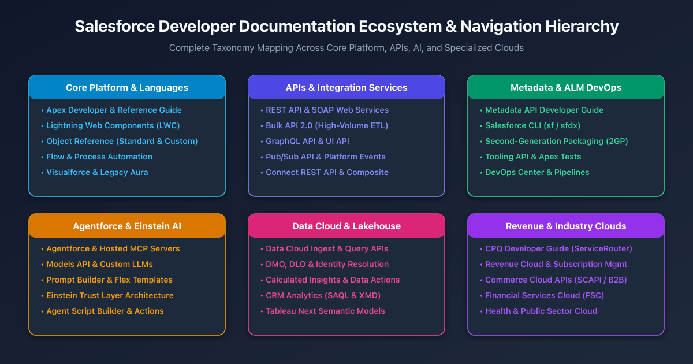

## Overview

The official **Salesforce Developer Documentation portal** ([developer.salesforce.com/docs](https://developer.salesforce.com/docs)) serves as the authoritative source of truth for platform architects, software engineers, and integration developers. With hundreds of distinct developer guides, API specifications, and reference manuals spanning more than twenty years of platform evolution, navigating the documentation library requires understanding its architectural taxonomy.

The documentation is organized around six foundational architectural pillars: **Core Platform & Languages**, **APIs & Integration Services**, **Metadata & Application Lifecycle Management (ALM)**, **Agentforce & Einstein AI**, **Data Cloud & Lakehouse**, and **Revenue & Industry Clouds**.

---

## Pillar 1: Core Platform & Programming Languages

This section houses the guides for building custom business logic, user interfaces, and automated workflows directly on the Lightning Platform.

### 1. Apex Developer Guide & Reference
* **URL:** [`https://developer.salesforce.com/docs/atlas.en-us.apexcode.meta/apexcode/apex_intro.htm`](https://developer.salesforce.com/docs/atlas.en-us.apexcode.meta/apexcode/apex_intro.htm)
* **What It Covers:**
  * Apex language syntax, object-oriented concepts, and execution flow.
  * Governor limits (SOQL, DML, Heap, CPU timeouts) and transaction management.
  * Triggers, context variables, and trigger frameworks.
  * Asynchronous Apex: Queueable, Batchable, Schedulable, and Future methods.
  * System namespace reference (`System`, `Database`, `Schema`, `ConnectApi`).

### 2. Lightning Web Components (LWC) Developer Guide
* **URL:** [`https://developer.salesforce.com/docs/component-library`](https://developer.salesforce.com/docs/component-library)
* **What It Covers:**
  * Modern web standards-based reactive UI framework.
  * Component lifecycle hooks (`connectedCallback`, `renderedCallback`, `disconnectedCallback`).
  * Lightning Data Service (LDS) wire adapters and functions (`getRecord`, `updateRecord`).
  * Base components library (`lightning-input`, `lightning-datatable`, `lightning-card`).
  * Inter-component communication via Custom Events and Lightning Message Service (LMS).

### 3. Object Reference for the Salesforce Platform
* **URL:** [`https://developer.salesforce.com/docs/atlas.en-us.object_reference.meta/object_reference/sforce_api_objects_intro.htm`](https://developer.salesforce.com/docs/atlas.en-us.object_reference.meta/object_reference/sforce_api_objects_intro.htm)
* **What It Covers:**
  * Complete data dictionary for standard objects (`Account`, `Contact`, `Opportunity`, `Case`, `Task`).
  * Field types, system audit fields, picklist defaults, and relationships (Lookup vs Master-Detail).
  * Big Objects, Platform Event definitions, and Change Data Capture entities.

---

## Pillar 2: APIs & Integration Services

The **Salesforce API Library** ([developer.salesforce.com/docs/apis](https://developer.salesforce.com/docs/apis)) outlines the programmatic endpoints used by external applications, middleware, and microservices to exchange data with Salesforce.

| API Name | Documentation Link | Protocol / Format | Recommended Workload |
| :--- | :--- | :--- | :--- |
| **REST API** | [REST API Guide](https://developer.salesforce.com/docs/atlas.en-us.api_rest.meta/api_rest/intro_what_is_rest_api.htm) | HTTP / JSON / XML | Synchronous record CRUD, search, and lightweight transactions. |
| **Bulk API 2.0** | [Bulk API 2.0 Guide](https://developer.salesforce.com/docs/atlas.en-us.api_asynch.meta/api_asynch/asynch_api_intro.htm) | Async REST / CSV | Batch importing or querying datasets >2,000 records up to 150M records/day. |
| **GraphQL API** | [GraphQL API Guide](https://developer.salesforce.com/docs/platform/graphql/guide/graphql-about.html) | GraphQL / JSON | Eliminating over-fetching in mobile and single-page apps with a single round-trip query. |
| **Pub/Sub API** | [Pub/Sub API Guide](https://developer.salesforce.com/docs/platform/pub-sub-api/guide/intro.html) | gRPC / HTTP/2 / Binary | Real-time event streaming for Platform Events and Change Data Capture (CDC). |
| **Connect REST API** | [Connect REST Guide](https://developer.salesforce.com/docs/atlas.en-us.chatterapi.meta/chatterapi/intro_what_is_chatter_api.htm) | HTTP / JSON | Simplified, business-process-oriented access to Chatter, CMS, and B2B Commerce. |
| **SOAP API** | [SOAP API Guide](https://developer.salesforce.com/docs/atlas.en-us.api.meta/api/sforce_api_quickstart_intro.htm) | SOAP / WSDL / XML | Strongly typed enterprise integrations requiring strict enterprise or partner contracts. |

---

## Pillar 3: Metadata, DevOps & Developer Tools

Salesforce's modern developer tooling focuses on source-driven development, scratch org lifecycles, and automated continuous delivery.

### 1. Metadata API Developer Guide
* **URL:** [`https://developer.salesforce.com/docs/atlas.en-us.api_meta.meta/api_meta/meta_intro.htm`](https://developer.salesforce.com/docs/atlas.en-us.api_meta.meta/api_meta/meta_intro.htm)
* **What It Covers:**
  * XML representations of all customizable elements (`CustomObject`, `ApexClass`, `Flow`, `PermissionSet`).
  * Package manifest (`package.xml`) structure and wildcards.
  * Synchronous and asynchronous metadata retrieval and deployment pipelines.

### 2. Salesforce CLI Command Reference (`sf`)
* **URL:** [`https://developer.salesforce.com/docs/atlas.en-us.sfdx_cli_reference.meta/sfdx_cli_reference/cli_reference.htm`](https://developer.salesforce.com/docs/atlas.en-us.sfdx_cli_reference.meta/sfdx_cli_reference/cli_reference.htm)
* **What It Covers:**
  * Modern `sf` commands for org authorization, source push/pull, and scratch org creation.
  * Deploying metadata using `sf project deploy start`.
  * Executing Apex unit tests via `sf apex run test`.

### 3. Second-Generation Packaging (2GP) Guide
* **URL:** [`https://developer.salesforce.com/docs/atlas.en-us.sfdx_dev.meta/sfdx_dev/sfdx_dev_dev2gp.htm`](https://developer.salesforce.com/docs/atlas.en-us.sfdx_dev.meta/sfdx_dev/sfdx_dev_dev2gp.htm)
* **What It Covers:**
  * Unlocked packages for enterprise modular application architecture.
  * Managed 2GP packages for Independent Software Vendors (ISVs).
  * Versioning, dependency resolution, and automated CI/CD packaging pipelines.

---

## Pillar 4: Agentforce & Einstein AI

The newest and fastest-growing segment of the developer documentation covers generative AI, autonomous agent design, and enterprise AI orchestration.

* **Agentforce Developer Guide:** [`https://developer.salesforce.com/docs/einstein/genai/guide`](https://developer.salesforce.com/docs/einstein/genai/guide)
  * Configuring autonomous agents, topics, instructions, and standard/custom actions.
  * Hosted Model Context Protocol (MCP) server integration (`platform/sobject-*`, `platform/headless-360`, and custom servers).
* **Models API Developer Guide:** [`https://developer.salesforce.com/docs/einstein/genai/guide/models-api.html`](https://developer.salesforce.com/docs/einstein/genai/guide/models-api.html)
  * Calling foundation LLMs directly from Apex (`aiplatform.ModelsAPI`) or REST.
  * Integrating custom third-party models via Bring Your Own Model (BYOM).
* **Prompt Builder & Flex Templates:** [`https://developer.salesforce.com/docs/einstein/genai/guide/prompt-templates.html`](https://developer.salesforce.com/docs/einstein/genai/guide/prompt-templates.html)
  * Authoring dynamic prompts grounded with CRM record data, Apex classes, and Flow resources.
* **Einstein Trust Layer Architecture:**
  * Zero-retention agreements, automated data masking, toxicity detection, and audit logging.

---

## Pillar 5: Data Cloud & Lakehouse Analytics

Documentation for zero-copy data federation, real-time streaming, and high-speed analytical querying.

* **Data Cloud Developer Guide:** [`https://developer.salesforce.com/docs/atlas.en-us.c360a_api.meta/c360a_api/c360a_api_intro.htm`](https://developer.salesforce.com/docs/atlas.en-us.c360a_api.meta/c360a_api/c360a_api_intro.htm)
  * Data ingestion APIs (Web SDK, Mobile SDK, Ingestion API).
  * Data Lake Objects (DLOs) to Data Model Objects (DMOs) mapping.
  * Identity Resolution rules and unified profile generation.
* **Data Cloud Query SQL API:**
  * Executing ANSI-compliant SQL queries against lakehouse tables via REST and MCP (`post_dc_query_sql`).
* **CRM Analytics & SAQL Reference:** [`https://developer.salesforce.com/docs/atlas.en-us.bi_dev_guide_saql.meta/bi_dev_guide_saql/bi_saql_intro.htm`](https://developer.salesforce.com/docs/atlas.en-us.bi_dev_guide_saql.meta/bi_dev_guide_saql/bi_saql_intro.htm)
  * Salesforce Analytics Query Language (SAQL) syntax, window functions, and Extended Metadata (XMD).

---

## Pillar 6: Revenue & Industry Cloud Guides

Salesforce provides specialized developer manuals for enterprise industries and business applications:

* **Salesforce CPQ Developer Guide:** [`https://developer.salesforce.com/docs/revenue/cpq-developer-guide/guide/cpq-developer-intro.html`](https://developer.salesforce.com/docs/revenue/cpq-developer-guide/guide/cpq-developer-intro.html)
  * The `SBQQ.ServiceRouter` programmatic quoting gateway (`read`, `load`, `save`).
  * Custom Calculator Plugins (QCP) and bundle configuration models.
* **Salesforce Commerce Cloud (SCAPI):** [`https://developer.salesforce.com/docs/commerce/commerce-api`](https://developer.salesforce.com/docs/commerce/commerce-api)
  * Headless Shopper and Admin REST APIs, Composable Storefront PWA Kit, and Webhook integrations.
* **Financial Services Cloud (FSC) Developer Guide:**
  * Financial Accounts, Household data models, and regulatory compliance APIs.
* **OmniStudio & Business Process Engine:**
  * OmniScripts, Integration Procedures, DataRaptors, and Calculation Matrices.

---

## How to Choose the Right Salesforce Developer Resource

| If your task is... | Start with this official guide | Primary Technology |
| :--- | :--- | :--- |
| Writing custom triggers or transactional business logic | **Apex Developer Guide** | Apex, SOQL, Unit Tests |
| Building interactive UI components in record pages | **Lightning Web Components Reference** | HTML5, Modern ES6+, CSS |
| Connecting an external system for high-volume ETL | **Bulk API 2.0 Developer Guide** | REST, CSV, Async Jobs |
| Building event-driven architectures with real-time push | **Pub/Sub API Developer Guide** | gRPC, Protocol Buffers, CDC |
| Deploying code and managing CI/CD release pipelines | **Salesforce CLI Reference & 2GP Guide** | CLI (`sf`), GitHub Actions |
| Implementing AI agents and autonomous assistants | **Agentforce & Models API Guides** | Generative AI, MCP, Prompts |
| Querying unified cross-cloud customer data lakes | **Data Cloud Query SQL API Guide** | ANSI SQL, Lakehouse, DMOs |
| Headless quoting and automated contract amendments | **Salesforce CPQ Developer Guide** | `SBQQ.ServiceRouter`, Apex |

