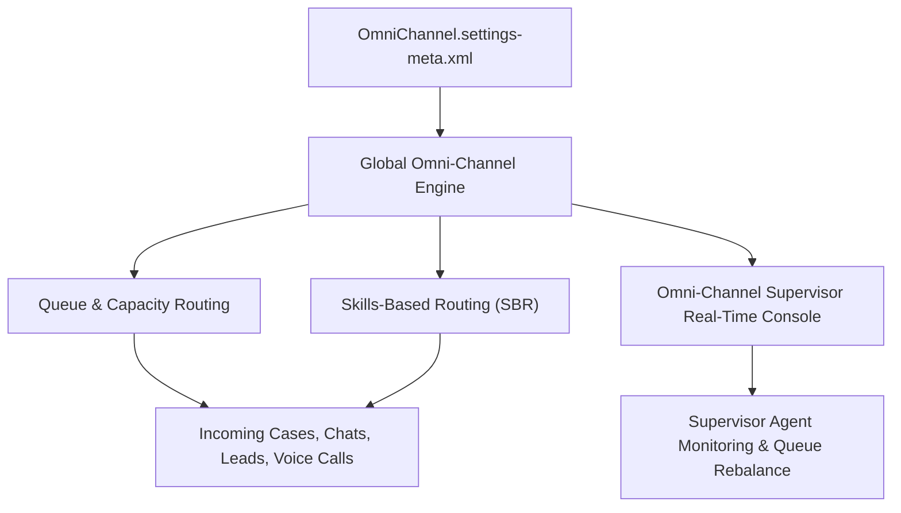

## Architectural Overview

`OmniChannelSettings` is an org-level settings metadata type that acts as the primary ignition switch for Salesforce Service Cloud Omni-Channel routing infrastructure. It activates the real-time presence engine, push-based routing models, Skills-Based Routing, and Omni-Channel Supervisor consoles.

In customer service and contact center architecture, deploying `OmniChannelSettings` is an absolute prerequisite before creating Routing Configurations, Presence User Configs, Service Channels, or Omni-Channel Flows. Without this setting active, dependent metadata types cannot be compiled or deployed.



## Directory and File Conventions

`OmniChannelSettings` is managed as a singleton settings file under `settings/`.

| Property | Value |
| :--- | :--- |
| **Metadata Type Name** | `Settings` (member: `OmniChannel`) / `OmniChannelSettings` |
| **SFDX Folder** | `force-app/main/default/settings/` |
| **File Name** | `OmniChannel.settings-meta.xml` |
| **Scratch Org Setting Key** | `omniChannelSettings` |

## Key Metadata Fields

The XML schema defines core contact center routing engines:

| Field Name | Field Type | Required | Architectural Description |
| :--- | :--- | :--- | :--- |
| `enableOmniChannel` | `boolean` | No | Master switch enabling Omni-Channel routing, presence statuses, and work distribution. |
| `enableOmniSkillsRouting` | `boolean` | No | Activates Skills-Based Routing, allowing work to match agent skill matrices rather than static queues. |
| `enableOmniSecondaryRoutingPriority` | `boolean` | No | Enables multi-tiered priority sorting on queues (e.g., routing based on customer tier or SLA deadline). |
| `enableOmniSupervisor` | `boolean` | No | Enables the Omni-Channel Supervisor monitoring console for contact center managers. |
| `enableStatusBasedWorkContinuation` | `boolean` | No | Preserves agent work item ownership and capacity allocations across pauses and status changes. |

> [!NOTE]
> Scratch org definition files require the `"ServiceCloud"` and `"LiveAgent"` or `"OmniChannel"` features enabled for `OmniChannelSettings` to deploy successfully.

## Declarative XML and Package Manifest Examples

A comprehensive production configuration enabling skills routing and supervisor oversight:

```xml title="force-app/main/default/settings/OmniChannel.settings-meta.xml"
<?xml version="1.0" encoding="UTF-8"?>
<OmniChannelSettings xmlns="http://soap.sforce.com/2006/04/metadata">
    <enableOmniChannel>true</enableOmniChannel>
    <enableOmniSecondaryRoutingPriority>true</enableOmniSecondaryRoutingPriority>
    <enableOmniSkillsRouting>true</enableOmniSkillsRouting>
    <enableOmniSupervisor>true</enableOmniSupervisor>
    <enableStatusBasedWorkContinuation>true</enableStatusBasedWorkContinuation>
</OmniChannelSettings>
```

### Scratch Org Configuration (`config/project-scratch-def.json`)

```json title="config/project-scratch-def.json"
{
  "orgName": "Omni-Channel Contact Center Scratch Org",
  "edition": "Enterprise",
  "features": ["ServiceCloud", "OmniChannel"],
  "settings": {
    "omniChannelSettings": {
      "enableOmniChannel": true,
      "enableOmniSkillsRouting": true,
      "enableOmniSupervisor": true,
      "enableOmniSecondaryRoutingPriority": true
    }
  }
}
```

### Package Manifest (`package.xml`)

```xml title="manifest/package.xml"
<?xml version="1.0" encoding="UTF-8"?>
<Package xmlns="http://soap.sforce.com/2006/04/metadata">
    <types>
        <members>OmniChannel</members>
        <name>Settings</name>
    </types>
    <version>68.0</version>
</Package>
```

## CLI Retrieval and Deployment Commands

Manage `OmniChannelSettings` using the Salesforce CLI:

```bash
# Retrieve OmniChannel settings from the environment
sf project retrieve start --metadata Settings:OmniChannel

# Deploy OmniChannel settings to the target org
sf project deploy start --metadata Settings:OmniChannel
```

## Architect Best Practices and Gotchas

- **CI/CD Pipeline Sequence:** Always deploy `Settings:OmniChannel` in an initial foundational deployment step before deploying `ServiceChannel`, `QueueRoutingConfig`, `PresenceDeclineReason`, or `PresenceUserConfig`. Deploying these without Omni-Channel enabled causes immediate failure.
- **Capacity Model Choices:** When configuring Omni-Channel, evaluate whether your workloads benefit from Status-Based Capacity (work consumed until record status changes) vs. Tab-Based Capacity (work consumed only while the agent has the console tab open).
- **Secondary Routing Priority Rules:** If `enableOmniSecondaryRoutingPriority` is enabled, ensure your routing configurations specify a secondary priority model, or incoming work will default to first-in-first-out timestamp sorting.

> [!WARNING]
> Disabling `enableOmniChannel` in an active environment terminates all live agent presence sessions and halts routing of active cases and chats.
