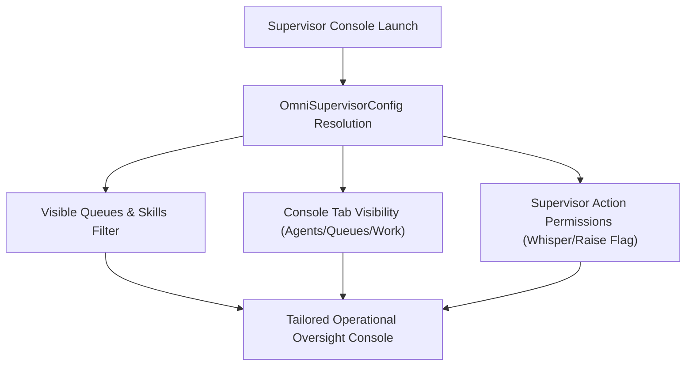

## Architectural Overview

`OmniSupervisorConfig` tailors the Omni-Channel Supervisor console interface for contact center managers and operational leads. It dictates which tabs (Agents, Queues, Work, Skills, Wallboard) appear in the console, defines queue filtering boundaries, determines whether supervisors can whisper or barge into live messaging and voice sessions, and configures agent status overrides.

In large, multi-tier enterprise support operations (e.g., Tier 1 Customer Care vs. Tier 3 Technical Escalations), granting unconstrained visibility to every supervisor creates cognitive clutter and risks compliance violations. `OmniSupervisorConfig` provides declarative governance to segment supervisor monitoring scopes by business unit.



## Directory and File Conventions

`OmniSupervisorConfig` metadata is stored in the `omniSupervisorConfigs/` folder.

| Property | Value |
| :--- | :--- |
| **Metadata Type Name** | `OmniSupervisorConfig` |
| **SFDX Folder** | `force-app/main/default/omniSupervisorConfigs/` |
| **File Suffix** | `.omniSupervisorConfig-meta.xml` |

## Key Metadata Fields

The XML schema controls tab presence, filtering scopes, and supervisory actions:

| Field Name | Field Type | Required | Architectural Description |
| :--- | :--- | :--- | :--- |
| `developerName` | `string` | Yes | Unique programmatic identifier for the supervisor configuration. |
| `masterLabel` | `string` | Yes | User-facing display label for the configuration in Setup. |
| `isDefault` | `boolean` | No | Designates this record as the default configuration when no explicit group assignment matches. |
| `skillVisibilityFilter` | `string` | No | Filtering logic restricting which agent skill proficiencies are visible to the supervisor. |
| `skillsSupervisorAccess` | `string` | No | Level of access granted to supervisors to edit or reassign agent skill proficiencies. |

> [!NOTE]
> `OmniSupervisorConfig` requires `OmniChannelSettings` to have `enableOmniSupervisor: true`.

## Declarative XML and Package Manifest Examples

An architectural definition configuring supervisor oversight for a tier-one customer service team:

```xml title="force-app/main/default/omniSupervisorConfigs/Tier_1_Supervisor_Config.omniSupervisorConfig-meta.xml"
<?xml version="1.0" encoding="UTF-8"?>
<OmniSupervisorConfig xmlns="http://soap.sforce.com/2006/04/metadata">
    <developerName>Tier_1_Supervisor_Config</developerName>
    <masterLabel>Tier 1 Customer Support Supervisor Config</masterLabel>
    <isDefault>true</isDefault>
    <skillsSupervisorAccess>FullAccess</skillsSupervisorAccess>
</OmniSupervisorConfig>
```

### Package Manifest (`package.xml`)

```xml title="manifest/package.xml"
<?xml version="1.0" encoding="UTF-8"?>
<Package xmlns="http://soap.sforce.com/2006/04/metadata">
    <types>
        <members>Tier_1_Supervisor_Config</members>
        <name>OmniSupervisorConfig</name>
    </types>
    <version>68.0</version>
</Package>
```

## CLI Retrieval and Deployment Commands

Manage supervisor configurations using the Salesforce CLI:

```bash
# Retrieve supervisor configurations from an org
sf project retrieve start --metadata OmniSupervisorConfig

# Deploy a specific supervisor configuration
sf project deploy start --metadata OmniSupervisorConfig:Tier_1_Supervisor_Config
```

## Architect Best Practices and Gotchas

- **Feature Prerequisite:** Ensure `OmniChannelSettings` with `enableOmniSupervisor: true` is deployed and active in the target org before deploying `OmniSupervisorConfig`.
- **Profile and Permission Set Linkage:** Creating a supervisor config is only the first step. You must associate supervisors via `OmniSupervisorConfigProfile` or `OmniSupervisorConfigUser` assignments (or Permission Sets) to activate the view for designated leaders.
- **Privacy and Voice Monitoring Compliance:** Ensure that enabling call listening or messaging whisper actions complies with regional labor and wiretapping regulations.

> [!TIP]
> Design distinct supervisor configs for Voice operations versus asynchronous Messaging operations to keep supervisor screen real estate optimized.
