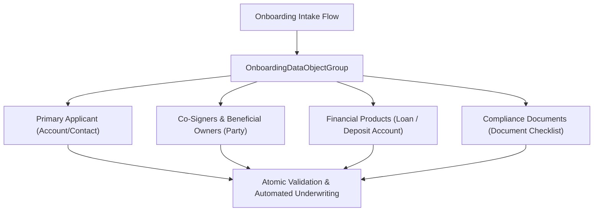

## Architectural Overview

`OnboardingDataObjectGroup` is a foundational Industry Cloud metadata type (prominently used across Financial Services Cloud, Insurance, and Public Sector Solutions) that groups disparate data objects into a cohesive operational onboarding container.

Customer intake in regulated industries requires assembling multi-party entities: primary applicants, co-signers, corporate entities, beneficial owners, financial accounts, and identity documents. Rather than writing brittle custom code to manage multi-record transactions across these tables, `OnboardingDataObjectGroup` bundles the participant schemas into a single declaratively-managed onboarding structure.



## Directory and File Conventions

`OnboardingDataObjectGroup` records reside in the `onboardingDataObjectGroups/` folder within modern SFDX source projects.

| Property | Value |
| :--- | :--- |
| **Metadata Type Name** | `OnboardingDataObjectGroup` |
| **SFDX Folder** | `force-app/main/default/onboardingDataObjectGroups/` |
| **File Suffix** | `.onboardingDataObjectGroup-meta.xml` |

## Key Metadata Fields

The XML definition provides group identification and primary entity linkages:

| Field Name | Field Type | Required | Architectural Description |
| :--- | :--- | :--- | :--- |
| `developerName` | `string` | Yes | Programmatic API name representing the onboarding group. |
| `masterLabel` | `string` | Yes | Human-readable label displayed in onboarding setup and journey builders. |
| `primaryObject` | `string` | Yes | The root entity orchestrating the onboarding lifecycle (e.g., `PartyOnboardingStage`, `Application__c`). |
| `description` | `string` | No | Architectural summary of the onboarding workflow, regulatory tier, and covered products. |

> [!NOTE]
> Objects registered in the onboarding group must have active field-level security and CRUD permissions assigned to the onboarding journey execution context.

## Declarative XML and Package Manifest Examples

An architectural definition configuring commercial banking onboarding:

```xml title="force-app/main/default/onboardingDataObjectGroups/Commercial_Banking_Onboarding.onboardingDataObjectGroup-meta.xml"
<?xml version="1.0" encoding="UTF-8"?>
<OnboardingDataObjectGroup xmlns="http://soap.sforce.com/2006/04/metadata">
    <developerName>Commercial_Banking_Onboarding</developerName>
    <masterLabel>Commercial Banking Onboarding Group</masterLabel>
    <primaryObject>Account</primaryObject>
    <description>Bundles corporate account, authorized signers, beneficial ownership, and KYC artifacts.</description>
</OnboardingDataObjectGroup>
```

### Package Manifest (`package.xml`)

```xml title="manifest/package.xml"
<?xml version="1.0" encoding="UTF-8"?>
<Package xmlns="http://soap.sforce.com/2006/04/metadata">
    <types>
        <members>Commercial_Banking_Onboarding</members>
        <name>OnboardingDataObjectGroup</name>
    </types>
    <version>68.0</version>
</Package>
```

## CLI Retrieval and Deployment Commands

Manage onboarding group metadata using the Salesforce CLI:

```bash
# Retrieve all onboarding data object groups
sf project retrieve start --metadata OnboardingDataObjectGroup

# Deploy a specific onboarding data group
sf project deploy start --metadata OnboardingDataObjectGroup:Commercial_Banking_Onboarding
```

## Architect Best Practices and Gotchas

- **Schema Dependencies:** Ensure all constituent objects (e.g., custom applicant fields or industry standard objects) exist in the target org prior to deploying `OnboardingDataObjectGroup`.
- **Atomic Rollback Strategy:** Because onboarding workflows span multiple objects, design your orchestration flows or integration controllers with unit-of-work transaction management to rollback dirty writes if verification checks fail.
- **Data Retention & Privacy (GDPR/CCPA):** Onboarding data groups handle highly sensitive PII. Ensure fields included in these data groups are protected by Salesforce Shield Platform Encryption where appropriate.

> [!TIP]
> Pair `OnboardingDataObjectGroup` with Salesforce Flow Orchestration to manage complex stage transitions and asynchronous document verification approvals across departments.
